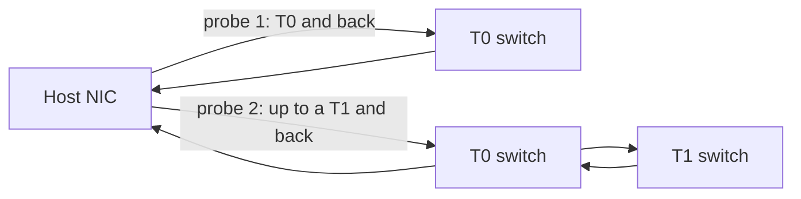

# AI Fabric Telemetry with SRv6

In an AI backend fabric, the expensive failures are not the clean ones. A link that goes down is noticed at once. The costly cases are **gray failures**: a switch whose control plane and links are up but that has stopped forwarding, or a link that drops a small share of packets. The training job slows down or stalls, and switch counters look healthy. SRv6 helps because it makes **the exact path of every probe explicit**, so the network can be tested the same way the GPUs use it.

## Why hash-based probing falls short

The classic data center approach is a *pingmesh*: every server pings a sample of other servers and the results are aggregated. On an ECMP fabric this has two built-in limits:

- **The probe's path is unknown.** Each probe is hashed onto one of many equal-cost paths. When it is lost, you know that *some* path between two hosts is bad, not which link or switch.
- **The probe may not follow the data.** A probe with a different 5-tuple from the training traffic can hash onto a different path, so a healthy probe says little about the flow that is actually slow.

Probing the switches directly with ICMP has its own limit: those packets go to the switch CPU, which rate-limits them, and they test the control plane rather than the forwarding ASIC.

## Source-routed probes

With SRv6 uSID, a host can send a probe along an **explicit path that loops back to itself**: out to its top-of-rack switch (T0), optionally up to a specific spine (T1), and back down to the same host. Because the path is in the destination address:

- the probe crosses exactly the links and switches you name;
- switches forward it as ordinary data-plane traffic at line rate, with no CPU involvement and no rate limiting;
- a probe that uses the same path as a data packet, for example the same [MRC](mrc.md) entropy value, tests exactly what that packet would experience;
- the sender is also the receiver, so the result needs no coordination with a remote host.

## Localizing faults by tier

Comparing the two kinds of self-probe narrows a fault down quickly:

| T0 self-probe | T1 self-probe | Most likely fault |
|:-------------:|:-------------:|-------------------|
| OK | OK | Healthy |
| Fail | Fail | NIC–T0 link or the T0 switch |
| OK | Fail (one T1) | That T0–T1 link or that T1 |
| OK | Fail (same T1 from many T0s) | The T1 switch itself |
| OK | Fail (one T1, from one T0 only) | The T0–T1 link between them |

Aggregating results from many hosts is what turns "one path is bad" into "this specific link or switch is bad".

## Clustermapper: SRv6 probing in production

OpenAI's **Clustermapper**, described in the [MRC paper](mrc.md) and presented at the OCP Global Summit in October 2026, applies this method at the scale of 100K-GPU-class clusters:

- An agent on every node probes each directly connected T0 (16 or 32 of them, one per NIC port across four NICs) with probes **source-routed to the T0 and back**, and probes a subset of T1s the same way.
- Together, the agents **probe every link in the network every millisecond**. Probing runs continuously, even when no job is running, because the cost is negligible.
- The resulting link-health map can feed **denylists** that tell MRC NICs which paths to avoid. In practice, pre-training has not needed denylists for spine-side (T0–T1) failures, because MRC maps those out by itself within microseconds.
- In one production incident, a T1 switch stopped forwarding while it still appeared up. Automation detected it, and the switch was rebooted without coordination with the training team.

The OCP 2026 talk also set out what is still missing: switch and ASIC vendors (and SONiC) should qualify **longer SRv6 paths that use an SRH**, and provide a supported way to **select one link when two switches have several parallel adjacencies**. It also asked operators to make **path testing part of fabric acceptance**, including payload-integrity checks.

!!! tip "Why it matters"
    Routing-protocol telemetry tells you what the control plane *believes*. Source-routed probing tells you what the forwarding plane *does*, on the exact paths the GPUs use. In a fabric without dynamic routing, such as an MRC fabric, this is the main health signal.

## Complementary SRv6 telemetry

Source-routed self-probes sit alongside the standard SRv6 operations toolset:

| Tool | What it adds in an AI fabric | Page |
|------|------------------------------|------|
| **SRv6 OAM** (RFC 9259) | Ping and traceroute to SIDs, and the O-flag for marking packets for telemetry | [OAM & Troubleshooting](../topics/oam-troubleshooting.md) |
| **STAMP / SRPM** | Standard one-way and two-way delay and loss measurement along explicit SRv6 paths | [Performance Measurement](../topics/srpm.md) |
| **IPFIX for SRv6** (RFC 9487) | Flow records that include SRv6 fields such as the active SID and segment list | [RFC 9487](../rfcs/rfc9487.md) |
| **Path Tracing** (IETF draft) | Hop-by-hop timestamps and interface IDs recorded in a compact form in the packet, for ECMP-aware path discovery | [draft-filsfils-ippm-path-tracing](https://datatracker.ietf.org/doc/draft-filsfils-ippm-path-tracing/) |
| **Streaming telemetry** | Queue occupancy, ECN marks, drops and trimming counters from switches | [Telemetry](../topics/telemetry.md) |

## Operational checklist

- [x] Give every switch an SRv6 locator and uN uSID so that any host can build a self-probe through it
- [x] Probe every NIC–T0 and T0–T1 link continuously from the hosts, not only during incidents
- [x] Use the same path encoding for probes as for data, so a probe result maps one-to-one to a data path
- [x] Feed probe results into path denylists or load-balancing weights on the NICs
- [x] Track "up but not forwarding" as its own failure class and automate the reboot or drain
- [x] Add explicit-path testing, with payload-integrity checks, to fabric acceptance before handing it to training

## Frequently Asked Questions

### What is Clustermapper?

Clustermapper is OpenAI's agent-based monitoring system for AI backend networks. An agent on every node sends SRv6 source-routed probes to its directly connected switches and to spine switches and back to itself, so that together the agents test every link every millisecond and pinpoint failed or lossy links and switches.

### Why use SRv6 for network probing instead of ping?

A normal ping on an ECMP fabric follows a hashed path that you cannot see, and pings to a switch are handled and rate-limited by its CPU. An SRv6 probe carries its exact path in the destination address and is forwarded in hardware like data traffic, so a lost probe identifies the specific link or switch that failed.

### What is a gray failure in an AI fabric?

A gray failure is a partial failure that normal monitoring misses, such as a switch that reports its links and control plane as up but no longer forwards packets, or a link with a low but steady loss rate. In synchronized AI training, a single gray failure can slow down the entire job.

## Further Reading

- :material-arrow-right: [MRC and SRv6](mrc.md) - The transport that consumes the probe results
- :material-arrow-right: [SRv6 AI Fabric Design](ai-fabric-design.md) - Addressing that makes every path probe-able
- :material-arrow-right: [SRv6 for AI](index.md) - Back to the hub
- :material-arrow-right: [OAM & Troubleshooting](../topics/oam-troubleshooting.md) - SRv6 ping, traceroute and the O-flag

## References

1. [Resilient AI Supercomputer Networking using MRC and SRv6](https://cdn.openai.com/pdf/resilient-ai-supercomputer-networking-using-mrc-and-srv6.pdf) - Section 3 describes Clustermapper's source-routed probing and fault localization
2. [OCP 2026: Clustermapper - Deterministic path diagnosis for AI backend networks using SRv6](https://www.segment-routing.net/conferences/2026-10-15-ocp-summit26-openai-clustermapper/) - OpenAI talk at the OCP Global Summit, October 2026
3. [Building resilient networks for AI supercomputers](https://techcommunity.microsoft.com/blog/azurehighperformancecomputingblog/building-resilient-networks-for-ai-supercomputers/4516919) - Microsoft on probe packets that follow data paths for ground-truth fabric health
4. [RFC 9259 - Operations, Administration, and Maintenance (OAM) in SRv6](https://www.rfc-editor.org/rfc/rfc9259) - SRv6 ping, traceroute and the O-flag
5. [RFC 9487 - Export of SRv6 Information in IP Flow Information Export (IPFIX)](https://www.rfc-editor.org/rfc/rfc9487) - SRv6 fields for flow telemetry
