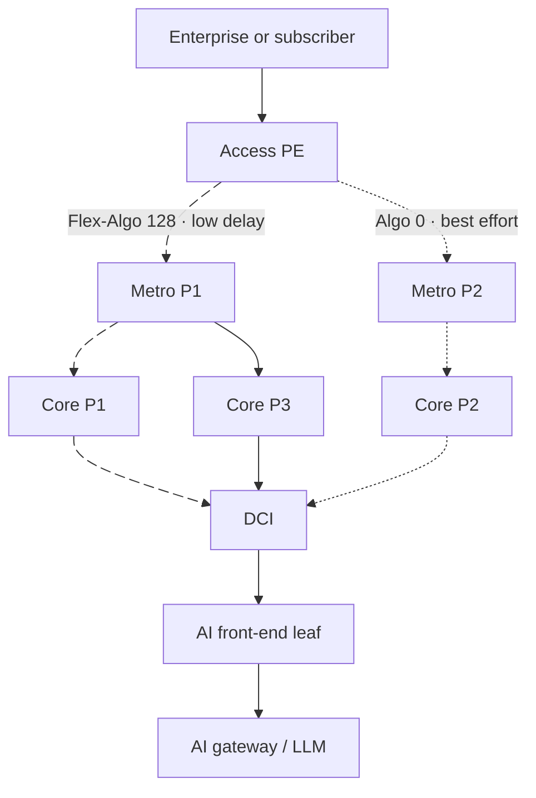

# SRv6 for AI Inference WAN

**Training happens in a few giant GPU clusters. Inference happens everywhere.** Prompts come from enterprise sites, homes and phones, and the models that answer them run in edge cabinets, metro sites, regional data centers and other clouds. The network between them decides the time to first token, whether regulated data stays in the country, and whether a voice agent feels instant or broken.

In October 2026 Cisco published an [AI Inference White Paper: Architecture for Wide Area Networks](https://www.cisco.com/c/en/us/solutions/collateral/design-zone/ai-inference-wan-wp.html), a high-level design for service providers and neoclouds. Its transport is **SRv6 uSID**, with a **Flex-Algo plane per inference SLA** and **BGP color** to put each inference service on its plane. This page explains that design in vendor-neutral terms and maps every building block to its standard.

!!! abstract "In one paragraph"
    Every inference location, from a far-edge cabinet to a regional facility, is treated as a data center. One SRv6 uSID backbone connects them to each other (DCI) and to enterprise and consumer access. The IGP computes several **planes** with Flex-Algo: best effort plus one or more inference planes (low latency, sovereign, secure links). Each plane has its own locator block inside `5f00::/16`. The router in front of an inference service advertises its prefix in BGP with a **color** that names the plane, and every access router then encapsulates traffic for that prefix with the matching SRv6 SID. No per-request path computation: the planes are computed before the first prompt arrives.

## Why inference is a WAN problem

| Driver | What it means for the network |
|--------|------------------------------|
| **Latency** | Voice agents, robotics and industrial vision cannot absorb a cross-continent round trip, so inference moves toward users |
| **Sovereignty** | Prompts and responses carry regulated data that must stay in a country or facility, so paths must be constrained, not just short |
| **Economics** | Many smaller GPU sites pooled as one capacity reduce peak contention and token cost, which needs any-to-any connectivity between sites |
| **Data gravity** | Video and sensor data is cheaper to process where it is produced; only the result crosses the backbone |

The blueprint places inference in four tiers, all reached through the same WAN:

| Tier | Where | Typical role |
|------|-------|-------------|
| Far edge | Access site or street cabinet | Latency-critical, lightweight models; first-hop inference |
| Metro edge | Aggregation or metro site | Mainstream interactive inference for a metro |
| Central edge | Regional data center or central office | Large models, model hosting, capacity pooling, DCI anchor |
| Peering | Cloud or private peering | Models the provider does not host |

## The design, layer by layer

| Layer | Choice in the blueprint | Standard |
|-------|------------------------|----------|
| Data plane | SRv6 with uSID | [RFC 8986](../rfcs/rfc8986.md), [RFC 9800](../rfcs/rfc9800.md) |
| Addressing | IANA SRv6 block, one `/32` per plane | [RFC 9602](../rfcs/rfc9602.md), draft-ietf-srv6ops-srv6addressing |
| IGP | IS-IS, multiple domains, summarization at the borders | [RFC 9352](../rfcs/rfc9352.md) |
| SLA planes | Flex-Algo per plane | [RFC 9350](../rfcs/rfc9350.md), [Flex-Algo](../topics/flex-algorithm.md) |
| Steering | BGP color on service routes; SR-TE on demand for tactical cases; PCE between domains | [RFC 9256](../rfcs/rfc9256.md), [RFC 9830](../rfcs/rfc9830.md), [RFC 9603](../rfcs/rfc9603.md) |
| Services | L3VPN (VPNv4/VPNv6), EVPN, multicast VPN | [RFC 9252](../rfcs/rfc9252.md), [BGP overlay](../topics/bgp-overlay-services.md) |
| Protection | Fast reroute; with Flex-Algo, TI-LFA computes repairs per plane | [RFC 9855](../rfcs/rfc9855.md), [TI-LFA](../topics/ti-lfa.md) |
| Assurance | SR Performance Measurement (TWAMP Light), PTP timing | [SRPM](../topics/srpm.md) |
| Transport security | MACsec or IPsec, post-quantum ready | [Security](../topics/security.md) |

Nothing in this list is Cisco-specific. Every building block is an IETF standard that other SRv6 implementations also ship; see the [support matrix](../implementations/support-matrix.md).

## SLA planes with Flex-Algo

Each **plane** is a Flex-Algo topology with its own constraints: lowest delay, links with a given affinity (for example only encrypted links), links inside one jurisdiction, or disjointness from another plane. The IGP computes every plane on every router ahead of time, so a new inference session finds its path already programmed.

Each plane gets its own **locator block**. The blueprint's example uses `5f00:bb00::/32` for best effort (algorithm 0) and `5f00:bb01::/32` for the inference plane (Flex-Algo 128). Nodes keep the same low-order bits in every plane, so the border between metro and backbone can advertise one summary per plane instead of every node locator. That is what lets the design grow to many inference sites without a routing-table explosion.

Inference traffic rides the Flex-Algo 128 plane; everything else stays on best effort. If a link in the inference plane fails, [TI-LFA](../topics/ti-lfa.md) computes the repair **inside the same Flex-Algo topology**, so inference traffic stays on a path that meets the plane's constraints instead of falling back to best effort.

## SLA signaling with BGP color

The router in front of an inference service, usually the DCI, advertises the service prefix in BGP VPNv4 or VPNv6 (or plain IPv4/IPv6 for the global table) with:

- a **color** extended community whose value names the SLA plane, and
- the **SRv6 service SID** for that VRF, allocated from the locator of that plane.

Every access router that imports the route encapsulates matching traffic with that SID, so packets toward the inference service follow the inference plane end to end. When a device in the AI front-end cannot set colors, it tags routes with a standard BGP community and the DCI translates it into a color. This is the same color-based steering defined for SR Policy ([RFC 9256](../rfcs/rfc9256.md)); with Flex-Algo, the color simply resolves to the plane's locator instead of to an explicit path.

## Connectivity models

The blueprint describes six ways to attach an inference component, and a real deployment mixes them along one application path (user to LLM router to model):

| Model | How it works | Fits |
|-------|-------------|------|
| **Local** | Both components hang off the same router; no transport needed | Agent and gateway in one edge site |
| **Direct IP handoff** | Compute connects to a routed interface on the access or edge router, which advertises the prefix with its color | Small front-ends at the edge |
| **AI front-end overlay** | The fabric uses EVPN over VXLAN; the DCI terminates VXLAN, looks up the VRF, and re-encapsulates in SRv6 toward the backbone (and the reverse) | Large, multi-tenant regional data centers |
| **External peering** | The model sits in another network; the peering router colors the prefix (or translates a community) and removes SRv6 at the edge | Cloud and third-party models |
| **Unified** | The front-end leaf joins the backbone IGP and does SRv6 encapsulation and plane steering itself | Small and medium sites |
| **Shared IP endpoint** | One user address needs two SLAs: it is advertised from two VRFs with two colors and two SIDs, and each service imports the plane it needs | Users reaching both web and inference services |

## The DCI: where the data center meets the WAN

The DCI is the boundary between the AI front-end fabric (often EVPN-VXLAN on NX-OS or SONiC) and the SRv6 backbone. It does three jobs:

1. **Data-plane interworking.** Terminate VXLAN (or front-end SRv6), do a Layer 3 lookup in the right VRF, re-encapsulate in SRv6 for the backbone.
2. **Control-plane interworking.** Translate EVPN Route Type 5 routes from the fabric into VPNv4/VPNv6 routes for the backbone, keeping or adding the SLA color, and the reverse.
3. **Summarization.** The fabric carries a host route per compute node; the DCI keeps those locally and advertises only aggregates to the backbone.

A lighter variant splits the job: a **border leaf** terminates VXLAN and hands plain IP to a PE that does the SRv6 side. The blueprint also notes that SRv6 uSID is an option inside the front-end fabric itself, which would remove the VXLAN-to-SRv6 translation entirely; that is the end-to-end model [Nebius](../use-cases/deployments.md#cloud-technology-companies) already runs.

## Inference WAN vs training fabric

SRv6 shows up at both ends of AI networking, but for opposite reasons:

| | Training back-end ([MRC](mrc.md)) | Inference WAN (this page) |
|--|------------------------------|---------------------------|
| Scope | One data center, GPU to GPU | Provider WAN, user to model and site to site |
| Who picks the path | The sending NIC, per packet | The IGP (Flex-Algo planes) and BGP color, per service |
| Control plane | None in the switches: static uSID routes | IS-IS with Flex-Algo, BGP services, optional PCE |
| Goal | Spray across 128–256 paths, bypass failed paths in tens of microseconds | Meet a per-service SLA (delay, sovereignty, isolation) end to end |
| Failure handling | NIC retires the failed path | TI-LFA within the plane, then IGP convergence |
| Typical traffic | Collective operations (all-reduce) | Prompts and tokens, KV-cache and model transfers between sites |

Between the two sits [scale-across](scale-across.md): SRv6 traffic engineering between AI data centers for training jobs that span sites.

## What to take from it

- **SRv6 uSID moved from hyperscaler back-ends into a vendor's provider-WAN reference design.** The inference blueprint makes SRv6 uSID the primary transport and lists SR-MPLS only as an alternative.
- **Flex-Algo is the SLA tool.** Planes computed in advance avoid any per-request path computation, which is what an inference service with millions of sessions needs.
- **Address planning matters more than ever.** One `/32` per plane inside `5f00::/16`, with consistent node bits, is what keeps summarization and filtering simple. See [SID structure](../topics/sid-structure.md) and the [SRv6 White Paper 2026](../white-papers/srv6-white-paper-2026.md#addressing-plan).
- **Measure the user experience, not just the link.** The blueprint ties network telemetry to inference metrics such as time to first token and inter-token latency, so operators can tell whether a slow answer came from the network or from the model.

## Frequently Asked Questions

### How is SRv6 used for AI inference?

SRv6 uSID carries inference traffic across the provider WAN between users, edge sites and inference data centers. Flex-Algo builds separate planes for different SLAs, such as low latency or in-country paths, and BGP color on each inference service's route puts its traffic on the right plane.

### What is an AI inference WAN?

It is the wide area network that connects users and enterprises to distributed AI inference sites, and those sites to each other. It has to deliver per-service SLAs, data sovereignty and isolation, because prompts and responses carry sensitive data and interactive AI is latency-bound.

### Why use Flex-Algo for AI inference?

Flex-Algo lets the IGP compute several topologies at once, each with its own constraint: lowest delay, specific link affinities, or a jurisdiction. Each becomes a plane with its own SRv6 locators, ready before any inference request arrives, and TI-LFA protects traffic inside each plane.

### Is AI inference networking different from AI training networking?

Yes. Training back-ends use static SRv6 source routing chosen by the NIC per packet inside one data center, as in OpenAI's MRC. Inference WANs use routing protocols, Flex-Algo planes and BGP color to meet a per-service SLA across a provider network.

## Further Reading

- :material-arrow-right: [SRv6 for AI](index.md) - Who runs SRv6 for AI and how
- :material-arrow-right: [Scale-Across](scale-across.md) - SRv6 between AI data centers
- :material-arrow-right: [Flex-Algorithm](../topics/flex-algorithm.md) - How SLA planes are computed
- :material-arrow-right: [Network Slicing](../use-cases/network-slicing.md) - The same planes used for 5G and enterprise slices
- :material-arrow-right: [SRv6 white papers](../white-papers/index.md) - This blueprint and every other public SRv6 white paper

## References

1. [Cisco AI Inference White Paper: Architecture for Wide Area Networks](https://www.cisco.com/c/en/us/solutions/collateral/design-zone/ai-inference-wan-wp.html) - Cisco, October 2026
2. [RFC 9350: IGP Flexible Algorithm](../rfcs/rfc9350.md)
3. [RFC 9256: Segment Routing Policy Architecture](../rfcs/rfc9256.md) - Color-based steering
4. [RFC 9252: BGP Overlay Services Based on Segment Routing over IPv6](../rfcs/rfc9252.md)
5. [RFC 9602: SRv6 Segment Identifiers in the IPv6 Addressing Architecture](../rfcs/rfc9602.md) - The `5f00::/16` block
6. [draft-ietf-srv6ops-srv6addressing](https://datatracker.ietf.org/doc/draft-ietf-srv6ops-srv6addressing/) - Addressing recommendations for SRv6
