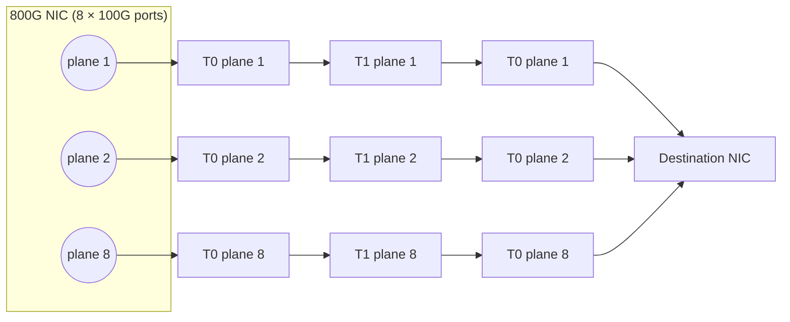

# MRC and SRv6: How OpenAI's AI Supercomputer Network Works

**MRC (Multipath Reliable Connection)** is an RDMA transport for AI training clusters that sprays every connection across hundreds of network paths. It pairs with **static SRv6 source routing**: each path is an explicit list of switch uSIDs written by the NIC into the IPv6 destination address, and the switches run no dynamic routing at all. MRC was released as an open OCP specification on 5 May 2026. It runs in production in OpenAI's and Microsoft's largest GPU training clusters, and it is the strongest production validation of SRv6 for AI to date.

!!! abstract "MRC + SRv6 in 60 seconds"
    - **What**: a multipath extension of the RoCEv2 Reliable Connection transport, specified by AMD, Broadcom, Intel, Microsoft, NVIDIA and OpenAI and published through the Open Compute Project (OCP MRC 1.0).
    - **Where**: OpenAI's largest NVIDIA GB200 training clusters, including the Oracle Cloud site in Abilene, Texas, and Microsoft's Fairwater AI supercomputers. It has trained frontier models used in ChatGPT and Codex.
    - **SRv6 role**: the NIC encodes the full path (one 16-bit **uN** uSID per switch hop after a 32-bit block) in the outer IPv6 destination address. Switches shift and forward using static routes that are configured at install time and never changed. **No BGP, no IGP.**
    - **Topology**: 800G NICs broken out into 8×100G (or 4×200G) parallel **planes**, so 131,072 GPUs fit in a **two-tier** Clos.
    - **Transport**: per-packet spraying across typically 128–256 paths, lossy Ethernet with no PFC, packet trimming, selective retransmission, and failed paths bypassed in tens of microseconds.
    - **Results**: ≈770 Gb/s (≈96% of peak) per 800G NIC, NCCL at 42,020 GPUs, and production jobs of 50K–75K GPUs riding through link flaps and switch reboots.

## Why MRC exists

Large training jobs synchronize thousands of GPUs at every step, so the slowest flow sets the pace for the whole job (see [AI Networking Glossary](ai-glossary.md)). The conventional AI backend, RoCEv2 on a lossless fabric with per-flow ECMP and BGP, has three problems at 100K-GPU scale:

1. **ECMP collisions.** Each RDMA queue pair (QP) follows one hashed path. A few elephant flows collide on the same links while others sit idle. In the MRC paper's comparison, a single RoCE QP reached about half the achievable all-reduce throughput because of collisions.
2. **Slow, opaque failure handling.** With dynamic routing, a failed link or switch is repaired by protocol convergence, which takes seconds to tens of seconds. Meanwhile, the transport cannot tell which physical path each packet took. The paper notes that a 512-port T0 has ECMP groups of up to 256 next hops, and that convergence can take very many round-trip times.
3. **Two adaptive systems fighting.** A multipath transport that reacts to loss *and* a routing protocol that reacts to the same failures are hard to reason about together.

The MRC authors' answer was to make the transport responsible for both load balancing and failure recovery, and to make the network as simple and static as possible. In the paper's own words, they "took the unusual position of disabling dynamic routing in the switches".

## The topology: multi-plane, two-tier Clos

A 51.2 Tb/s switch has 64 ports of 800G. A conventional three-tier 800G Clos built from it tops out at 65,536 NICs; going bigger needs a fourth tier, oversubscription or separate rails. MRC clusters instead **break each 800G NIC out by lane into 8×100G ports** and build **8 parallel 100G planes** from the same switches, which now have 512 ports each:

| | Conventional 800G Clos | MRC multi-plane (8×100G) |
|---|---|---|
| Tiers for ~131K GPUs | 3 or more | **2** |
| Switch radix | 64 × 800G | 512 × 100G |
| Longest path | 5 switches | **3 switches** |
| GPUs one hop away | 32 | **256** |
| Optics / switches at full bisection | baseline | **≈2/3 of the optics, ≈3/5 of the switches** |
| Capacity lost per node when one T0–T1 link fails | ≈3% | **≈0.4%** |

Each T0 connects 256 NIC ports down and 256 T1s up, and each T1 connects 512 T0s: 512 T0s × 256 NICs = **131,072 NICs** in two tiers. Losing a NIC-to-T0 link still costs a node 12% of its NIC bandwidth, but the job survives it. Production clusters use both 4-plane (4×200G) and 8-plane (8×100G) variants.



## How SRv6 is used

### The packet

MRC packets are **IPv6-in-IPv6**. The **NIC** does all SRv6 encapsulation and decapsulation; every switch is a plain SRv6 transit node.

```
┌──────────────────────────────────────────────────────────────┐
│ Outer IPv6 header                                             │
│   DA = SRv6 path: 32-bit block | uSID | uSID | uSID | uSID |0│
│   Flow label = part of the 32-bit entropy value (EV)          │
├──────────────────────────────────────────────────────────────┤
│ Inner IPv6 header                                             │
│   DA = destination NIC address (used to decapsulate)          │
├──────────────────────────────────────────────────────────────┤
│ UDP  (source port = rest of the EV)                           │
├──────────────────────────────────────────────────────────────┤
│ RDMA transport headers + payload (MRC)                        │
└──────────────────────────────────────────────────────────────┘
```

The deployment described in the paper never mentions a Segment Routing Header: a whole cross-fabric path fits in the outer destination address, so the overhead is a single 40-byte IPv6 header. This "DA-only" form of [reduced encapsulation](../topics/srh-packet-walk.md#reduced-encapsulation) is what keeps SRv6 on the fast path of every switch ASIC.

### uSID format and forwarding

The destination address follows the [uSID format](../topics/usid-compression.md) of RFC 9800: a **32-bit locator block followed by 16-bit uSIDs**, one per hop, using the **uN** behavior (each switch on the path is named explicitly). Every switch does the same three steps at line rate:

1. Compare the first 48 bits of the destination address with its own block + uSID.
2. On a match, shift the remaining uSIDs left by 16 bits (the uN shift).
3. Look up the new destination address in a **static /48 route** that names the egress port.

For a path that crosses a T1 (source T0 → T1 → destination T0 → NIC), the address carries **four uSIDs**:

```
| 32-bit block | source T0 | T1 | destination T0 | last-hop port | 0000 | 0000 |
```

The last uSID is not a switch: it identifies the destination T0's downlink port to the receiving NIC. The two empty slots are End-of-Container zeros.

!!! note "Illustrative example (values are made up)"
    ```
    DA = fcbb:bb00:0103:0b07:0141:0012::
         └─block─┘ └T0┘ └T1┘ └T0┘ └port┘
    At source T0 (0103):      shift → fcbb:bb00:0b07:0141:0012::
    At T1 (0b07):             shift → fcbb:bb00:0141:0012::
    At destination T0 (0141): shift → fcbb:bb00:0012::  → static route to port 0x12
    ```
    The paper defines the layout (32-bit block, 16-bit uN uSIDs, last-hop downlink as the final uSID) but does not publish its numbering plan. See [SRv6 AI Fabric Design](ai-fabric-design.md) for how to build one.

### Entropy values map to explicit paths

This is the core idea that ties the transport to SRv6:

- When a QP starts, the NIC generates an **EV set**, typically **128–256 entropy values**, split equally across planes. Each EV corresponds to one explicit path on one plane.
- From a per-node configuration file, the NIC gets an SRv6 address *template* for the destination's T0 group and fills in the last-hop downlink.
- For **every packet**, the NIC picks the next EV and specializes the template from it: the **plane number** goes into every uSID and the **T0 uplink number** goes into the T1 uSID. The mapping is algorithmic, so the NIC does not need a table of 256 addresses per QP.
- The EV is also written into the **UDP source port and the IPv6 flow label**. Switches do not hash it, because the path is already explicit. It is there so the receiver can echo it in acknowledgements, since the uSID shifts have consumed the destination address by the time the packet arrives.

Because the EV-to-path mapping is exact, "this EV saw loss" means "this physical path saw loss". That is something per-flow ECMP hashing can never tell a transport.

### A static control plane

Switch forwarding tables are configured when the switch is installed and are not changed afterwards. There is **no BGP, no IGP and no controller programming the switches**. A per-node host agent configures only the NICs: their EV profiles and path denylists. The authors also rejected the middle ground of static ECMP with MRC on top, because it still gives no simple mapping from EV to physical path for failure reporting. Their motivation includes switch software itself: they cite a study in which 17% of switch failures were software bugs, and they observed switches whose control plane and links were up while they were not forwarding.

## How the transport uses the paths

| Mechanism | What MRC does |
|-----------|---------------|
| **Spraying** | A different EV for each packet, rotating through the EV set across all planes. Every packet carries its RDMA address, so the receiver writes it to GPU memory on arrival in any order. |
| **No PFC** | The fabric runs lossy, best-effort Ethernet. With hundreds of paths converging on the last hop, PFC would cause head-of-line blocking. |
| **ECN as a load-balancing signal** | Switches mark ECN (except on the last hop); the receiver echoes it per EV and the sender temporarily avoids that path. |
| **Packet trimming** | A congested switch trims the payload instead of dropping the packet and forwards the header with priority, so the receiver can NACK it. Trimmed loss means congestion; untrimmed loss means a failed path. |
| **Path failure** | An untrimmed loss retires the EV immediately and replaces it with a backup EV *on the same plane*. Failed paths are bypassed in a few tens of microseconds. |
| **Path recovery** | Background probes resurrect retired EVs once their paths work again. |
| **Congestion control** | UET's sender-based NSCC (ECN + delay), with optional receiver-side window penalties. |
| **NIC port failure** | Signalled to remote QPs with a port-state bitmap so they stop using that plane. This is the slow case: under a second in the testbed and a few seconds in production. |

Replacing a retired EV with one from the same plane keeps every plane equally loaded. The trade-off: any single-path traffic sharing the backend, or heavy link loss in one plane, limits MRC to the most congested plane.

## The OCP specification is broader than the deployment

OCP MRC 1.0 defines three forwarding models: plain **ECMP hashing**, **Structured EV** (switches read per-hop fields from the flow label and UDP port) and **SRv6**. For SRv6 it allows:

- **uSID-only** or **uSID + one SRH**, with any SRH in RFC 9800 compressed encoding;
- both **uN and uA** behaviors (the latter selects a specific link);
- **F3216 and F1616** container formats, up to 6 uSIDs in the destination address;
- an informative model in which source routing reaches an upper-tier switch and normal IP forwarding takes over from there. This differs from the paper's deployment, which source-routes the full path down to the last-hop port.

So the specification is a framework that SRv6 operators can adopt at different depths, from "pin the spine" to "pin every hop".

## Telemetry: Clustermapper

Because every path is explicit, OpenAI's **Clustermapper** agents on every node send **source-routed probes** from the host to each directly connected T0 and to a subset of T1s, and back to themselves. Collectively they probe every link in the network every millisecond. Comparing T0 and T1 self-probes localizes a fault to a NIC–T0 link, a T0–T1 link or a switch. Switches forward the probes as ordinary data-plane traffic, unlike rate-limited ICMP to the switch CPU, and each probe takes exactly the path an MRC packet with the same EV would take. Details: [AI Fabric Telemetry with SRv6](ai-fabric-telemetry.md).

## Results

**Production** (GB200 clusters):

| Event | Outcome |
|-------|---------|
| Job start, 75K GPUs, no pre-populated denylist | Losses fell well below 1 packet/s per NIC within a couple of minutes; fewer than 5 packets lost per QP in the first minute |
| Constant T0–T1 link flaps (up to ~12/min) | "Almost no impact"; flapping links are left in service |
| T0 transceiver flap, 50K-GPU job | ≈25% throughput dip for the minute of flaps, then full recovery; no QP failed and no node was evicted |
| T1 switch silently stopped forwarding, 75K-GPU job | Detected automatically and rebooted; throughput largely unaffected; four T1 reboots needed no coordination with the training team |

**Testbed** (GB200 + ConnectX-8, 8×100G planes, NVIDIA Spectrum-5):

| Test | Result |
|------|--------|
| Point-to-point 32 KB writes | ≈770 Gb/s ≈ **96% of the 800G peak**, both T0-local and cross-T1 |
| 2-byte latency (one way) | 5.09 µs T0-local, 6.54 µs cross-T1 |
| 20 T0–T1 links disabled one per second | Minimal throughput impact |
| T1 switch down | No steady-state degradation |
| T0 switch down | Bandwidth drops ≈100 Gb/s, in proportion to lost capacity |
| 20% loss injected on one path | Path retired at once and line rate sustained |
| NCCL sendrecv at **42,020 GPUs** | Up to 92 GB/s per NIC (≈92% of 800G) |

**MRC vs RoCEv2** on identical hardware (64 GPUs; RoCE on single-plane 400G with ECMP, PFC and DCQCN, versus MRC on 4×100G planes with SRv6 and no PFC):

- One MRC QP spraying across 256 paths beat 16 RoCE QPs on ring all-reduce. MRC also won all-to-all at every message size.
- With 1% injected loss, RoCE was "pretty much unusable" while MRC kept about a third of its throughput (the injected loss hit every plane, which is worse than real failures).
- In a 7:1 incast test, a RoCE victim flow lost about 25% (one QP), while an MRC victim flow saw no impact.

## Hardware and software

| Layer | Implementations named by the authors |
|-------|--------------------------------------|
| NICs | NVIDIA ConnectX-8 (800G), AMD Pollara (400G), AMD Vulcano (800G), Broadcom Thor Ultra (800G) |
| Switches running SRv6 uN | NVIDIA Spectrum-4 and Spectrum-5 with Cumulus or SONiC; [Arista EOS](../implementations/arista-eos.md) on Broadcom Tomahawk 5 |
| Software | libMRC (OCP), Microsoft's open-source NCCL MRC plugin, ibverbs shim, MSCCL++ support, and [SONiC](../implementations/sonic.md) SRv6 work |

Testbed results were published for ConnectX-8, Pollara and Thor Ultra. Broadcom has also said that Tomahawk 6 supports SRv6 uSID and packet trimming.

## Limitations the authors acknowledge

- **The NIC transceiver is a single point of failure.** In the 4×200G design one 800G optic carries all four ports, so if it flaps, QPs fail.
- **NIC-side failures are slower to handle than fabric failures**: remapping EVs across many QPs is not instantaneous on current NICs.
- **Sustained 1% loss** still cuts MRC to about a third of its throughput: enough to ride out transients, not to keep training.
- **Reverse paths:** simply reversing the SRv6 forward path does not always work, so receivers keep a separate, heuristic set of reverse EVs.
- **SRv6 gaps called out at OCP 2026**: switch vendors still need to qualify longer paths that use an SRH, and to provide a supported way to pick one link among parallel adjacencies.
- Large-scale MRC-vs-RoCE comparisons were not published; the head-to-head tests used small testbeds.

## What this means for network engineers

- **SRv6 in the data center is no longer a lab idea.** The largest AI training networks in production use it, specifically for its simplest property: an explicit path in the destination address.
- **The value is in the static network plus explicit paths.** Fewer moving parts in the switches and exact path identity for every packet give the transport and the telemetry ground truth.
- **uSID is what makes it practical**: a three-switch path plus the last-hop port fits in one IPv6 address, with no SRH and 40 bytes of overhead.
- **Day-2 operations change.** Link flaps become background noise, switch reboots need no coordination, and monitoring shifts from routing state to path probing.

## Frequently Asked Questions

### What is MRC in AI networking?

MRC (Multipath Reliable Connection) is an RDMA transport that extends RoCEv2 so that one connection sprays its packets across hundreds of network paths, tolerates out-of-order arrival and recovers from path failures in microseconds. It was specified by AMD, Broadcom, Intel, Microsoft, NVIDIA and OpenAI and released through the Open Compute Project in May 2026.

### Does MRC require SRv6?

No. The OCP MRC specification also supports ECMP hashing and a "Structured EV" mode. The production deployment described by OpenAI and Microsoft uses static SRv6 uSID source routing, because it maps every entropy value to an exact physical path and lets the switches run without dynamic routing.

### How does MRC use SRv6?

The NIC writes the whole path into the outer IPv6 destination address as a 32-bit block followed by one 16-bit uN uSID per switch and a final uSID for the last-hop port. Each switch matches its own uSID, shifts the address and forwards on a static route. Each entropy value the NIC uses maps algorithmically to one such path.

### Do MRC switches run BGP?

No. In the deployment described in the MRC paper, dynamic routing is disabled. Switch forwarding tables are static routes configured at install time and never changed. Failure handling moves entirely to the MRC transport at the edge.

### How large are MRC clusters?

The multi-plane design supports 131,072 GPUs in two switch tiers. The paper reports production jobs of 50,000 and 75,000 GPUs and an NCCL benchmark at 42,020 GPUs.

### Which hardware supports MRC with SRv6?

The authors name NVIDIA ConnectX-8, AMD Pollara and Vulcano, and Broadcom Thor Ultra NICs, plus NVIDIA Spectrum-4/5 switches (Cumulus or SONiC) and Arista EOS on Broadcom Tomahawk 5 for SRv6 uN forwarding.

## Further Reading

- :material-arrow-right: [SRv6 for AI](index.md) - Hub: who uses SRv6 for AI and why
- :material-arrow-right: [SRv6 AI Fabric Design](ai-fabric-design.md) - Build a uSID plan for a multi-plane GPU fabric
- :material-arrow-right: [SRv6 vs ECMP, Adaptive Routing and InfiniBand](srv6-vs-ai-fabric-alternatives.md) - Where MRC + SRv6 sits among the alternatives
- :material-arrow-right: [AI Fabric Telemetry](ai-fabric-telemetry.md) - Clustermapper and path-aware probing
- :material-arrow-right: [uSID Compression](../topics/usid-compression.md) - The RFC 9800 encoding MRC relies on

## References

1. [Resilient AI Supercomputer Networking using MRC and SRv6](https://cdn.openai.com/pdf/resilient-ai-supercomputer-networking-using-mrc-and-srv6.pdf) - OpenAI, Microsoft, AMD, Broadcom and NVIDIA paper (arXiv [2605.04333](https://arxiv.org/abs/2605.04333), May 2026): topology, SRv6 encoding, transport, production and testbed results
2. [OCP Multipath Reliable Connection (MRC) Specification 1.0](https://www.opencompute.org/documents/ocp-mrc-1-0-pdf) - The open specification: forwarding models, SRv6 modes, transport, congestion control
3. [The Multipath Reliable Connection (MRC) Transport](https://arxiv.org/abs/2606.18170) - Companion transport paper (June 2026)
4. [Supercomputer networking to accelerate large scale AI training](https://openai.com/index/mrc-supercomputer-networking/) - OpenAI announcement, 5 May 2026
5. [Building resilient networks for AI supercomputers](https://techcommunity.microsoft.com/blog/azurehighperformancecomputingblog/building-resilient-networks-for-ai-supercomputers/4516919) - Microsoft Azure HPC blog on Fairwater, static SRv6 and the 42,020-GPU benchmark
6. [AMD Advances AI Networking at Scale with MRC](https://www.amd.com/en/blogs/2026/amd-advances-ai-networking-at-scale-with-mrc.html) - AMD on Pollara and Vulcano MRC support
7. [MRC and SRv6: foundational networking innovations for AI supercomputers](https://blogs.cisco.com/datacenter/mrc-and-srv6-how-foundational-networking-innovations-are-enabling-the-next-generation-of-ai-supercomputers) - Cisco perspective on MRC and SRv6
8. [OCP 2026: Clustermapper - Deterministic path diagnosis for AI backend networks using SRv6](https://www.segment-routing.net/conferences/2026-10-15-ocp-summit26-openai-clustermapper/) - OpenAI talk, October 2026
9. [OCP-Multipath-Reliable-Connection (GitHub)](https://github.com/opencomputeproject/OCP-Multipath-Reliable-Connection) - libMRC reference software
