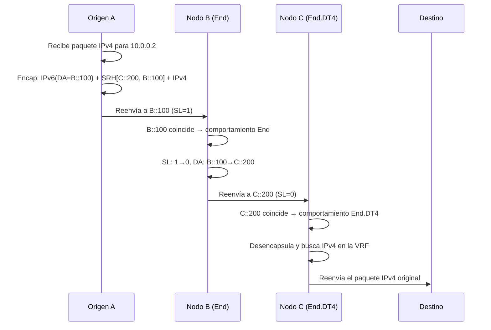

# Cabecera SRH: recorrido del paquete

Entender cómo funciona la Segment Routing Header (SRH) a nivel de paquete es esencial para diseñar y diagnosticar redes SRv6. Esta página recorre la mecánica paso a paso.

## Formato de la SRH (RFC 8754)

La SRH es una *Routing Header* de IPv6 con **Routing Type = 4**.

```
 0                   1                   2                   3
 0 1 2 3 4 5 6 7 8 9 0 1 2 3 4 5 6 7 8 9 0 1 2 3 4 5 6 7 8 9 0 1
+-+-+-+-+-+-+-+-+-+-+-+-+-+-+-+-+-+-+-+-+-+-+-+-+-+-+-+-+-+-+-+-+
|  Next Header  |  Hdr Ext Len  |  Routing Type | Segments Left |
|               |               |     (= 4)     |     (SL)      |
+-+-+-+-+-+-+-+-+-+-+-+-+-+-+-+-+-+-+-+-+-+-+-+-+-+-+-+-+-+-+-+-+
|  Last Entry   |    Flags      |              Tag              |
+-+-+-+-+-+-+-+-+-+-+-+-+-+-+-+-+-+-+-+-+-+-+-+-+-+-+-+-+-+-+-+-+
|                                                               |
|            Segment List[0] (128-bit IPv6 address)             |
|                        (Last SID)                             |
|                                                               |
+-+-+-+-+-+-+-+-+-+-+-+-+-+-+-+-+-+-+-+-+-+-+-+-+-+-+-+-+-+-+-+-+
|                                                               |
|            Segment List[1] (128-bit IPv6 address)             |
|                                                               |
|                                                               |
+-+-+-+-+-+-+-+-+-+-+-+-+-+-+-+-+-+-+-+-+-+-+-+-+-+-+-+-+-+-+-+-+
|                            ...                                |
+-+-+-+-+-+-+-+-+-+-+-+-+-+-+-+-+-+-+-+-+-+-+-+-+-+-+-+-+-+-+-+-+
|                                                               |
|            Segment List[n] (128-bit IPv6 address)             |
|                       (First SID)                             |
|                                                               |
+-+-+-+-+-+-+-+-+-+-+-+-+-+-+-+-+-+-+-+-+-+-+-+-+-+-+-+-+-+-+-+-+
|                                                               |
|                  Optional TLV objects                         |
|                                                               |
+-+-+-+-+-+-+-+-+-+-+-+-+-+-+-+-+-+-+-+-+-+-+-+-+-+-+-+-+-+-+-+-+
```

### Campos principales

| Campo | Tamaño | Descripción |
|-------|:------:|-------------|
| **Next Header** | 8 bits | Tipo de la siguiente cabecera (por ejemplo, 41 = IPv6, 4 = IPv4) |
| **Hdr Ext Len** | 8 bits | Longitud de la SRH en unidades de 8 octetos, sin contar los primeros 8 |
| **Routing Type** | 8 bits | Siempre **4** para la SRH |
| **Segments Left (SL)** | 8 bits | Índice en la lista de segmentos que apunta al segmento **activo** |
| **Last Entry** | 8 bits | Índice del último elemento de la lista (empieza en 0) |
| **Flags** | 8 bits | Banderas; el RFC 8754 no define ninguna |
| **Tag** | 16 bits | Agrupación o marcado de paquetes |
| **Segment List** | 128 bits cada uno | Lista ordenada de SIDs, en **orden inverso** |

!!! warning "¡Orden inverso!"
    La lista de segmentos se codifica en **orden inverso**: `Segment List[0]` es el **último** SID que se procesa y `Segment List[n]` es el **primero**. El puntero `Segments Left` empieza en `n` y va bajando hasta 0.

## Recorrido completo de un paquete

Sigamos un paquete desde el origen A, a través de dos endpoints SRv6 (B y C), hasta el destino D:

```
Origen (A) → Nodo B → Nodo C → Destino (D)

SIDs SRv6:
  B::100  = comportamiento End en el Nodo B
  C::200  = comportamiento End.DT4 en el Nodo C (desencapsula a IPv4)
```

### Paso 1: entrada (Origen A)

El origen A recibe un paquete IPv4 con destino `10.0.0.2` y tiene que dirigirlo por B y luego por C.

```
Paquete original:
  [IPv4: 10.0.0.1 → 10.0.0.2][Payload]

Tras la encapsulación SRv6:
  ┌──────────────────────────────────────────┐
  │ Cabecera IPv6 externa                     │
  │   Origen:  A::1                           │
  │   Destino: B::100  ← SID activo           │
  │   Next Header: 43 (Routing)               │
  ├──────────────────────────────────────────┤
  │ SRH                                       │
  │   Segments Left: 1                        │
  │   Last Entry:    1                        │
  │   Segment List[0]: C::200  (último SID)   │
  │   Segment List[1]: B::100  (primer SID)   │
  ├──────────────────────────────────────────┤
  │ Cabecera IPv4 interna                     │
  │   10.0.0.1 → 10.0.0.2                    │
  ├──────────────────────────────────────────┤
  │ Payload                                   │
  └──────────────────────────────────────────┘
```

!!! info "DA = SID activo"
    La dirección IPv6 de destino siempre es igual al SID activo (`Segment List[Segments Left]`).

### Paso 2: endpoint (Nodo B, comportamiento End)

El Nodo B recibe el paquete. La dirección de destino coincide con su SID local `B::100`, que tiene el comportamiento **End**:

1. Decrementa `Segments Left`: 1 → **0**
2. Copia `Segment List[0]` en la dirección de destino IPv6: DA = **C::200**
3. Reenvía según la nueva dirección de destino

```
Tras el procesamiento en el Nodo B:
  ┌──────────────────────────────────────────┐
  │ Cabecera IPv6 externa                     │
  │   Origen:  A::1                           │
  │   Destino: C::200  ← ¡Actualizado!       │
  ├──────────────────────────────────────────┤
  │ SRH                                       │
  │   Segments Left: 0     ← ¡Decrementado!  │
  │   Last Entry:    1                        │
  │   Segment List[0]: C::200                 │
  │   Segment List[1]: B::100                 │
  ├──────────────────────────────────────────┤
  │ IPv4 interna: 10.0.0.1 → 10.0.0.2        │
  ├──────────────────────────────────────────┤
  │ Payload                                   │
  └──────────────────────────────────────────┘
```

### Paso 3: salida (Nodo C, comportamiento End.DT4)

El Nodo C recibe el paquete. La dirección de destino coincide con su SID local `C::200`, que tiene el comportamiento **End.DT4**:

1. SL = 0, así que es el último segmento
2. **Desencapsula**: quita la cabecera IPv6 externa y la SRH
3. **Busca** la dirección de destino IPv4 interna en la tabla de la VRF indicada
4. **Reenvía** el paquete IPv4 original

```
Tras el procesamiento en el Nodo C:
  [IPv4: 10.0.0.1 → 10.0.0.2][Payload]  ← ¡Paquete original restaurado!
```

### Paso 4: entrega

El paquete IPv4 original llega al destino `10.0.0.2` como si SRv6 nunca hubiera intervenido.

## Diagrama de secuencia



## Sabores PSP, USP y USD

Los endpoints SRv6 pueden soportar distintos **sabores** (*flavors*) que optimizan cómo se maneja la SRH:

| Sabor | Nombre completo | Descripción |
|-------|-----------------|-------------|
| **PSP** | Penultimate Segment Pop | El penúltimo nodo (SL=1) quita la SRH antes de reenviar al último segmento. Reduce la carga en el nodo de salida. |
| **USP** | Ultimate Segment Pop | El último nodo quita la SRH él mismo. |
| **USD** | Ultimate Segment Decap | El último nodo desencapsula toda la cabecera IPv6 externa y la SRH. Se aplica a End, End.X y End.T; End.DT4/DT6/DT46 desencapsulan por definición y no llevan sabor. |

!!! tip "PSP es el más común"
    PSP está muy desplegado porque libera al PE de salida de quitar la SRH. PSP y USD son la pareja habitual (la palabra clave `psp-usd` de IOS-XR); Linux implementa PSP en End. Los sabores solo se aplican a End, End.X y End.T.

## SRH con TLVs

La SRH puede llevar objetos TLV (Type-Length-Value) opcionales después de la lista de segmentos:

| TLV | Descripción |
|-----|-------------|
| **HMAC TLV** | Autenticación criptográfica de la SRH |
| **Padding TLV** | Relleno para alineación |
| **NSH Carrier TLV** | Transporta metadatos NSH para encadenamiento de servicios |

## Encapsulación reducida

**H.Encaps.Red** (*Reduced Encapsulation*, RFC 8986) optimiza la SRH omitiendo de la lista de segmentos el **primer** SID de la ruta, porque el nodo de entrada ya lo coloca en la dirección IPv6 de destino. Así se ahorran 16 bytes por paquete, y con una ruta de un solo SID la SRH desaparece por completo.

```
Ruta: SID-1 → SID-2 → SID-3   (la lista se guarda en orden inverso)

H.Encaps:      SRH [SID-3, SID-2, SID-1], SL=2, DA = SID-1
H.Encaps.Red:  SRH [SID-3, SID-2],        SL=2, DA = SID-1  ← SID-1 solo va en la DA
```

## Comandos de verificación

=== "Linux"

    ```bash
    # Capturar paquetes SRv6: Next Header 43 es la Routing Header (SRv6 usa Routing Type 4)
    tcpdump -i eth0 -vv 'ip6 proto 43'

    # Ver la tabla local de SIDs
    ip -6 route show | grep seg6local

    # Decodificar con tshark
    tshark -i eth0 -O ipv6 -Y 'ipv6.routing.type == 4'
    ```

=== "Cisco IOS-XR"

    ```cisco
    show segment-routing srv6 sid
    show cef ipv6 <SID> detail
    debug segment-routing srv6 dataplane
    ```

=== "Juniper"

    ```junos
    show route table inet6.0 protocol srv6
    show spring-traffic-engineering srv6-sid
    ```

## Para seguir leyendo

- :material-arrow-right: [Estructura del SID](estructura-del-sid.md) — Cómo se compone el SID de 128 bits
- :material-arrow-right: [uSID](usid.md) — La optimización con micro-SIDs
- :material-arrow-right: [¿Qué es SRv6?](que-es-srv6.md) — Los conceptos básicos
- :material-arrow-right: [Network Programming](../topics/network-programming.md) — Todos los comportamientos SRv6 *(en inglés)*
- :material-file-document: [RFC 8754](../rfcs/rfc8754.md) — Especificación de la SRH *(en inglés)*

## Referencias

1. [RFC 8754 - IPv6 Segment Routing Header (SRH)](https://www.rfc-editor.org/rfc/rfc8754.html) - Especificación completa del formato de la SRH, sus campos y las reglas de procesamiento
2. [RFC 8986 - SRv6 Network Programming](https://datatracker.ietf.org/doc/rfc8986/) - Define los comportamientos End, End.X y End.DT4, los sabores PSP, USP y USD, y H.Encaps.Red
3. [SRv6 Linux Kernel Implementation](https://segment-routing.org/index.php/implementation/configuration) - Guía de configuración de seg6 y seg6local en el kernel de Linux *(en inglés)*
