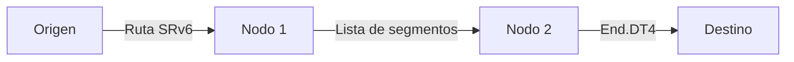

# ¿Qué es SRv6?

**SRv6 (Segment Routing over IPv6, o Segment Routing sobre IPv6)** es una arquitectura de red que usa el plano de datos de IPv6 para implementar enrutamiento de origen (*source routing*) y programación de red. También lo verás como **IPv6 Segment Routing** o **Segment Routing v6**: los tres nombres se refieren a la misma tecnología del IETF.

## IPv6 Segment Routing, Segment Routing v6, SRv6: una sola tecnología

Segment Routing ([RFC 8402](../rfcs/rfc8402.md)) es una arquitectura de enrutamiento de origen con dos planos de datos:

| Nombre que verás | Qué significa |
|------------------|---------------|
| **SRv6**, Segment Routing over IPv6, IPv6 Segment Routing, Segment Routing v6, SR v6 | Los segmentos son direcciones IPv6; la lista viaja en la dirección de destino y, cuando hace falta, en la Segment Routing Header ([RFC 8754](../rfcs/rfc8754.md)) |
| **SR-MPLS**, Segment Routing MPLS | Los segmentos son etiquetas MPLS en una pila de etiquetas ([RFC 8660](https://www.rfc-editor.org/rfc/rfc8660)) |

El "v6" de "Segment Routing v6" indica la versión de IP del plano de datos, no una sexta versión de Segment Routing. Las funciones del plano de control (extensiones de IS-IS/OSPFv3, [Flex-Algo](../topics/flex-algorithm.md), [TI-LFA](../topics/ti-lfa.md), [SR Policy](../topics/sr-policy.md)) se comparten entre ambos, por eso la documentación de los fabricantes suele cubrirlos en una sola guía de "Segment Routing". La comparación lado a lado está en [SRv6 vs SR-MPLS](srv6-vs-sr-mpls.md).

## Visión general

SRv6 codifica una lista de instrucciones, llamadas **segmentos**, en la cabecera del paquete IPv6. Cada segmento es una dirección IPv6 de 128 bits que representa una instrucción o un comportamiento específico de la red.



## Conceptos clave

### Segmentos

Un **segmento** es una dirección IPv6 que codifica:

- **Locator (localizador)**: identifica al nodo dentro de la red
- **Function (función)**: especifica el comportamiento que se debe aplicar
- **Arguments (argumentos)**: parámetros opcionales para la función

Cada una de estas partes se explica en detalle en [Estructura del SID](estructura-del-sid.md).

### Segment Routing Header (SRH)

La SRH es una cabecera de extensión de IPv6 (*routing header* de tipo 4) que transporta la lista ordenada de segmentos. Su funcionamiento paso a paso está en [Cabecera SRH](cabecera-srh.md).

```
 0                   1                   2                   3
 0 1 2 3 4 5 6 7 8 9 0 1 2 3 4 5 6 7 8 9 0 1 2 3 4 5 6 7 8 9 0 1
+-+-+-+-+-+-+-+-+-+-+-+-+-+-+-+-+-+-+-+-+-+-+-+-+-+-+-+-+-+-+-+-+
|  Next Header  |  Hdr Ext Len  | Routing Type  | Segments Left |
+-+-+-+-+-+-+-+-+-+-+-+-+-+-+-+-+-+-+-+-+-+-+-+-+-+-+-+-+-+-+-+-+
|  Last Entry   |    Flags      |              Tag              |
+-+-+-+-+-+-+-+-+-+-+-+-+-+-+-+-+-+-+-+-+-+-+-+-+-+-+-+-+-+-+-+-+
|                                                               |
|            Segment List[0] (128-bit IPv6 address)             |
|                                                               |
|                                                               |
+-+-+-+-+-+-+-+-+-+-+-+-+-+-+-+-+-+-+-+-+-+-+-+-+-+-+-+-+-+-+-+-+
|                                                               |
|            Segment List[1] (128-bit IPv6 address)             |
|                                                               |
|                                                               |
+-+-+-+-+-+-+-+-+-+-+-+-+-+-+-+-+-+-+-+-+-+-+-+-+-+-+-+-+-+-+-+-+
|                            ...                                |
+-+-+-+-+-+-+-+-+-+-+-+-+-+-+-+-+-+-+-+-+-+-+-+-+-+-+-+-+-+-+-+-+
```

### Enrutamiento de origen

En SRv6, el **nodo de origen** (el nodo de entrada o *ingress*) define toda la ruta a través de la red al llenar la lista de segmentos. Los nodos intermedios solo procesan el segmento activo y reenvían el paquete.

## Ventajas

| Característica | Descripción |
|----------------|-------------|
| :material-ip-network: **IPv6 nativo** | No necesita protocolos de overlay: usa IPv6 de forma nativa |
| :material-code-tags: **Programabilidad** | Los comportamientos de la red se definen mediante funciones SRv6 |
| :material-cog: **Simplificación** | Elimina los protocolos de señalización de MPLS (LDP, RSVP) |
| :material-chart-line: **Escalabilidad** | El espacio de SID de 128 bits soporta redes de gran escala |
| :material-shield-check: **Seguridad** | La SRH admite el TLV HMAC para autenticación |

## Cómo funciona (versión simplificada)

1. El **nodo de entrada** recibe un paquete y determina la política SRv6 que le corresponde
2. Encapsula el paquete con una cabecera IPv6 externa más una SRH
3. Llena la lista de segmentos con la ruta deseada
4. Los **nodos de tránsito** reenvían según la dirección IPv6 de destino
5. Los **nodos endpoint** procesan el SID activo y ejecutan el comportamiento asociado
6. El **nodo de salida** (*egress*) desencapsula y entrega el paquete original

!!! example "Flujo simple de un paquete SRv6"
    ```
    Original:  [IPv4: 10.0.0.1 -> 10.0.0.2][Payload]

    SRv6:      [IPv6: A::1 -> B::100]             <- IPv6 externa (DA = SID activo)
               [SRH: SL=1, [C::100, B::100]]       <- Lista de segmentos
               [IPv4: 10.0.0.1 -> 10.0.0.2]        <- Paquete original
               [Payload]
    ```

## SRv6 vs MPLS

SRv6 cambia de fondo la forma de programar redes frente al MPLS tradicional. MPLS usa etiquetas de 20 bits con protocolos de señalización (LDP, RSVP-TE); SRv6 usa direcciones IPv6 de 128 bits como identificadores de segmento, lo que permite una red programable sin la complejidad de los overlays. La comparación completa está en [SRv6 vs SR-MPLS](srv6-vs-sr-mpls.md).

## Para seguir leyendo

- :material-arrow-right: [Estructura del SID](estructura-del-sid.md) — El formato del SID de 128 bits (Locator, función y argumentos)
- :material-arrow-right: [Cabecera SRH](cabecera-srh.md) — Cómo se procesa un paquete SRv6 nodo por nodo
- :material-arrow-right: [uSID](usid.md) — Compresión de SIDs para reducir la sobrecarga
- :material-arrow-right: [SRv6 vs SR-MPLS](srv6-vs-sr-mpls.md) — Diferencias y cuándo usar cada uno
- :material-arrow-right: [Network Programming](../topics/network-programming.md) — Comportamientos SRv6 (End, End.DT4, End.DX6…) *(en inglés)*
- :material-arrow-right: [Implementaciones](../implementations/index.md) — Guías de configuración para Cisco, Juniper, Arista, Nokia, FRR y Linux *(en inglés)*
- :material-arrow-right: [Labs con netlab](../labs/netlab.md) — Levanta un laboratorio SRv6 listo en minutos *(en inglés)*

## Referencias

1. [RFC 8402 - Segment Routing Architecture](https://www.rfc-editor.org/rfc/rfc8402) - Define la arquitectura de Segment Routing, con sus planos de datos MPLS e IPv6
2. [RFC 8754 - IPv6 Segment Routing Header (SRH)](https://www.rfc-editor.org/rfc/rfc8754.html) - Especifica la cabecera SRH usada en el plano de datos IPv6
3. [RFC 8986 - SRv6 Network Programming](https://datatracker.ietf.org/doc/rfc8986/) - Define el modelo de programación de red de SRv6 y el conjunto base de comportamientos
4. [What is SRv6 network programming? - APNIC Blog](https://blog.apnic.net/2020/05/01/what-is-srv6-network-programming/) - Introducción accesible a la programación de red con SRv6 *(en inglés)*
