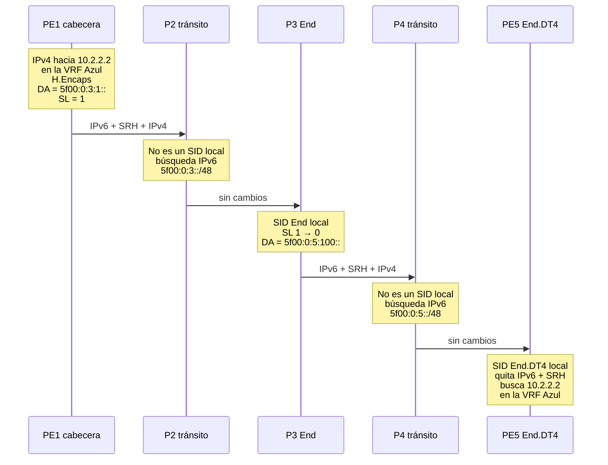

# ¿Qué es SRv6?

**SRv6 (Segment Routing over IPv6, o Segment Routing sobre IPv6)** es una tecnología de red que dirige y programa el tráfico escribiendo dentro del propio paquete IPv6 una lista ordenada de instrucciones, llamadas *segmentos*. Cada instrucción es una dirección IPv6 de 128 bits (un **SID**). Un router ejecuta la instrucción que está en la dirección de destino del paquete y luego toma su lugar la siguiente. Así, las rutas, las VPN y la protección rápida (*fast reroute*) funcionan sin estado por flujo en el núcleo, sin LDP ni RSVP-TE y sin plano de datos MPLS. SRv6 es un estándar del IETF ([RFC 8402](../rfcs/rfc8402.md), [RFC 8754](../rfcs/rfc8754.md), [RFC 8986](../rfcs/rfc8986.md)) construido sobre el reenvío IPv6 de siempre.

<figure markdown="span">
  { width="1200" height="630" loading="lazy" }
  <figcaption>Formato del paquete SRv6 y estructura del SID. El segmento activo es siempre la dirección IPv6 de destino.</figcaption>
</figure>

!!! abstract "En esta guía"
    1. [SRv6 de un vistazo](#srv6-de-un-vistazo)
    2. [Por qué existe SRv6](#por-que-existe-srv6)
    3. [Cómo funciona SRv6: las piezas](#como-funciona-srv6-las-piezas)
    4. [Recorrido de un paquete SRv6, salto a salto](#recorrido-de-un-paquete-srv6-salto-a-salto)
    5. [uSID: SRv6 con SID comprimidos](#usid-srv6-con-sid-comprimidos)
    6. [SRv6 vs IPv6](#srv6-vs-ipv6) y [SRv6 vs MPLS y SR-MPLS](#srv6-vs-mpls-y-sr-mpls)
    7. [Para qué se usa SRv6](#para-que-se-usa-srv6) y [quién usa SRv6](#quien-usa-srv6)
    8. [Lo que hay que tener en cuenta](#lo-que-hay-que-tener-en-cuenta)
    9. [Cómo probar SRv6](#como-probar-srv6)
    10. [Preguntas frecuentes](#preguntas-frecuentes)

## SRv6 de un vistazo

| | |
|---|---|
| **Qué es** | Segment Routing ([RFC 8402](../rfcs/rfc8402.md)) aplicado al plano de datos IPv6 |
| **Idea central** | El origen codifica la ruta y los servicios como una lista de direcciones IPv6 (SID) dentro del paquete |
| **Formato de la instrucción** | SID de 128 bits = Locator (a dónde) + Function (qué hacer) + Arguments (datos opcionales) |
| **Cabecera** | Cabecera IPv6 normal, más la Segment Routing Header (SRH, [RFC 8754](../rfcs/rfc8754.md)) cuando hay que llevar más de un SID |
| **Comportamientos** | End, End.X, End.DT4/DT6/DT46, End.DX2, H.Encaps…, definidos en [RFC 8986](../rfcs/rfc8986.md) |
| **Plano de control** | IS-IS ([RFC 9352](../rfcs/rfc9352.md)), OSPFv3 ([RFC 9513](../rfcs/rfc9513.md)), servicios BGP ([RFC 9252](../rfcs/rfc9252.md)), SR Policy ([RFC 9256](../rfcs/rfc9256.md)). Sin LDP ni RSVP-TE |
| **Compresión** | uSID / SID comprimidos ([RFC 9800](../rfcs/rfc9800.md)): varias instrucciones en una sola dirección de 128 bits |
| **Bloque de direcciones para SID** | `5f00::/16`, reservado por la IANA para SID de SRv6 ([RFC 9602](../rfcs/rfc9602.md)) |
| **Usos típicos** | Ingeniería de tráfico, L3VPN/EVPN, *fast reroute* con TI-LFA, *network slicing*, transporte 5G, fabrics de IA |
| **Quién lo usa** | Operadores como SoftBank, Bell Canada, Swisscom y China Mobile, además de redes de nube e IA de Microsoft, Meta y OpenAI ([despliegues](../use-cases/deployments.md), en inglés) |

### IPv6 Segment Routing, Segment Routing v6, SRv6: una sola tecnología

También verás SRv6 como **IPv6 Segment Routing**, **Segment Routing v6** o **SR v6**. Todos esos nombres se refieren a la misma tecnología del IETF. Segment Routing tiene dos planos de datos:

| Nombre que verás | Qué significa |
|------------------|---------------|
| **SRv6**, Segment Routing over IPv6, IPv6 Segment Routing, Segment Routing v6, SR v6 | Los segmentos son direcciones IPv6. La lista viaja en la dirección de destino y, cuando hace falta, en la SRH ([RFC 8754](../rfcs/rfc8754.md)) |
| **SR-MPLS**, Segment Routing MPLS | Los segmentos son etiquetas MPLS en una pila de etiquetas ([RFC 8660](https://www.rfc-editor.org/rfc/rfc8660)) |

El "v6" indica la versión de IP del plano de datos. No significa una sexta versión de Segment Routing. Los dos planos de datos comparten las funciones del plano de control: extensiones de IS-IS/OSPFv3, [Flex-Algo](../topics/flex-algorithm.md), [TI-LFA](../topics/ti-lfa.md) y [SR Policy](../topics/sr-policy.md). Por eso las guías de los fabricantes suelen cubrir ambos bajo un mismo título de "Segment Routing".

## Por qué existe SRv6

Una red MPLS clásica de proveedor de servicios usa cuatro o cinco protocolos para lo que en realidad es un solo trabajo: llevar los paquetes por la ruta elegida y entregarlos en la VPN correcta.

| Tarea | Red MPLS clásica | Red SRv6 |
|-------|------------------|----------|
| Topología y alcanzabilidad | IS-IS u OSPF | IS-IS u OSPFv3, que además anuncian los locators SRv6 |
| Etiquetas de transporte | LDP, una etiqueta por FEC en cada salto | Ninguna. Los locators son prefijos IPv6 comunes |
| Ingeniería de tráfico | RSVP-TE, con estado de cada túnel en todos los routers intermedios | SR Policy. El estado vive solo en el nodo de cabecera |
| Servicios VPN | BGP con etiquetas VPN | BGP con SID de servicio SRv6 ([RFC 9252](../rfcs/rfc9252.md)) |
| Protección rápida | FRR de RSVP-TE o LFA, con huecos de cobertura | [TI-LFA](../topics/ti-lfa.md), con cobertura completa e independiente de la topología |
| Plano de datos | MPLS, habilitado salto a salto en cada dominio | IPv6. Los routers de tránsito solo necesitan reenviar IPv6 |

Cada protocolo adicional suma estado, configuración y modos de falla. RSVP-TE es el peor caso: una malla completa de túneles entre *N* routers de borde implica del orden de *N²* túneles, y cada router intermedio guarda estado de todos los túneles que lo atraviesan. Además, MPLS se detiene en los bordes de cada dominio. Los centros de datos, los servidores y muchas redes de acceso usan IP puro, así que los servicios se tienen que unir en cada frontera con VXLAN, GRE u opciones inter-AS.

[Segment Routing](../rfcs/rfc8402.md) resolvió el problema del estado con **enrutamiento de origen** (*source routing*). El nodo de cabecera escribe la ruta en el paquete y el núcleo no guarda estado por ruta. SR-MPLS sigue necesitando MPLS en todas partes. SRv6 da un paso más y expresa las instrucciones como direcciones IPv6. El resultado:

- **Un solo plano de datos de punta a punta.** La misma encapsulación cruza WAN, metro, centro de datos e incluso servidores Linux. El tráfico IPv4 viaja como carga útil.
- **El servicio vive en la dirección.** Un SID de SRv6 puede significar "desencapsula y busca en la VRF Azul", así que una VPN no necesita una etiqueta aparte.
- **Los locators se pueden sumarizar** como cualquier prefijo IPv6, lo que ayuda a escalar redes grandes con varias áreas y dominios.
- **La red se vuelve programable.** Operadores y aplicaciones pueden encadenar instrucciones para armar un "programa de red" ([RFC 8986](../rfcs/rfc8986.md)).

!!! tip "Una analogía que encaja"
    Piensa en SRv6 como una ruta en el GPS del auto con paradas intermedias. El conductor (el nodo de cabecera) marca algunas paradas. Entre una parada y otra, el GPS elige el mejor camino (la ruta más corta del IGP), y nadie en la carretera necesita conocer el itinerario completo. En cada parada puede pasar algo, como "recoger a un pasajero" o "tomar el carril exprés". En SRv6, eso es la función del SID.

## Cómo funciona SRv6: las piezas

### Segmentos y SID

Un **segmento** es una instrucción. En SRv6 cada segmento se identifica con un **SID** (*Segment Identifier*), un valor de 128 bits que se escribe como una dirección IPv6. [RFC 8986](../rfcs/rfc8986.md) lo divide en tres partes:

<figure class="srv6-figure" style="width:100%">
<svg viewBox="0 0 760 222" role="img" aria-labelledby="sidfig-es-title sidfig-es-desc" xmlns="http://www.w3.org/2000/svg" style="width:100%;height:auto;max-width:760px">
<title id="sidfig-es-title">Anatomía de un SID de SRv6</title>
<desc id="sidfig-es-desc">El SID de 128 bits 5f00:0:5:100:: dividido en un bloque de 32 bits, un ID de nodo de 16 bits, una función de 16 bits y 64 bits de argumentos. El bloque y el ID de nodo forman el locator 5f00:0:5::/48, un prefijo enrutable que indica a dónde ir. La función indica qué hacer allí. Los argumentos llevan datos opcionales.</desc>
<style>
.sidf-a{fill:var(--md-primary-fg-color);fill-opacity:.10;stroke:var(--md-primary-fg-color);stroke-width:1.5}
.sidf-b{fill:var(--md-primary-fg-color);fill-opacity:.24;stroke:var(--md-primary-fg-color);stroke-width:1.5}
.sidf-c{fill:none;stroke:var(--md-default-fg-color--light);stroke-width:1.5;stroke-dasharray:5 4}
.sidf-hex{fill:var(--md-default-fg-color);font-family:var(--md-code-font-family,monospace);font-size:20px}
.sidf-bits{fill:var(--md-default-fg-color--light);font-size:14px}
.sidf-name{fill:var(--md-default-fg-color);font-size:15px;font-weight:700}
.sidf-note{fill:var(--md-default-fg-color--light);font-size:14px}
.sidf-br{fill:none;stroke:var(--md-default-fg-color--light);stroke-width:1.3}
.sidf-sid{fill:var(--md-default-fg-color);font-family:var(--md-code-font-family,monospace);font-size:16px}
</style>
<text class="sidf-bits" x="100" y="28" text-anchor="middle">32 bits</text>
<text class="sidf-bits" x="230" y="28" text-anchor="middle">16 bits</text>
<text class="sidf-bits" x="365" y="28" text-anchor="middle">16 bits</text>
<text class="sidf-bits" x="595" y="28" text-anchor="middle">64 bits</text>
<rect class="sidf-a" x="20" y="38" width="160" height="48" rx="4"/>
<rect class="sidf-a" x="180" y="38" width="100" height="48"/>
<rect class="sidf-b" x="280" y="38" width="170" height="48"/>
<rect class="sidf-c" x="450" y="38" width="290" height="48" rx="4"/>
<text class="sidf-hex" x="100" y="68" text-anchor="middle">5f00:0000</text>
<text class="sidf-hex" x="230" y="68" text-anchor="middle">0005</text>
<text class="sidf-hex" x="365" y="68" text-anchor="middle">0100</text>
<text class="sidf-hex" x="595" y="68" text-anchor="middle">0000:0000:0000:0000</text>
<text class="sidf-note" x="100" y="106" text-anchor="middle">bloque de SID</text>
<text class="sidf-note" x="230" y="106" text-anchor="middle">ID de nodo</text>
<path class="sidf-br" d="M22 116 v8 H278 v-8"/>
<path class="sidf-br" d="M282 116 v8 H448 v-8"/>
<path class="sidf-br" d="M452 116 v8 H738 v-8"/>
<text class="sidf-name" x="150" y="146" text-anchor="middle">Locator: a dónde ir</text>
<text class="sidf-note" x="150" y="166" text-anchor="middle">5f00:0:5::/48, prefijo enrutable</text>
<text class="sidf-name" x="365" y="146" text-anchor="middle">Function: qué hacer</text>
<text class="sidf-note" x="365" y="166" text-anchor="middle">0x100 = End.DT4, VRF Azul</text>
<text class="sidf-name" x="595" y="146" text-anchor="middle">Arguments: datos opcionales</text>
<text class="sidf-note" x="595" y="166" text-anchor="middle">cero en la mayoría de los casos</text>
<text class="sidf-sid" x="380" y="205" text-anchor="middle">Se escribe como una dirección IPv6: 5f00:0:5:100::</text>
</svg>
<figcaption>Un SID, una instrucción: "ve al nodo 5, luego desencapsula y busca el paquete IPv4 interno en la VRF Azul."</figcaption>
</figure>

| Parte | Función | Ejemplo |
|-------|---------|---------|
| **Locator** | Prefijo enrutable que lleva al nodo dueño del SID. Se forma con un **bloque** común del dominio más un **ID de nodo** | `5f00:0:5::/48` |
| **Function** | Elige el comportamiento que ejecuta el nodo, como End, End.X o End.DT4 | `0x100` → End.DT4 en la VRF Azul |
| **Arguments** | Datos opcionales por paquete que usan algunos comportamientos (por ejemplo, *split-horizon* de EVPN o MUP) | Normalmente `0` |

El largo de cada campo lo elige el operador. Lo único fijo es el total de 128 bits. Los routers anuncian sus **locators** en el IGP como prefijos IPv6 comunes. Cada router guarda sus propios **SID** en una tabla local, la "My SID table" de RFC 8986. Un SID no es la dirección de una interfaz, y [RFC 9602](../rfcs/rfc9602.md) reservó `5f00::/16` para que los SID sean fáciles de reconocer y filtrar. Los detalles están en [Estructura del SID](estructura-del-sid.md).

### El segmento activo vive en la dirección de destino

Esta es la idea clave de SRv6. **La dirección de destino IPv6 (DA) siempre contiene el SID activo**, es decir, la próxima instrucción a ejecutar. Los routers que no son dueños de ese SID enrutan el paquete como cualquier otro paquete IPv6. El router dueño del SID ejecuta la función, escribe el siguiente SID en la DA y vuelve a reenviar el paquete.

Por eso, un programa de una sola instrucción no necesita ninguna cabecera extra: basta con un SID en la DA. El tráfico VPN entre dos PE muchas veces se ve exactamente así.

### La Segment Routing Header (SRH)

Cuando una ruta necesita más de un SID, los demás viajan en la **Segment Routing Header**. La SRH es una cabecera de extensión de enrutamiento de IPv6 (Next Header 43, Routing Type 4) definida en [RFC 8754](../rfcs/rfc8754.md).

```
 0                   1                   2                   3
 0 1 2 3 4 5 6 7 8 9 0 1 2 3 4 5 6 7 8 9 0 1 2 3 4 5 6 7 8 9 0 1
+-+-+-+-+-+-+-+-+-+-+-+-+-+-+-+-+-+-+-+-+-+-+-+-+-+-+-+-+-+-+-+-+
|  Next Header  |  Hdr Ext Len  | Routing Type=4| Segments Left |
+-+-+-+-+-+-+-+-+-+-+-+-+-+-+-+-+-+-+-+-+-+-+-+-+-+-+-+-+-+-+-+-+
|  Last Entry   |    Flags      |              Tag              |
+-+-+-+-+-+-+-+-+-+-+-+-+-+-+-+-+-+-+-+-+-+-+-+-+-+-+-+-+-+-+-+-+
|        Segment List[0]  (último SID de la ruta, 128 bits)     |
+-+-+-+-+-+-+-+-+-+-+-+-+-+-+-+-+-+-+-+-+-+-+-+-+-+-+-+-+-+-+-+-+
|                              ...                              |
+-+-+-+-+-+-+-+-+-+-+-+-+-+-+-+-+-+-+-+-+-+-+-+-+-+-+-+-+-+-+-+-+
|        Segment List[n]  (primer SID de la ruta, 128 bits)     |
+-+-+-+-+-+-+-+-+-+-+-+-+-+-+-+-+-+-+-+-+-+-+-+-+-+-+-+-+-+-+-+-+
|           TLV opcionales (por ejemplo, HMAC, padding)         |
+-+-+-+-+-+-+-+-+-+-+-+-+-+-+-+-+-+-+-+-+-+-+-+-+-+-+-+-+-+-+-+-+
```

| Campo | Para qué sirve |
|-------|----------------|
| **Segments Left (SL)** | Índice del SID activo. Cada endpoint lo reduce en uno |
| **Last Entry** | Índice del último elemento de la lista de segmentos |
| **Segment List** | Los SID, guardados en **orden inverso**: `[0]` es el SID final y `[n]` es el primero |
| **Tag / Flags** | Marcado de paquetes. Todavía no hay flags definidos |
| **TLV** | Datos opcionales, como el TLV HMAC para autenticar la SRH |

En el tráfico encapsulado, la sobrecarga es de **40 bytes** de cabecera IPv6 externa, más **8 bytes** fijos de SRH, más **16 bytes por cada SID** de la lista. Muchas veces la SRH es más chica o directamente no está:

- **H.Encaps.Red** (encapsulación reducida) deja el primer SID fuera de la SRH porque ya está en la DA. Con un solo SID, esto elimina la SRH por completo.
- **uSID** mete varias instrucciones en una sola dirección, así que muchas rutas no necesitan SRH. Ver [más abajo](#usid-srv6-con-sid-comprimidos).

En [Cabecera SRH](cabecera-srh.md) se explican todos los campos y los *flavors* PSP/USP/USD.

### Tres roles: origen, tránsito y endpoint

| Rol | Qué hace el nodo | ¿Necesita soporte SRv6? |
|-----|------------------|:-----------------------:|
| **Nodo de origen / cabecera** | Clasifica el paquete, elige la lista de SID (de BGP, de una SR Policy o de un controlador) y agrega la cabecera IPv6 externa y la SRH (H.Encaps) | Sí |
| **Nodo de tránsito** | Reenvía según la DA con una búsqueda IPv6 normal por prefijo más largo. No revisa la SRH ([RFC 8754 §4.2](../rfcs/rfc8754.md)) | **No**, alcanza con IPv6 |
| **Endpoint de segmento** | La DA coincide con uno de sus SID locales, así que ejecuta el comportamiento: actualiza SL y DA, desencapsula, hace *cross-connect*… | Sí |

Como los nodos de tránsito solo necesitan IPv6, SRv6 puede cruzar partes de la red que nunca oyeron hablar de él. En la práctica, esta es una gran diferencia con MPLS.

### Programación de red: los SID como instrucciones

[RFC 8986](../rfcs/rfc8986.md) define lo que un SID puede *hacer*. Una lista de segmentos es, en la práctica, un pequeño programa, y cada SID es una instrucción.

| Comportamiento | Qué significa | Uso típico |
|----------------|---------------|------------|
| **End** | Pasar al siguiente SID (reducir SL y copiar el siguiente SID en la DA) | Pasar por un nodo, como en TE laxa |
| **End.X** | Igual que End, pero sacar el paquete por una adyacencia concreta | TE estricta, rutas de reparación de TI-LFA |
| **End.DT4 / End.DT6 / End.DT46** | Desencapsular y buscar el paquete interno en una tabla VRF | L3VPN |
| **End.DX4 / End.DX6** | Desencapsular y enviar a un *next hop* concreto | L3VPN por CE |
| **End.DX2 / End.DT2U / End.DT2M** | Desencapsular una trama Ethernet hacia un *cross-connect* o un bridge | EVPN VPWS / E-LAN |
| **End.B6.Encaps** | Aplicar otra SR Policy (Binding SID) | Escalado y TE entre dominios |
| **H.Encaps / H.Encaps.Red** | Cabecera: envolver el paquete en IPv6 + SRH | Dirigir tráfico hacia SRv6 |

RFC posteriores agregan comportamientos para SID comprimidos ([RFC 9800](../rfcs/rfc9800.md)), el plano de usuario móvil ([RFC 9433](../rfcs/rfc9433.md)) y la replicación multicast ([RFC 9524](../rfcs/rfc9524.md)). El catálogo completo está en [Network Programming](../topics/network-programming.md) *(en inglés)*.

### El plano de control: quién le dice al nodo de cabecera qué SID usar

SRv6 no tiene un protocolo de señalización propio. La información la llevan protocolos que ya existen:

- **IS-IS / OSPFv3** anuncian el locator de cada nodo y sus SID End/End.X ([RFC 9352](../rfcs/rfc9352.md), [RFC 9513](../rfcs/rfc9513.md)). [Flex-Algo](../topics/flex-algorithm.md) le da a cada locator su propia topología con restricciones.
- **BGP** anuncia los SID de servicio junto con las rutas VPN y EVPN ([RFC 9252](../rfcs/rfc9252.md)). En el modo más simple, **SRv6 BE (*best effort*)**, un PE pone en la DA el SID de servicio del PE remoto y la ruta más corta del IGP hace el resto.
- **SR Policy** ([RFC 9256](../rfcs/rfc9256.md)) define listas de SID explícitas para **SRv6 TE**. Un controlador puede entregarlas por BGP ([RFC 9830](../rfcs/rfc9830.md)) o PCEP ([RFC 9603](../rfcs/rfc9603.md)), usando la topología que aprende por BGP-LS ([RFC 9514](../rfcs/rfc9514.md)). El tráfico entra a una política según su color.

## Recorrido de un paquete SRv6, salto a salto

Veamos un ejemplo completo: un paquete L3VPN que debe tomar una ruta con ingeniería de tráfico a través de **P3**, por ejemplo porque P3 está en el camino de menor latencia.

- **PE1** (cabecera) aprendió por BGP que `10.2.2.0/24` en la VRF Azul está detrás de **PE5**, con el SID de servicio `5f00:0:5:100::` (End.DT4).
- Una SR Policy en PE1 indica llegar a PE5 pasando por P3, cuyo SID End es `5f00:0:3:1::`.
- **P2** y **P4** son routers de tránsito. Solo conocen por IS-IS los prefijos de locator `5f00:0:3::/48` y `5f00:0:5::/48`.



Este es el paquete que arma PE1:

```
IPv6 externa  SA = 2001:db8::1 (PE1)   DA = 5f00:0:3:1::   Next Header = 43
SRH           Routing Type = 4   Segments Left = 1   Last Entry = 1
              Segment List[0] = 5f00:0:5:100::   (PE5: End.DT4, VRF Azul)
              Segment List[1] = 5f00:0:3:1::     (P3: End)
IPv4 interna  10.1.1.1 → 10.2.2.2
Carga útil
```

| Paso | Nodo | Rol | DA después del nodo | SL | Qué pasa |
|:----:|------|-----|---------------------|:--:|----------|
| 1 | PE1 | Cabecera, H.Encaps | `5f00:0:3:1::` | 1 | Envuelve el paquete IPv4 en IPv6 + SRH, con el primer SID en la DA |
| 2 | P2 | Tránsito | `5f00:0:3:1::` | 1 | Búsqueda IPv6 normal por prefijo más largo. Ignora la SRH |
| 3 | P3 | Endpoint, End | `5f00:0:5:100::` | 0 | La DA es un SID local: reduce SL, copia `Segment List[0]` en la DA y reduce el *hop limit* |
| 4 | P4 | Tránsito | `5f00:0:5:100::` | 0 | Búsqueda IPv6 normal hacia el locator de PE5 |
| 5 | PE5 | Endpoint, End.DT4 | (desencapsulado) | – | Quita la cabecera IPv6 externa y la SRH, y reenvía 10.2.2.2 con la tabla de la VRF Azul |

!!! info "Qué cambia en la práctica"
    - **Flavor PSP:** P3 es el penúltimo endpoint, así que con *Penultimate Segment Pop* quita la SRH. PE5 recibe entonces un paquete IPv6 simple cuya DA es su SID End.DT4.
    - **Sobrecarga:** el ejemplo cuesta 40 + 8 + 2 × 16 = **80 bytes**. Con H.Encaps.Red son 64 bytes. Con uSID las dos instrucciones caben en la DA, así que son **40 bytes y sin SRH**.
    - **Sin TE (SRv6 BE):** PE1 pondría solo `5f00:0:5:100::` en la DA, sin SRH, y la ruta más corta del IGP llevaría el paquete hasta PE5.

## uSID: SRv6 con SID comprimidos

Al principio, SRv6 recibió críticas por su sobrecarga. Dieciséis bytes por SID suman rápido en una ruta de TE larga, y algunos equipos solo pueden agregar unos pocos SID. Los **micro-SID (uSID)** resuelven esto. Son el *flavor* NEXT-C-SID de [RFC 9800](../rfcs/rfc9800.md), que también define el *flavor* REPLACE-C-SID (G-SRv6).

Con el formato más común, **F3216**, una dirección de 128 bits contiene un bloque uSID de 32 bits seguido de hasta **seis microinstrucciones de 16 bits**:

```
fcbb:bb00 : 0003 : 0005 : e004 : 0000 : 0000 : 0000
 bloque     P3     PE5    desencap. en VRF de PE5   fin del contenedor
```

Cada nodo consume su propio uSID, **desplaza** el resto de la dirección hacia la izquierda y reenvía según la nueva DA. Los nodos de tránsito siguen haciendo una búsqueda IPv6 normal. Despliegues recientes como los de Rakuten Mobile, Swisscom, Bell Canada, Telefônica VIVO y Rijkswaterstaat usan uSID, y con él una ruta típica de VPN sobre TE cabe solo en la cabecera IPv6.

→ La explicación completa, con tablas de sobrecarga, está en [uSID](usid.md).

## SRv6 vs IPv6

SRv6 **no** es una nueva versión de IP ni una alternativa a IPv6. Es una forma de *usar* IPv6: las direcciones adquieren un segundo significado como instrucciones, y la cabecera de enrutamiento de tipo 4 lleva la lista.

| | IPv6 | SRv6 |
|---|------|------|
| **Qué es** | El protocolo de Internet, versión 6 ([RFC 8200](https://www.rfc-editor.org/rfc/rfc8200)) | Segment Routing implementado con paquetes IPv6 |
| **Significado de la dirección de destino** | Un host o una interfaz | La instrucción activa: un nodo *y* una función |
| **Selección de ruta** | Salto a salto: cada router elige el siguiente salto | El origen elige paradas intermedias. Entre ellas, se aplica el enrutamiento IPv6 normal |
| **Cabeceras** | Cabecera IPv6 + cabeceras de extensión opcionales | Las mismas, más la SRH (Routing Type 4) cuando hace falta |
| **Soporte en routers** | Todo router IPv6 | Los nodos de cabecera y los endpoints necesitan SRv6. Los de tránsito solo necesitan IPv6 |
| **Servicios** | Ninguno incorporado | VPN, TE, protección rápida y *slicing* codificados en los SID |

## SRv6 vs MPLS y SR-MPLS

| | MPLS con LDP / RSVP-TE | SR-MPLS | SRv6 |
|---|---|---|---|
| **Plano de datos** | Etiquetas MPLS | Etiquetas MPLS | IPv6 |
| **Tamaño de la instrucción** | Entrada de etiqueta de 4 bytes | Entrada de etiqueta de 4 bytes | SID de 16 bytes, o uSID de 2 bytes |
| **Distribución de etiquetas/SID** | LDP, RSVP-TE | Extensiones del IGP | Extensiones del IGP (los locators son prefijos) |
| **Estado de TE en el núcleo** | Por túnel (RSVP-TE) | Ninguno | Ninguno |
| **Cruza redes solo IP** | No | No | Sí |
| **Sumarización de direcciones de nodo** | No con LDP (requiere rutas de host /32) | No (un prefix SID por nodo) | Sí, los locators son prefijos sumarizables |
| **Programación de red** | Solo etiquetas VPN | Limitada | Amplia (función + argumentos) |
| **Sobrecarga de encapsulación** | La menor | La menor | Mínimo 40 bytes de cabecera IPv6; uSID elimina el costo por SID |
| **Madurez** | Décadas | Muy desplegado | En producción desde 2019, crece rápido |

SRv6 cambia una cabecera fija más grande por un único plano de datos en todas partes y la eliminación de LDP y RSVP-TE. La comparación completa, con recomendaciones de cuándo elegir cada uno, está en [SRv6 vs SR-MPLS](srv6-vs-sr-mpls.md). Los caminos de migración están en [Interworking & Migration](../topics/interworking-migration.md) *(en inglés)*.

## Para qué se usa SRv6

| Caso de uso | Qué aporta SRv6 | Más información *(en inglés, salvo IA)* |
|-------------|-----------------|------------------------------------------|
| **Ingeniería de tráfico** | Rutas explícitas o con restricciones sin estado en los nodos intermedios. Rutas de baja latencia y disjuntas con SR Policy y Flex-Algo | [Traffic Engineering](../use-cases/traffic-engineering.md), [SR Policy](../topics/sr-policy.md), [Flex-Algo](../topics/flex-algorithm.md) |
| **L3VPN y EVPN** | Servicios VPN y EVPN transportados por un SID de servicio, sin MPLS y sin VXLAN | [VPN Services](../use-cases/vpn-services.md), [BGP Overlay](../topics/bgp-overlay-services.md), [EVPN Multihoming](../topics/evpn-multihoming.md) |
| **Protección rápida** | Protección TI-LFA, normalmente por debajo de 50 ms, en cualquier topología, reparando sobre la ruta posconvergencia | [TI-LFA](../topics/ti-lfa.md), [Micro-Loop Avoidance](../topics/micro-loop-avoidance.md) |
| ***Network slicing*** | Topologías y SLA por *slice* con Flex-Algo, QoS y SR Policy | [Network Slicing](../use-cases/network-slicing.md) |
| **Transporte 5G y MUP** | Un solo transporte desde la RAN hasta el núcleo. SRv6 MUP reemplaza los túneles GTP-U ([RFC 9433](../rfcs/rfc9433.md)) | [5G Transport](../use-cases/5g-transport.md) |
| **Fabrics de IA** | Ubicación determinista de cada flujo en los fabrics de GPU y entre centros de datos de IA | [SRv6 para IA](ia.md), [AI/ML Networks](../use-cases/ai-networking.md) |
| **Encadenamiento de servicios** | Pasar el tráfico por firewalls y otras funciones de red como SID de la lista | [Service Chaining](../use-cases/service-chaining.md) |
| **Nube y servidores** | SRv6 desde el servidor o desde una VPC en la nube a través del backbone | [Cloud Backbone](../use-cases/cloud-native-backbone.md), [Host-Based SRv6](../topics/host-based-srv6.md) |

## Quién usa SRv6

SRv6 está en servicio comercial desde 2019 y lo usan:

- **Operadores de telecomunicaciones**, entre ellos SoftBank y Rakuten Mobile (Japón), China Mobile, Reliance Jio, Bell Canada, Swisscom, Iliad, Telefônica VIVO (Brasil) y Verizon, que está llevando SRv6 a todos sus dominios.
- **Redes de nube e IA:** Microsoft (centros de datos de IA Fairwater), OpenAI (MRC en clústeres de más de 100.000 GPU), Meta (TE en el backbone), Google (fabric de IA Virgo), Alibaba Cloud y Nebius.
- **Sector público:** Rijkswaterstaat (Países Bajos), que migró su backbone nacional de MPLS a SRv6 uSID.

Cada caso, con enlace al anuncio original, está en [Real-World Deployments](../use-cases/deployments.md) *(en inglés)*. Entre las implementaciones están Cisco IOS XR e IOS XE, Juniper Junos, Nokia SR OS, Arista EOS, Huawei, el kernel de Linux, FRRouting, VPP y SONiC. Ver [Implementaciones](../implementations/index.md) *(en inglés)*.

### Breve historia

| Año | Hito |
|:---:|------|
| 2013 | El IETF crea el grupo de trabajo SPRING para estandarizar Segment Routing |
| 2017 | Linux 4.10 incluye un plano de datos SRv6, y la versión 4.14 agrega los comportamientos de endpoint |
| 2018 | [RFC 8402](../rfcs/rfc8402.md), arquitectura de Segment Routing |
| 2019 | Primeras redes SRv6 comerciales, como la red *greenfield* de Iliad en Italia |
| 2020 | [RFC 8754](../rfcs/rfc8754.md), la Segment Routing Header |
| 2021 | [RFC 8986](../rfcs/rfc8986.md), SRv6 Network Programming |
| 2022–2023 | Servicios BGP ([RFC 9252](../rfcs/rfc9252.md)), SR Policy ([RFC 9256](../rfcs/rfc9256.md)), IS-IS ([RFC 9352](../rfcs/rfc9352.md)), MUP ([RFC 9433](../rfcs/rfc9433.md)), OSPFv3 ([RFC 9513](../rfcs/rfc9513.md)) |
| 2024 | [RFC 9602](../rfcs/rfc9602.md) reserva `5f00::/16` para los SID de SRv6 |
| 2025 | Se publican los SID comprimidos ([RFC 9800](../rfcs/rfc9800.md)) y TI-LFA ([RFC 9855](../rfcs/rfc9855.md)). SRv6 llega a las supercomputadoras de IA de Microsoft y OpenAI |

## Lo que hay que tener en cuenta

SRv6 no es gratis. Una evaluación honesta incluye:

- **MTU.** La encapsulación agrega al menos 40 bytes, y más si hay SRH. Los enlaces del núcleo necesitan una MTU mayor que el borde. Hay que planificarlo ([Performance & Scaling](../topics/performance-scaling.md), en inglés).
- **Profundidad de SID en el hardware.** Cada ASIC puede agregar o procesar una cantidad limitada de SID. uSID elimina en gran parte este límite, así que conviene verificar que tus equipos lo soporten.
- **Balanceo de carga.** Los routers del núcleo calculan el hash sobre la cabecera IPv6 externa, así que el nodo de cabecera debe completar el **flow label** a partir del paquete interno para que ECMP siga funcionando.
- **Frontera de seguridad.** Igual que MPLS, SRv6 confía en su propio dominio. El filtrado en el borde es obligatorio (ver las preguntas frecuentes y [Security](../topics/security.md), en inglés).
- **Operación.** Ping y traceroute funcionan sobre los SID porque son direcciones IPv6 ([RFC 9259](../rfcs/rfc9259.md)), pero algunas herramientas de monitoreo todavía asumen MPLS. Ver [OAM & Troubleshooting](../topics/oam-troubleshooting.md) *(en inglés)*.

## Cómo probar SRv6

Puedes correr SRv6 en tu laptop. El kernel de Linux lo implementa de forma nativa:

```bash
# Cabecera: dirigir 10.2.2.0/24 por el SID End de P3 y luego el SID End.DT4 de PE5
ip route add 10.2.2.0/24 vrf blue encap seg6 mode encap \
  segs 5f00:0:3:1::,5f00:0:5:100:: dev eth0

# P3: instalar el SID End
ip -6 route add 5f00:0:3:1::/128 encap seg6local action End dev eth0

# PE5 de salida: asociar el SID End.DT4 a la VRF blue (requiere net.vrf.strict_mode=1)
ip -6 route add 5f00:0:5:100::/128 encap seg6local \
  action End.DT4 vrftable 100 dev blue
```

iproute2 recibe los segmentos en el orden del recorrido y arma la SRH invertida por su cuenta. Para entornos completos que funcionan *(en inglés)*:

- [SRv6 en Linux](../implementations/linux-kernel.md): soporte del kernel por versión y un laboratorio probado con dos *network namespaces*
- [netlab](../labs/netlab.md): topologías SRv6 multifabricante listas en minutos
- [Containerlab](../labs/containerlab.md) y [GNS3](../labs/gns3.md): para armar tu propio laboratorio
- [Todos los labs](../labs/index.md)

## Preguntas frecuentes

### ¿Qué es SRv6 en redes?

SRv6 (Segment Routing over IPv6) es una tecnología de enrutamiento de origen en la que el router de entrada escribe una lista de instrucciones dentro del paquete IPv6. Cada instrucción es una dirección IPv6 de 128 bits llamada SID. Los routers ejecutan el SID que está en la dirección de destino y reenvían el paquete hacia el siguiente. Así, los operadores pueden armar rutas con ingeniería de tráfico, VPN y protección rápida sobre una red IPv6 normal, sin MPLS, LDP ni RSVP-TE.

### ¿Cómo funciona SRv6?

El router de cabecera encapsula el paquete en una cabecera IPv6 externa cuya dirección de destino es el primer SID. Si la ruta tiene más de un SID, los demás van en una Segment Routing Header. Los routers de tránsito reenvían el paquete según esa dirección, como a cualquier paquete IPv6. El router dueño del SID ejecuta su función: pasa al siguiente SID, saca el paquete por un enlace concreto o lo desencapsula dentro de una VPN. El proceso se repite hasta el último SID.

### ¿Cuál es la diferencia entre IPv6 y SRv6?

IPv6 es el protocolo de Internet. SRv6 es una forma de usar IPv6 en la que las direcciones también funcionan como instrucciones y una cabecera de extensión de enrutamiento de IPv6 (la SRH, tipo 4) puede llevar una lista de ellas. Todo paquete SRv6 es un paquete IPv6 válido, y los routers intermedios solo necesitan reenvío IPv6 común. Solo los nodos que agregan o ejecutan SID necesitan soporte SRv6.

### ¿SRv6 es un protocolo?

No en el sentido de un protocolo que intercambia sus propios mensajes. SRv6 es una arquitectura y un plano de datos: paquetes IPv6 con la Segment Routing Header (RFC 8754) y un conjunto de comportamientos estandarizados para los SID (RFC 8986). La información que necesita la transportan protocolos existentes, como IS-IS y OSPFv3 para los locators, BGP para los SID de servicio de las VPN, y BGP o PCEP para las SR Policies.

### ¿SRv6 reemplaza a MPLS?

Puede hacerlo. SRv6 ofrece los servicios para los que los operadores usan MPLS, como VPN, ingeniería de tráfico y protección rápida, sin plano de datos MPLS, LDP ni RSVP-TE. Varios operadores y redes públicas ya migraron su backbone de MPLS a SRv6. Aun así, MPLS y SR-MPLS siguen muy desplegados, y la mayoría de las migraciones hace convivir ambos durante años mediante gateways de interworking y PE con doble plano de datos.

### ¿SRv6 es seguro?

SRv6 es tan seguro como el filtrado que lo rodea. Igual que MPLS, asume un dominio de confianza (RFC 8402, RFC 8754), así que los routers de borde deben descartar los paquetes que llegan de afuera con una SRH o dirigidos a SID internos. Usar el bloque de SID 5f00::/16 de RFC 9602 simplifica ese filtro. La SRH también admite un TLV HMAC opcional que autentica la lista de segmentos cuando los enlaces atraviesan infraestructura no confiable.

### ¿Qué es un SID en SRv6?

Un SID (*Segment Identifier*) es un valor de 128 bits, escrito como una dirección IPv6, que nombra una instrucción. Tiene tres partes: un locator que lleva el paquete al nodo correcto, una función que elige el comportamiento a ejecutar allí (por ejemplo, End.DT4, desencapsular en una VRF) y argumentos opcionales.

### ¿Qué es uSID en SRv6?

uSID (micro-SID) es la compresión de SRv6, estandarizada como el *flavor* NEXT-C-SID en RFC 9800. Mete hasta seis instrucciones de 16 bits en una sola dirección IPv6 de 128 bits. Cada nodo consume su propia instrucción y desplaza el resto. Así, una ruta de TE de varios saltos más un servicio VPN pueden caber en la dirección de destino IPv6, sin SRH.

## Para seguir leyendo

- :material-arrow-right: [Estructura del SID](estructura-del-sid.md): el formato del SID de 128 bits y el bloque `5f00::/16`
- :material-arrow-right: [Cabecera SRH](cabecera-srh.md): todos los campos de la SRH y los *flavors* PSP/USP/USD
- :material-arrow-right: [uSID](usid.md): micro-SID y RFC 9800
- :material-arrow-right: [SRv6 vs SR-MPLS](srv6-vs-sr-mpls.md): cuándo elegir cada uno
- :material-arrow-right: [SRv6 para IA](ia.md): quién usa SRv6 en redes de IA y por qué
- :material-arrow-right: [Network Programming](../topics/network-programming.md): todos los comportamientos SRv6 *(en inglés)*
- :material-arrow-right: [Interworking & Migration](../topics/interworking-migration.md): cómo pasar de MPLS a SRv6 *(en inglés)*
- :material-arrow-right: [Security](../topics/security.md): filtrado, HMAC y vectores de ataque *(en inglés)*
- :material-arrow-right: [Implementaciones](../implementations/index.md): guías de configuración para Cisco, Juniper, Arista, Nokia, FRR y Linux *(en inglés)*

## Referencias

1. [RFC 8402 - Segment Routing Architecture](https://www.rfc-editor.org/rfc/rfc8402) - Define la arquitectura de Segment Routing para los planos de datos MPLS e IPv6, incluido el modelo de confianza del dominio SR
2. [RFC 8754 - IPv6 Segment Routing Header (SRH)](https://www.rfc-editor.org/rfc/rfc8754.html) - Especifica la SRH, el procesamiento en origen, tránsito y endpoint, y el TLV HMAC
3. [RFC 8986 - SRv6 Network Programming](https://www.rfc-editor.org/rfc/rfc8986.html) - Define la estructura del SID, los comportamientos de endpoint y de cabecera, y los *flavors* PSP/USP/USD
4. [RFC 9252 - BGP Overlay Services Based on SRv6](https://www.rfc-editor.org/rfc/rfc9252.html) - Cómo BGP señaliza los SID de servicio SRv6 para L3VPN y EVPN
5. [RFC 9602 - SRv6 Segment Identifiers in the IPv6 Addressing Architecture](https://www.rfc-editor.org/rfc/rfc9602.html) - Reserva `5f00::/16` para los SID de SRv6
6. [RFC 9800 - Compressed SRv6 Segment List Encoding](https://www.rfc-editor.org/rfc/rfc9800.html) - Estandariza la compresión NEXT-C-SID (uSID) y REPLACE-C-SID
7. [What is SRv6 network programming? - APNIC Blog](https://blog.apnic.net/2020/05/01/what-is-srv6-network-programming/) - Introducción de Clarence Filsfils (2020) al modelo de programación de red *(en inglés)*
