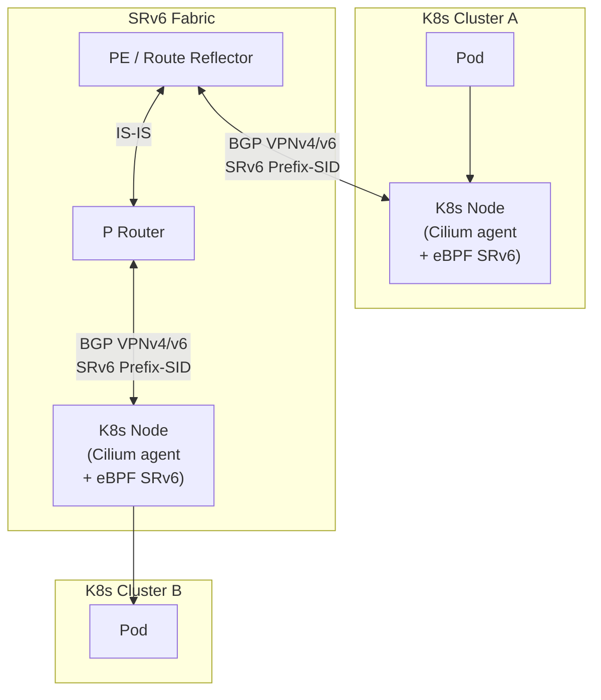

# SRv6 with Cilium (eBPF)

**Cilium** is the eBPF-based networking layer (CNI) for Kubernetes. It can make each Kubernetes node an SRv6 endpoint: pod traffic is encapsulated into SRv6 by eBPF programs on the node, and SRv6 packets addressed to the node's SIDs are decapsulated into the right tenant. What you get depends on which Cilium you run:

| | Open-source Cilium | Isovalent Enterprise for Cilium |
|---|---|---|
| SRv6 datapath (eBPF encap/decap) | Since **1.13**, behind the hidden agent flag `--enable-srv6`, labelled **beta**; still hidden in 1.20 | Yes |
| Control plane (locators, SID allocation, VRFs, BGP VPN routes) | **None** — nothing in open source programs the SRv6 maps | Yes: SRv6 L3VPN, **Beta** since Enterprise 1.13 |
| uSID (F3216) | No | Yes (locator pools with `behaviorType: uSID`) |
| Helm values | None for SRv6 | `enterprise.srv6.*` |

!!! warning "SRv6 L3VPN is not an open-source Cilium feature"
    The [Cilium 1.13 release blog](https://isovalent.com/blog/post/cilium-release-113/) lists SRv6 under "Isovalent Cilium Enterprise", and open-source Cilium has no SRv6 documentation page, CRD or Helm value. If you need SRv6 L3VPN to Kubernetes pods today, you need the Enterprise product, or you build your own control plane that programs the eBPF maps.

## Why Cilium + SRv6?

Router-based SRv6 implementations (IOS-XR, Junos, SR OS, FRRouting) stop at the PE. With SRv6 in the CNI, the fabric extends **into the Kubernetes node**: each worker node gets its own locator and SIDs and exchanges VPN routes with the PE routers over BGP, so tenant traffic leaves the node already encapsulated.



## The Open-Source Datapath

All of open-source Cilium's SRv6 code is in [`bpf/lib/srv6.h`](https://github.com/cilium/cilium/blob/v1.20.0/bpf/lib/srv6.h) and the maps it reads. It implements:

| Function | RFC 8986 equivalent | Notes |
|----------|--------------------|-------|
| Encapsulation, `--srv6-encap-mode=reduced` (default) | H.Encaps.Red | Single SID in the outer destination address, no SRH |
| Encapsulation, `--srv6-encap-mode=srh` | H.Encaps | Outer IPv6 header plus an SRH with exactly one SID |
| Decapsulation to IPv4 or IPv6 when the destination matches a local SID | End.DT4 / End.DT6 | The SID maps to a VRF ID; the inner packet is re-run through the normal host ingress path |

There is no transit SRv6 processing (End, End.X), no multi-SID segment lists, no flavors, no L2 behaviors and no uSID in the open-source datapath. Both flags (`--enable-srv6`, `--srv6-encap-mode`) are hidden and marked beta in the agent ([source](https://github.com/cilium/cilium/blob/v1.20.0/daemon/cmd/daemon_main.go#L223-L234)). Reduced encapsulation has been the default since 1.13 ([source](https://github.com/cilium/cilium/blob/v1.13.0/pkg/defaults/defaults.go#L202-L203)).

### eBPF maps

| Map | Key → value | Purpose |
|-----|-------------|---------|
| `cilium_srv6_vrf_v4` / `cilium_srv6_vrf_v6` | source IP + destination CIDR → VRF ID | Classifies pod egress traffic into a VRF |
| `cilium_srv6_policy_v4` / `cilium_srv6_policy_v6` | VRF ID + destination CIDR → SID | Picks the remote SID to encapsulate toward |
| `cilium_srv6_sid` | local SID → VRF ID | Matches incoming SRv6 packets for decapsulation |

Older releases (up to 1.15) also had `cilium_srv6_state_v4/_v6` maps; they were later removed.

### Where it runs

Both directions are **TC** programs, not XDP: encapsulation runs on pod egress (`bpf_lxc.c`, tail call `CILIUM_CALL_SRV6_ENCAP`) and decapsulation in `cil_from_netdev` in [`bpf_host.c`](https://github.com/cilium/cilium/blob/v1.20.0/bpf/bpf_host.c#L324-L337). The XDP program explicitly skips SRv6 handling. eBPF programs run inside the kernel; this is not kernel bypass.

### Inspecting the datapath

```bash
# List the SRv6 maps (the agent CLI was renamed cilium-dbg in 1.15)
cilium-dbg bpf srv6 vrf
cilium-dbg bpf srv6 policy
cilium-dbg bpf srv6 sid
```

Hubble flows carry the trace reasons `SRV6_ENCAP` and `SRV6_DECAP` (from 1.15). There are no SRv6-specific Prometheus metrics; SRv6 drops are counted by the generic drop metrics.

## Isovalent Enterprise: SRv6 L3VPN

Isovalent Enterprise for Cilium adds the control plane. Its documentation requires a login, so the details below come from Isovalent's [Enterprise 1.13 announcement](https://isovalent.com/blog/post/isovalent-enterprise-1-13/) and from public Cisco lab material that runs the Enterprise product ([Cisco Live LTRSPG-2212 lab](https://github.com/cisco-asp-web/LTRSPG-2212/blob/main/lab_3/lab_3-guide.md)); check them against your release.

- **Locators and SIDs** — `IsovalentSRv6LocatorPool` (with `behaviorType: uSID` or `SRH`, e.g. a 32/16/16 F3216 structure) and `IsovalentSRv6SIDManager` allocate a per-node locator and per-VRF SIDs such as uDT4.
- **VRFs** — `IsovalentVRF` classifies pods into tenants; route distinguishers and import/export route targets are set per VRF in `IsovalentBGPClusterConfig`.
- **BGP** — the BGP control plane is GoBGP (open source and Enterprise alike; FRR is not used). The lab peers over **VPNv4** (`afi: ipv4, safi: mpls_vpn`) and advertises the locator itself as plain IPv6 unicast via `IsovalentBGPAdvertisement` (`advertisementType: SRv6LocatorPool`).

### How the routes are signaled

The signaling follows [RFC 9252](../rfcs/rfc9252.md), as on any SRv6 PE:

- **One BGP session per peer** carries the routes of every VRF; the route target extended communities place each prefix in the right VRF on the PE.
- The **BGP next hop is the node's IPv6 address**. The Service SID travels in the **BGP Prefix-SID attribute** (SRv6 L3 Service TLV), with the function bits transposed into the label field. In the Cisco lab, the IOS-XR route reflector shows a uDT4 SID (behavior 63) learned from the Cilium node this way.
- IPv4 tenant prefixes use **VPNv4** (AFI 1 / SAFI 128) and IPv6 prefixes VPNv6 (AFI 2 / SAFI 128).

### EVPN fabrics

Cilium does not speak BGP EVPN for SRv6; the open-source advertisement types are PodCIDR, CiliumPodIPPool, Service and Interface only ([source](https://github.com/cilium/cilium/blob/v1.20.0/pkg/k8s/apis/cilium.io/v2/bgp_advert_types.go)). If the rest of your fabric carries tenant routes as EVPN Route Type 5 over SRv6, the PE that peers with the Kubernetes nodes must run VPNv4/VPNv6 toward them and re-originate the routes into EVPN (a gateway function). A plain route reflector cannot do this: it reflects routes within the same address family.

## Comparison with Router-Based SRv6

| Aspect | Cilium (open source) | Isovalent Enterprise | FRRouting | Cisco IOS-XR |
|--------|:--------------------:|:--------------------:|:---------:|:------------:|
| Data plane | eBPF (TC) in the kernel | eBPF (TC) in the kernel | Linux kernel seg6 | ASIC / NPU |
| Control plane | None for SRv6 | GoBGP + Kubernetes CRDs | FRR (IS-IS, BGP) | IOS-XR (IS-IS, BGP) |
| L3VPN | :material-close-circle: | :material-check-circle: (Beta) | :material-check-circle: | :material-check-circle: |
| uSID | :material-close-circle: | :material-check-circle: | :material-check-circle: | :material-check-circle: |
| Kubernetes-native | :material-check-circle: | :material-check-circle: | :material-close-circle: | :material-close-circle: |

See the [SRv6 Support Matrix](support-matrix.md) for open-source Cilium next to every other platform, behavior by behavior.

## Further Reading

- :material-arrow-right: [SRv6 Support Matrix](support-matrix.md) -- Cilium, Linux, FRR, VPP and vendor routers side by side
- :material-arrow-right: [Host-Based SRv6](../topics/host-based-srv6.md) -- How end-hosts participate in SRv6 without router involvement
- :material-arrow-right: [BGP Overlay Services](../topics/bgp-overlay-services.md) -- VPNv4/VPNv6 signaling for SRv6 L3VPN
- :material-arrow-right: [Linux Kernel](linux-kernel.md) -- The kernel's own seg6 data plane, which Cilium does not use for SRv6
- :material-arrow-right: [FRRouting](frrouting.md) -- Open-source BGP/IS-IS for SRv6 on Linux hosts
- :material-arrow-right: [Cloud-Native Backbone](../use-cases/cloud-native-backbone.md) -- SRv6 in cloud and container environments

## References

1. [Cilium source: bpf/lib/srv6.h (v1.20.0)](https://github.com/cilium/cilium/blob/v1.20.0/bpf/lib/srv6.h) -- The complete open-source SRv6 datapath and map definitions
2. [Cilium source: hidden SRv6 agent flags (v1.20.0)](https://github.com/cilium/cilium/blob/v1.20.0/daemon/cmd/daemon_main.go#L223-L234) -- `--enable-srv6` (beta) and `--srv6-encap-mode`
3. [Cilium 1.13 release blog](https://isovalent.com/blog/post/cilium-release-113/) -- SRv6 listed under Isovalent Cilium Enterprise; single SID only at the time
4. [Isovalent Enterprise for Cilium 1.13](https://isovalent.com/blog/post/isovalent-enterprise-1-13/) -- SRv6 L3VPN support, feature status Beta
5. [cilium-dbg bpf srv6 command reference](https://docs.cilium.io/en/stable/cmdref/cilium-dbg_bpf_srv6/) -- Listing the SRv6 eBPF maps
6. [Cisco Live LTRSPG-2212 lab guide](https://github.com/cisco-asp-web/LTRSPG-2212/blob/main/lab_3/lab_3-guide.md) -- Public lab running Isovalent Enterprise SRv6 L3VPN with uSID against IOS-XR (secondary source)
7. [RFC 9252 - BGP Overlay Services Based on SRv6](https://www.rfc-editor.org/rfc/rfc9252) -- Service SIDs in the BGP Prefix-SID attribute
8. [SRv6 on Cilium: an introductory demo (Isovalent)](https://youtu.be/k_2nMzxi1Hk) -- Video walkthrough of SRv6 L3VPN with Cilium
