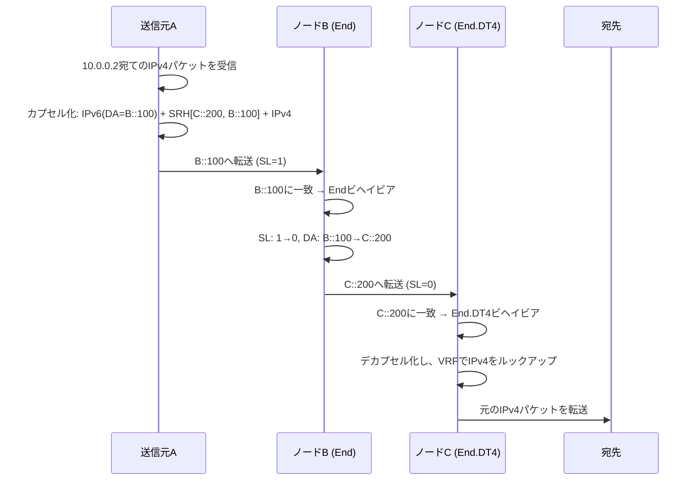

# SRHとパケットウォーク

Segment Routing Header（SRH）がパケットレベルでどう動くかを理解することは、SRv6ネットワークの設計とトラブルシューティングに欠かせません。このページでは、その仕組みを一歩ずつ追っていきます。

## SRHのフォーマット（RFC 8754）

SRHは、**Routing Type = 4**のIPv6 Routing Headerです。

```
 0                   1                   2                   3
 0 1 2 3 4 5 6 7 8 9 0 1 2 3 4 5 6 7 8 9 0 1 2 3 4 5 6 7 8 9 0 1
+-+-+-+-+-+-+-+-+-+-+-+-+-+-+-+-+-+-+-+-+-+-+-+-+-+-+-+-+-+-+-+-+
|  Next Header  |  Hdr Ext Len  |  Routing Type | Segments Left |
|               |               |     (= 4)     |     (SL)      |
+-+-+-+-+-+-+-+-+-+-+-+-+-+-+-+-+-+-+-+-+-+-+-+-+-+-+-+-+-+-+-+-+
|  Last Entry   |    Flags      |              Tag              |
+-+-+-+-+-+-+-+-+-+-+-+-+-+-+-+-+-+-+-+-+-+-+-+-+-+-+-+-+-+-+-+-+
|                                                               |
|            Segment List[0] (128-bit IPv6 address)             |
|                        (Last SID)                             |
|                                                               |
+-+-+-+-+-+-+-+-+-+-+-+-+-+-+-+-+-+-+-+-+-+-+-+-+-+-+-+-+-+-+-+-+
|                                                               |
|            Segment List[1] (128-bit IPv6 address)             |
|                                                               |
|                                                               |
+-+-+-+-+-+-+-+-+-+-+-+-+-+-+-+-+-+-+-+-+-+-+-+-+-+-+-+-+-+-+-+-+
|                            ...                                |
+-+-+-+-+-+-+-+-+-+-+-+-+-+-+-+-+-+-+-+-+-+-+-+-+-+-+-+-+-+-+-+-+
|                                                               |
|            Segment List[n] (128-bit IPv6 address)             |
|                       (First SID)                             |
|                                                               |
+-+-+-+-+-+-+-+-+-+-+-+-+-+-+-+-+-+-+-+-+-+-+-+-+-+-+-+-+-+-+-+-+
|                                                               |
|                  Optional TLV objects                         |
|                                                               |
+-+-+-+-+-+-+-+-+-+-+-+-+-+-+-+-+-+-+-+-+-+-+-+-+-+-+-+-+-+-+-+-+
```

### 主なフィールド

| フィールド | サイズ | 説明 |
|------------|:------:|------|
| **Next Header** | 8ビット | 次のヘッダーの種類（例：41 = IPv6、4 = IPv4） |
| **Hdr Ext Len** | 8ビット | 先頭8オクテットを除いたSRHの長さ（8オクテット単位） |
| **Routing Type** | 8ビット | SRHでは常に**4** |
| **Segments Left（SL）** | 8ビット | セグメントリストのインデックスで、**現在アクティブな**セグメントを指す |
| **Last Entry** | 8ビット | セグメントリストの最後の要素のインデックス（0始まり） |
| **Flags** | 8ビット | 現在は未使用（予約） |
| **Tag** | 16ビット | パケットのグルーピングやマーキング |
| **Segment List** | 各128ビット | SIDの順序付きリスト。**逆順**で格納される |

!!! warning "逆順に注意"
    セグメントリストは**逆順**でエンコードされます。`Segment List[0]`が**最後に**処理されるSIDで、`Segment List[n]`が**最初に**処理されるSIDです。`Segments Left`は`n`から始まり、0に向かってデクリメントされます。

## パケットウォークの全体像

送信元Aから2つのSRv6エンドポイント（BとC）を経由して宛先Dに届くまで、パケットを追跡してみましょう。

```
Source (A) → Node B → Node C → Destination (D)

SRv6 SIDs:
  B::100  = End behavior on Node B
  C::200  = End.DT4 behavior on Node C (decap to IPv4)
```

`B::100`はノードBのEndビヘイビア、`C::200`はノードCのEnd.DT4ビヘイビア（デカプセル化してIPv4へ）です。

### ステップ1：Ingress（送信元A）

送信元Aは`10.0.0.2`宛てのIPv4パケットを受信し、B、Cの順に経由させる必要があります。

```
Original packet:
  [IPv4: 10.0.0.1 → 10.0.0.2][Payload]

After SRv6 encapsulation:
  ┌──────────────────────────────────────────┐
  │ Outer IPv6 Header                         │
  │   Source:      A::1                       │
  │   Destination: B::100  ← Active SID      │
  │   Next Header: 43 (Routing)               │
  ├──────────────────────────────────────────┤
  │ SRH                                       │
  │   Segments Left: 1                        │
  │   Last Entry:    1                        │
  │   Segment List[0]: C::200  (last SID)     │
  │   Segment List[1]: B::100  (first SID)    │
  ├──────────────────────────────────────────┤
  │ Inner IPv4 Header                         │
  │   10.0.0.1 → 10.0.0.2                    │
  ├──────────────────────────────────────────┤
  │ Payload                                   │
  └──────────────────────────────────────────┘
```

!!! info "DA = アクティブSID"
    IPv6の宛先アドレス（DA）は、常に現在アクティブなSID（`Segment List[Segments Left]`）と一致します。

### ステップ2：エンドポイント（ノードB：Endビヘイビア）

ノードBがパケットを受信します。DAが自身のローカルSID `B::100`（**End**ビヘイビア）に一致するので、次の処理を行います。

1. `Segments Left`をデクリメント：1 → **0**
2. `Segment List[0]`をIPv6のDAにコピー：DA = **C::200**
3. 新しいDAに基づいて転送

```
After Node B processing:
  ┌──────────────────────────────────────────┐
  │ Outer IPv6 Header                         │
  │   Source:      A::1                       │
  │   Destination: C::200  ← Updated!        │
  ├──────────────────────────────────────────┤
  │ SRH                                       │
  │   Segments Left: 0     ← Decremented!    │
  │   Last Entry:    1                        │
  │   Segment List[0]: C::200                 │
  │   Segment List[1]: B::100                 │
  ├──────────────────────────────────────────┤
  │ Inner IPv4: 10.0.0.1 → 10.0.0.2          │
  ├──────────────────────────────────────────┤
  │ Payload                                   │
  └──────────────────────────────────────────┘
```

### ステップ3：Egress（ノードC：End.DT4ビヘイビア）

ノードCがパケットを受信します。DAが自身のローカルSID `C::200`（**End.DT4**ビヘイビア）に一致します。

1. SL = 0なので、これが最後のセグメント
2. **デカプセル化**：外側のIPv6ヘッダーとSRHを取り除く
3. 指定されたVRFテーブルで内側のIPv4 DAを**ルックアップ**
4. 元のIPv4パケットを**転送**

```
After Node C processing:
  [IPv4: 10.0.0.1 → 10.0.0.2][Payload]  ← Original packet restored!
```

### ステップ4：配送

元のIPv4パケットは、SRv6を経由したことをまったく意識させずに宛先`10.0.0.2`へ届けられます。

## パケットウォークのシーケンス図



## PSP、USP、USDフレーバー

SRv6のエンドポイントは、SRHの扱い方を最適化するさまざまな**フレーバー**をサポートできます。

| フレーバー | 正式名称 | 説明 |
|------------|----------|------|
| **PSP** | Penultimate Segment Pop | 最後から2番目のノード（SL=1）が、最後のセグメントへ転送する前にSRHを取り除く。Egressノードの負荷を減らせる |
| **USP** | Ultimate Segment Pop | 最後のノード自身がSRHを取り除く |
| **USD** | Ultimate Segment Decap | 最後のノードが外側のIPv6ヘッダーとSRHをまとめてデカプセル化する。End、End.X、End.Tに適用される。End.DT4/DT6/DT46は定義上デカプセル化を行うため、フレーバーは付かない |

!!! tip "最も一般的なのはPSP"
    PSPはSRHの除去をEgress PEから肩代わりして効率を高めるため、広く使われています。PSPとUSDはよく組み合わせて使われます（IOS-XRの`psp-usd`キーワード）。LinuxはEndでPSPを実装しています。フレーバーが適用されるのはEnd、End.X、End.Tだけです。

## TLV付きのSRH

SRHは、セグメントリストの後ろにオプションのTLV（Type-Length-Value）オブジェクトを運べます。

| TLV | 説明 |
|-----|------|
| **HMAC TLV** | SRHの暗号学的な認証 |
| **Padding TLV** | アライメントのためのパディング |
| **NSH Carrier TLV** | サービスチェイニング用のNSHメタデータを運ぶ |

## Reduced Encapsulation（H.Encaps.Red）

**H.Encaps.Red**（Reduced Encapsulation、RFC 8986）は、経路の**最初の**SIDをセグメントリストから省くことでSRHを最適化します。最初のSIDはヘッドエンドがすでにIPv6のDAに入れているためです。これによりパケットごとに16バイトを節約でき、SIDが1つだけの経路ではSRH自体が不要になります。

```
Path: SID-1 → SID-2 → SID-3   (segment list is stored in reverse order)

H.Encaps:      SRH [SID-3, SID-2, SID-1], SL=2, DA = SID-1
H.Encaps.Red:  SRH [SID-3, SID-2],        SL=2, DA = SID-1  ← SID-1 only in the DA
```

H.Encaps.Redでは、SID-1はDAにだけ存在し、SRHには入りません。SLは省略しない場合と同じ値（2）から始まります。

## 確認コマンド

=== "Linux"

    ```bash
    # SRv6パケットをキャプチャ：Next Header 43はRouting Header（SRv6はRouting Type 4を使用）
    tcpdump -i eth0 -vv 'ip6 proto 43'

    # ローカルSIDテーブルを表示
    ip -6 route show | grep seg6local

    # tsharkでデコード
    tshark -i eth0 -O ipv6 -Y 'ipv6.routing.type == 4'
    ```

=== "Cisco IOS-XR"

    ```cisco
    show segment-routing srv6 sid
    show cef ipv6 <SID> detail
    debug segment-routing srv6 dataplane
    ```

=== "Juniper"

    ```junos
    show route table inet6.0 protocol srv6
    show spring-traffic-engineering srv6-sid
    ```

## 関連ページ

- :material-arrow-right: [SRv6とは](what-is-srv6.md) — SRv6の基本
- :material-arrow-right: [SIDの構造](sid-structure.md) — 128ビットSIDの構成
- :material-arrow-right: [uSID](usid.md) — マイクロSIDによる最適化
- :material-arrow-right: [Network Programming](../topics/network-programming.md) — SRv6のすべてのビヘイビア *（英語）*
- :material-file-document: [RFC 8754](../rfcs/rfc8754.md) — SRHの仕様 *（英語）*
- :material-file-document: [RFC 8986](../rfcs/rfc8986.md) — SRv6 Network Programming *（英語）*

## 参考文献

1. [RFC 8754 - IPv6 Segment Routing Header (SRH)](https://www.rfc-editor.org/rfc/rfc8754.html) - SRHのフォーマット、フィールド、パケット処理ルールの完全な仕様
2. [RFC 8986 - SRv6 Network Programming](https://datatracker.ietf.org/doc/rfc8986/) - End、End.X、End.DT4などのエンドポイントビヘイビアと、PSP、USP、USDフレーバーを定義
3. [SRv6 Linux Kernel Implementation](https://segment-routing.org/index.php/implementation/configuration) - Linuxカーネルのseg6/seg6localライトウェイトトンネルの設定ガイド *（英語）*
4. [Cisco IOS-XR: Configure Segment Routing over IPv6 (SRv6)](https://www.cisco.com/c/en/us/td/docs/iosxr/ncs5500/segment-routing/72x/b-segment-routing-cg-ncs5500-72x/configure-segment-routing-over-ipv6.html) - NCS 5500向けCisco IOS-XRのSRv6設定ガイド *（英語）*
