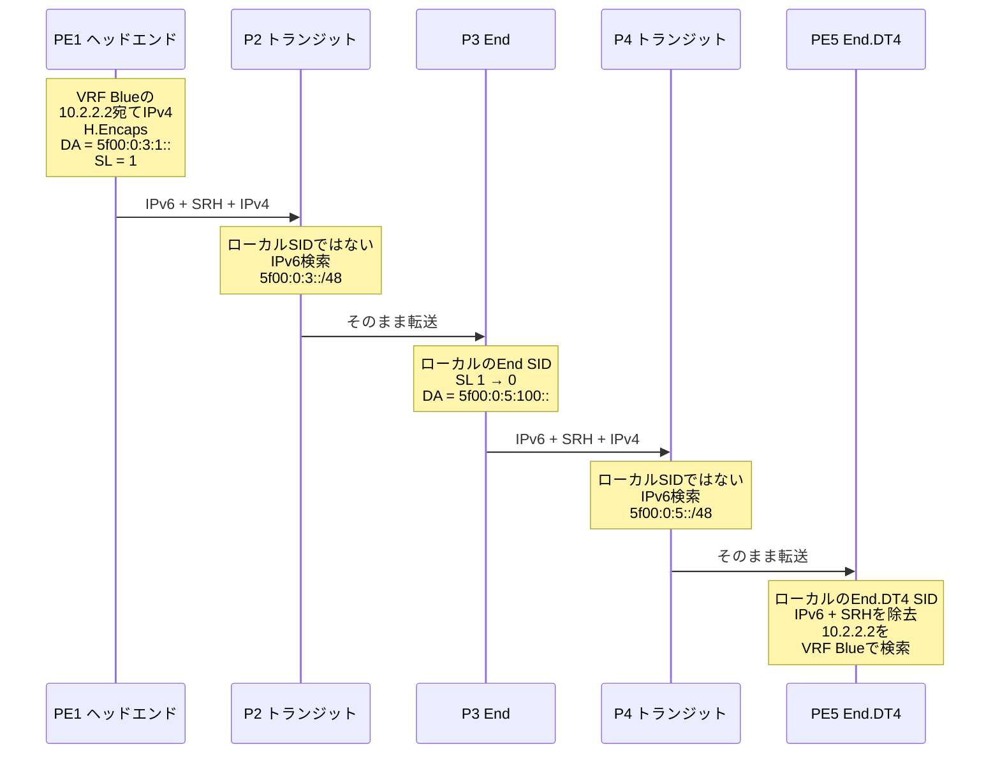

# SRv6とは

**SRv6（Segment Routing over IPv6）**は、*セグメント*と呼ばれる命令の順序付きリストをIPv6パケット自体に書き込み、トラフィックの経路と処理をプログラムする技術です。各命令は128ビットのIPv6アドレス（**SID**）で表されます。ルーターはパケットの宛先アドレスに入っている命令を実行し、次の命令に置き換えます。そのため、経路制御、VPN、高速迂回（Fast Reroute）を、コアでのフローごとの状態保持なしに、LDPやRSVP-TE、MPLSデータプレーンを使わずに実現できます。SRv6はIETF標準（[RFC 8402](../rfcs/rfc8402.md)、[RFC 8754](../rfcs/rfc8754.md)、[RFC 8986](../rfcs/rfc8986.md)）であり、通常のIPv6転送の上に成り立っています。

!!! abstract "このページの内容"
    1. [SRv6の概要](#srv6-at-a-glance)
    2. [SRv6が生まれた理由](#why-srv6-exists)
    3. [SRv6の仕組み：構成要素](#how-srv6-works)
    4. [SRv6パケットの転送をホップごとに追う](#packet-walk)
    5. [uSID：SIDを圧縮したSRv6](#usid)
    6. [SRv6とIPv6の違い](#srv6-vs-ipv6)、[SRv6とMPLS・SR-MPLSの違い](#srv6-vs-mpls)
    7. [SRv6の用途](#use-cases)、[SRv6の導入事例](#who-uses-srv6)
    8. [知っておくべきトレードオフ](#trade-offs)
    9. [SRv6を試すには](#how-to-try)
    10. [よくある質問](#faq)

## SRv6の概要 {#srv6-at-a-glance}

| | |
|---|---|
| **概要** | Segment Routing（[RFC 8402](../rfcs/rfc8402.md)）をIPv6データプレーンに適用したもの |
| **基本的な考え方** | 送信元が、経路とサービスをIPv6アドレス（SID）のリストとしてパケットに書き込む |
| **命令の形式** | 128ビットのSID = Locator（どこへ）+ Function（何をするか）+ Arguments（任意のデータ） |
| **ヘッダー** | 通常のIPv6ヘッダー。複数のSIDを運ぶ必要があるときはSegment Routing Header（SRH、[RFC 8754](../rfcs/rfc8754.md)）を追加 |
| **ビヘイビア** | End、End.X、End.DT4/DT6/DT46、End.DX2、H.Encapsなど。[RFC 8986](../rfcs/rfc8986.md)で定義 |
| **コントロールプレーン** | IS-IS（[RFC 9352](../rfcs/rfc9352.md)）、OSPFv3（[RFC 9513](../rfcs/rfc9513.md)）、BGPサービス（[RFC 9252](../rfcs/rfc9252.md)）、SR Policy（[RFC 9256](../rfcs/rfc9256.md)）。LDPやRSVP-TEは不要 |
| **圧縮** | uSID／圧縮SID（[RFC 9800](../rfcs/rfc9800.md)）：1つの128ビットアドレスに複数の命令を格納 |
| **SID用アドレスブロック** | `5f00::/16`。IANAがSRv6のSID用に予約（[RFC 9602](../rfcs/rfc9602.md)） |
| **主な用途** | トラフィックエンジニアリング、L3VPN/EVPN、TI-LFAによる高速迂回、ネットワークスライシング、5Gトランスポート、AIファブリック |
| **導入している組織** | ソフトバンク、Bell Canada、Swisscom、China Mobileなどの通信事業者、Microsoft、Meta、OpenAIのクラウド・AIネットワーク（[導入事例](../use-cases/deployments.md)、英語） |

### IPv6 Segment Routing、Segment Routing v6、SRv6は同じ技術 {#one-technology}

SRv6は**IPv6 Segment Routing**、**Segment Routing v6**、**SR v6**と呼ばれることもありますが、いずれも同じIETFの技術を指しています。Segment Routingには2つのデータプレーンがあります。

| 目にする名称 | 意味 |
|--------------|------|
| **SRv6**、Segment Routing over IPv6、IPv6 Segment Routing、Segment Routing v6、SR v6 | セグメントはIPv6アドレス。リストは宛先アドレスと、必要に応じてSRH（[RFC 8754](../rfcs/rfc8754.md)）で運ばれる |
| **SR-MPLS**、Segment Routing MPLS | セグメントはラベルスタック上のMPLSラベル（[RFC 8660](https://www.rfc-editor.org/rfc/rfc8660)） |

「v6」はデータプレーンのIPバージョンを表しており、Segment Routingの第6版という意味ではありません。IS-IS/OSPFv3の拡張、[Flex-Algo](../topics/flex-algorithm.md)、[TI-LFA](../topics/ti-lfa.md)、[SR Policy](../topics/sr-policy.md)といったコントロールプレーンの機能は両者で共通です。そのため、ベンダーのドキュメントでは両方が1つの「Segment Routing」ガイドにまとめられていることがよくあります。

## SRv6が生まれた理由 {#why-srv6-exists}

従来のMPLSによるサービスプロバイダーネットワークでは、「選んだ経路でパケットを運び、正しいVPNに届ける」という本来1つの仕事のために、4〜5種類のプロトコルを動かしています。

| 役割 | 従来のMPLSネットワーク | SRv6ネットワーク |
|------|------------------------|------------------|
| トポロジーと到達性 | IS-ISまたはOSPF | IS-ISまたはOSPFv3。SRv6のLocatorも広告する |
| トランスポートラベル | LDP。FECごと・ホップごとにラベル | 不要。Locatorは通常のIPv6プレフィックス |
| トラフィックエンジニアリング | RSVP-TE。すべての中継ルーターがトンネルの状態を保持 | SR Policy。状態はヘッドエンドだけが持つ |
| VPNサービス | VPNラベル付きのBGP | SRv6サービスSID付きのBGP（[RFC 9252](../rfcs/rfc9252.md)） |
| 高速迂回 | RSVP-TE FRRやLFA。カバーできないケースがある | [TI-LFA](../topics/ti-lfa.md)。トポロジーに依存せず全体をカバー |
| データプレーン | MPLS。各ドメインでホップごとに有効化が必要 | IPv6。中継ルーターはIPv6を転送できればよい |

プロトコルが1つ増えるたびに、状態、設定、障害の要因も増えます。最も負担が大きいのはRSVP-TEです。*N*台のエッジルーター間をフルメッシュのトンネルで結ぶと、トンネル数はおよそ*N²*本になり、中継ルーターは自分を通るすべてのトンネルの状態を保持しなければなりません。さらに、MPLSはドメインの境界で途切れます。データセンター、サーバー、多くのアクセス網は素のIPで動いているため、境界ごとにVXLAN、GRE、inter-ASオプションなどでサービスをつなぎ合わせる必要があります。

[Segment Routing](../rfcs/rfc8402.md)は**ソースルーティング**によって状態の問題を解決しました。ヘッドエンドが経路をパケットに書き込み、コアは経路ごとの状態を持ちません。ただしSR-MPLSでは依然としてすべての区間でMPLSが必要です。SRv6はさらに一歩進め、命令をIPv6アドレスとして表現します。その結果、次のことが可能になります。

- **エンドツーエンドで単一のデータプレーン。** WAN、メトロ、データセンター、さらにはLinuxホストまで、同じカプセル化で通せます。IPv4トラフィックはペイロードとして運ばれます。
- **サービスがアドレスに入る。** SRv6のSIDは「デカプセル化してVRF Blueで検索する」といった意味を持てるため、VPNに別のラベルは要りません。
- **Locatorを集約できる。** 通常のIPv6プレフィックスと同じように集約できるため、複数エリア・複数ドメインの大規模ネットワークでもスケールしやすくなります。
- **ネットワークをプログラムできる。** 事業者やアプリケーションが命令を組み合わせて「ネットワークプログラム」を作れます（[RFC 8986](../rfcs/rfc8986.md)）。

!!! tip "わかりやすいたとえ"
    SRv6は、カーナビで経由地を設定したルートのようなものです。ドライバー（ヘッドエンド）がいくつかの経由地を入力します。経由地と経由地の間はカーナビが最適な道（IGPの最短経路）を選び、途中の道路は全体の行程を知る必要がありません。経由地では「同乗者を乗せる」「高速レーンに入る」といった何かが起きます。SRv6では、それがSIDのFunctionです。

## SRv6の仕組み：構成要素 {#how-srv6-works}

### セグメントとSID {#segments-and-sids}

**セグメント**は1つの命令です。SRv6では、各セグメントを**SID**（Segment Identifier）で識別します。SIDはIPv6アドレスと同じ形式で書く128ビットの値で、[RFC 8986](../rfcs/rfc8986.md)はこれを3つの部分に分けています。

<figure class="srv6-figure" style="width:100%">
<svg viewBox="0 0 760 222" role="img" aria-labelledby="sidfig-ja-title sidfig-ja-desc" xmlns="http://www.w3.org/2000/svg" style="width:100%;height:auto;max-width:760px">
<title id="sidfig-ja-title">SRv6 SIDの構造</title>
<desc id="sidfig-ja-desc">128ビットのSID 5f00:0:5:100:: を、32ビットのブロック、16ビットのノードID、16ビットのFunction、64ビットのArgumentsに分けた図。ブロックとノードIDがLocator 5f00:0:5::/48（行き先を示すルーティング可能なプレフィックス）を構成し、Functionはそこで何をするかを、Argumentsは任意のデータを表す。</desc>
<style>
.sidf-a{fill:var(--md-primary-fg-color);fill-opacity:.10;stroke:var(--md-primary-fg-color);stroke-width:1.5}
.sidf-b{fill:var(--md-primary-fg-color);fill-opacity:.24;stroke:var(--md-primary-fg-color);stroke-width:1.5}
.sidf-c{fill:none;stroke:var(--md-default-fg-color--light);stroke-width:1.5;stroke-dasharray:5 4}
.sidf-hex{fill:var(--md-default-fg-color);font-family:var(--md-code-font-family,monospace);font-size:20px}
.sidf-bits{fill:var(--md-default-fg-color--light);font-size:14px}
.sidf-name{fill:var(--md-default-fg-color);font-size:15px;font-weight:700}
.sidf-note{fill:var(--md-default-fg-color--light);font-size:14px}
.sidf-br{fill:none;stroke:var(--md-default-fg-color--light);stroke-width:1.3}
.sidf-sid{fill:var(--md-default-fg-color);font-family:var(--md-code-font-family,monospace);font-size:16px}
</style>
<text class="sidf-bits" x="100" y="28" text-anchor="middle">32ビット</text>
<text class="sidf-bits" x="230" y="28" text-anchor="middle">16ビット</text>
<text class="sidf-bits" x="365" y="28" text-anchor="middle">16ビット</text>
<text class="sidf-bits" x="595" y="28" text-anchor="middle">64ビット</text>
<rect class="sidf-a" x="20" y="38" width="160" height="48" rx="4"/>
<rect class="sidf-a" x="180" y="38" width="100" height="48"/>
<rect class="sidf-b" x="280" y="38" width="170" height="48"/>
<rect class="sidf-c" x="450" y="38" width="290" height="48" rx="4"/>
<text class="sidf-hex" x="100" y="68" text-anchor="middle">5f00:0000</text>
<text class="sidf-hex" x="230" y="68" text-anchor="middle">0005</text>
<text class="sidf-hex" x="365" y="68" text-anchor="middle">0100</text>
<text class="sidf-hex" x="595" y="68" text-anchor="middle">0000:0000:0000:0000</text>
<text class="sidf-note" x="100" y="106" text-anchor="middle">SIDブロック</text>
<text class="sidf-note" x="230" y="106" text-anchor="middle">ノードID</text>
<path class="sidf-br" d="M22 116 v8 H278 v-8"/>
<path class="sidf-br" d="M282 116 v8 H448 v-8"/>
<path class="sidf-br" d="M452 116 v8 H738 v-8"/>
<text class="sidf-name" x="150" y="146" text-anchor="middle">Locator：どこへ行くか</text>
<text class="sidf-note" x="150" y="166" text-anchor="middle">5f00:0:5::/48（通常の経路）</text>
<text class="sidf-name" x="365" y="146" text-anchor="middle">Function：何をするか</text>
<text class="sidf-note" x="365" y="166" text-anchor="middle">0x100 = End.DT4、VRF Blue</text>
<text class="sidf-name" x="595" y="146" text-anchor="middle">Arguments：任意のデータ</text>
<text class="sidf-note" x="595" y="166" text-anchor="middle">多くのビヘイビアでは0</text>
<text class="sidf-sid" x="380" y="205" text-anchor="middle">1つのIPv6アドレスとして表記：5f00:0:5:100::</text>
</svg>
<figcaption>1つのSIDが1つの命令：「ノード5へ行き、デカプセル化して、内側のIPv4パケットをVRF Blueで検索せよ」</figcaption>
</figure>

| 部分 | 役割 | 例 |
|------|------|----|
| **Locator** | SIDを持つノードへ導く、ルーティング可能なプレフィックス。ドメイン共通の**ブロック**と**ノードID**で構成 | `5f00:0:5::/48` |
| **Function** | ノードが実行するビヘイビア（End、End.X、End.DT4など）を選ぶ | `0x100` → VRF BlueへのEnd.DT4 |
| **Arguments** | 一部のビヘイビアが使う、パケットごとの任意のデータ（EVPNのスプリットホライズンやMUPなど） | 通常は`0` |

各フィールドの長さは事業者が決めます。固定されているのは合計128ビットという点だけです。ルーターは自分の**Locator**を通常のIPv6プレフィックスとしてIGPで広告します。各ルーターは自分の**SID**をローカルのテーブル（RFC 8986の「My SID table」）で管理します。SIDはインターフェースアドレスではありません。また、[RFC 9602](../rfcs/rfc9602.md)によって`5f00::/16`が予約され、SIDを見分けやすく、フィルタリングしやすくなりました。詳しくは[SIDの構造](sid-structure.md)を参照してください。

### アクティブなセグメントは宛先アドレスにある {#active-segment}

これがSRv6の最も重要なポイントです。**IPv6の宛先アドレス（DA）には、常にアクティブなSID、つまり次に実行する命令が入っています。**そのSIDを持っていないルーターは、パケットを通常のIPv6パケットとしてルーティングします。SIDを持つルーターはFunctionを実行し、次のSIDをDAに書き込んで、再びパケットを転送します。

そのため、命令が1つだけのプログラムには追加のヘッダーがまったく要りません。DAにSIDが1つあれば十分です。2台のPE間のVPNトラフィックは、多くの場合まさにこの形になります。

### Segment Routing Header（SRH） {#srh}

経路に2つ以上のSIDが必要な場合、残りのSIDは**Segment Routing Header**で運ばれます。SRHはIPv6のルーティング拡張ヘッダー（Next Header 43、Routing Type 4）で、[RFC 8754](../rfcs/rfc8754.md)で定義されています。

```
 0                   1                   2                   3
 0 1 2 3 4 5 6 7 8 9 0 1 2 3 4 5 6 7 8 9 0 1 2 3 4 5 6 7 8 9 0 1
+-+-+-+-+-+-+-+-+-+-+-+-+-+-+-+-+-+-+-+-+-+-+-+-+-+-+-+-+-+-+-+-+
|  Next Header  |  Hdr Ext Len  | Routing Type=4| Segments Left |
+-+-+-+-+-+-+-+-+-+-+-+-+-+-+-+-+-+-+-+-+-+-+-+-+-+-+-+-+-+-+-+-+
|  Last Entry   |    Flags      |              Tag              |
+-+-+-+-+-+-+-+-+-+-+-+-+-+-+-+-+-+-+-+-+-+-+-+-+-+-+-+-+-+-+-+-+
|        Segment List[0]  (last SID of the path, 128 bits)      |
+-+-+-+-+-+-+-+-+-+-+-+-+-+-+-+-+-+-+-+-+-+-+-+-+-+-+-+-+-+-+-+-+
|                              ...                              |
+-+-+-+-+-+-+-+-+-+-+-+-+-+-+-+-+-+-+-+-+-+-+-+-+-+-+-+-+-+-+-+-+
|        Segment List[n]  (first SID of the path, 128 bits)     |
+-+-+-+-+-+-+-+-+-+-+-+-+-+-+-+-+-+-+-+-+-+-+-+-+-+-+-+-+-+-+-+-+
|              Optional TLVs (e.g. HMAC, padding)               |
+-+-+-+-+-+-+-+-+-+-+-+-+-+-+-+-+-+-+-+-+-+-+-+-+-+-+-+-+-+-+-+-+
```

| フィールド | 役割 |
|------------|------|
| **Segments Left（SL）** | アクティブなSIDのインデックス。エンドポイントを通るたびに1ずつ減る |
| **Last Entry** | Segment Listの最後の要素のインデックス |
| **Segment List** | SIDのリスト。**逆順**に格納され、`[0]`が最後のSID、`[n]`が最初のSID |
| **Tag / Flags** | パケットのマーキング用。現時点で定義済みのフラグはない |
| **TLV** | 任意のデータ。SRHを認証するHMAC TLVなど |

カプセル化したトラフィックのオーバーヘッドは、外側IPv6ヘッダーの**40バイト**、SRHの固定部分**8バイト**、リスト内の**SID 1つにつき16バイト**です。ただし、実際のSRHはこれより小さいか、まったくないことも多くあります。

- **H.Encaps.Red**（Reduced Encapsulation）は、最初のSIDがすでにDAに入っているため、それをSRHから省きます。SIDが1つだけならSRH自体がなくなります。
- **uSID**は1つのアドレスに複数の命令を詰め込むため、多くの経路でSRHが不要になります。[後述](#usid)を参照してください。

すべてのフィールドとPSP/USP/USDフレーバーについては[SRHとパケットウォーク](srh-packet-walk.md)で解説しています。

### 3つの役割：送信元、トランジット、エンドポイント {#three-roles}

| 役割 | ノードの処理 | SRv6対応が必要か |
|------|--------------|:----------------:|
| **送信元ノード／ヘッドエンド** | パケットを分類し、（BGP、SR Policy、コントローラーから得た）SIDリストを選び、外側IPv6ヘッダーとSRHを付ける（H.Encaps） | 必要 |
| **トランジットノード** | DAに対して通常のIPv6最長一致検索を行って転送する。SRHは見ない（[RFC 8754 §4.2](../rfcs/rfc8754.md)） | **不要**。IPv6だけでよい |
| **セグメントエンドポイント** | DAが自分のローカルSIDに一致するので、ビヘイビアを実行する（SLとDAの更新、デカプセル化、クロスコネクトなど） | 必要 |

トランジットノードにはIPv6以外何も求められないため、SRv6はSRv6をまったく知らないネットワーク区間も通過できます。これは実運用上、MPLSとの大きな違いです。

### ネットワークプログラミング：命令としてのSID {#network-programming}

[RFC 8986](../rfcs/rfc8986.md)は、SIDが*何をできるか*を定義しています。Segment Listは小さなプログラムであり、各SIDはその中の1つの命令です。

| ビヘイビア | 意味 | 主な用途 |
|------------|------|----------|
| **End** | 次のSIDに進む（SLを減らし、次のSIDをDAにコピー） | ノードを経由させる（ルーズなTE） |
| **End.X** | Endと同じだが、指定した隣接リンクから送出する | ストリクトなTE、TI-LFAの迂回経路 |
| **End.DT4 / End.DT6 / End.DT46** | デカプセル化し、内側のパケットをVRFテーブルで検索する | L3VPN |
| **End.DX4 / End.DX6** | デカプセル化し、指定したネクストホップへ送る | CE単位のL3VPN |
| **End.DX2 / End.DT2U / End.DT2M** | デカプセル化したイーサネットフレームをクロスコネクトやブリッジへ渡す | EVPN VPWS / E-LAN |
| **End.B6.Encaps** | 別のSR Policy（Binding SID）を適用する | スケーリング、ドメイン間TE |
| **H.Encaps / H.Encaps.Red** | ヘッドエンドでパケットをIPv6 + SRHで包む | SRv6への引き込み |

その後のRFCでは、圧縮SID（[RFC 9800](../rfcs/rfc9800.md)）、モバイルユーザープレーン（[RFC 9433](../rfcs/rfc9433.md)）、マルチキャストのレプリケーション（[RFC 9524](../rfcs/rfc9524.md)）向けのビヘイビアも追加されています。全一覧は[Network Programming](../topics/network-programming.md)（英語）を参照してください。

### コントロールプレーン：ヘッドエンドはどのSIDを使うかをどう知るのか {#control-plane}

SRv6には独自のシグナリングプロトコルがありません。必要な情報は既存のプロトコルが運びます。

- **IS-IS / OSPFv3**は、各ノードのLocatorとEnd/End.XのSIDを広告します（[RFC 9352](../rfcs/rfc9352.md)、[RFC 9513](../rfcs/rfc9513.md)）。[Flex-Algo](../topics/flex-algorithm.md)を使うと、Locatorごとに制約付きの独自トポロジーを持たせられます。
- **BGP**は、VPNやEVPNの経路と一緒にサービスSIDを広告します（[RFC 9252](../rfcs/rfc9252.md)）。最もシンプルな**SRv6 BE（ベストエフォート）**では、PEが対向PEのサービスSIDをDAに入れるだけで、あとはIGPの最短経路が運びます。
- **SR Policy**（[RFC 9256](../rfcs/rfc9256.md)）は、**SRv6 TE**用の明示的なSIDリストを定義します。コントローラーはBGP-LS（[RFC 9514](../rfcs/rfc9514.md)）で得たトポロジーをもとに、BGP（[RFC 9830](../rfcs/rfc9830.md)）やPCEP（[RFC 9603](../rfcs/rfc9603.md)）でポリシーを配布できます。トラフィックはColorによってポリシーに振り分けられます。

## SRv6パケットの転送をホップごとに追う {#packet-walk}

完全な例を見てみましょう。L3VPNのパケットを、トラフィックエンジニアリングで**P3**経由の経路に流します。たとえばP3が低遅延の経路上にある場合です。

- **PE1**（ヘッドエンド）は、VRF Blueの`10.2.2.0/24`が**PE5**の配下にあり、サービスSIDが`5f00:0:5:100::`（End.DT4）であることをBGPで学習しています。
- PE1のSR Policyは、PE5へはP3を経由するよう指定しています。P3のEnd SIDは`5f00:0:3:1::`です。
- **P2**と**P4**はトランジットルーターです。IS-ISで学習したLocatorプレフィックス`5f00:0:3::/48`と`5f00:0:5::/48`しか知りません。



PE1が組み立てるパケットは次のとおりです。

```
外側IPv6   SA = 2001:db8::1 (PE1)   DA = 5f00:0:3:1::   Next Header = 43
SRH        Routing Type = 4   Segments Left = 1   Last Entry = 1
           Segment List[0] = 5f00:0:5:100::   (PE5: End.DT4, VRF Blue)
           Segment List[1] = 5f00:0:3:1::     (P3: End)
内側IPv4   10.1.1.1 → 10.2.2.2
ペイロード
```

| ステップ | ノード | 役割 | 処理後のDA | SL | 処理内容 |
|:--------:|--------|------|------------|:--:|----------|
| 1 | PE1 | ヘッドエンド、H.Encaps | `5f00:0:3:1::` | 1 | IPv4パケットをIPv6 + SRHで包み、最初のSIDをDAに入れる |
| 2 | P2 | トランジット | `5f00:0:3:1::` | 1 | 通常のIPv6最長一致検索。SRHは無視 |
| 3 | P3 | エンドポイント、End | `5f00:0:5:100::` | 0 | DAがローカルSIDに一致：SLを減らし、`Segment List[0]`をDAにコピーし、Hop Limitを減らす |
| 4 | P4 | トランジット | `5f00:0:5:100::` | 0 | PE5のLocatorに向けて通常のIPv6検索 |
| 5 | PE5 | エンドポイント、End.DT4 | （デカプセル化） | – | 外側IPv6ヘッダーとSRHを外し、VRF Blueのテーブルで10.2.2.2を転送 |

!!! info "実際の運用で変わる点"
    - **PSPフレーバー：** P3は最後から2番目のエンドポイントなので、Penultimate Segment Popを使うとSRHを外します。この場合PE5は、DAが自分のEnd.DT4 SIDになっただけのシンプルなIPv6パケットを受け取ります。
    - **オーバーヘッド：** この例では40 + 8 + 2 × 16 = **80バイト**です。H.Encaps.Redなら64バイト、uSIDなら2つの命令がDAに収まるので**40バイトでSRHなし**になります。
    - **TEを使わない場合（SRv6 BE）：** PE1はDAに`5f00:0:5:100::`だけを入れ、SRHは付けません。IGPの最短経路がパケットをPE5まで運びます。

## uSID：SIDを圧縮したSRv6 {#usid}

初期のSRv6はオーバーヘッドの大きさを批判されました。SID 1つにつき16バイトは長いTE経路ではすぐに膨らみますし、一部のハードウェアは少数のSIDしか付加できません。この問題を解決するのが**マイクロSID（uSID）**です。uSIDは[RFC 9800](../rfcs/rfc9800.md)のNEXT-C-SIDフレーバーにあたり、同RFCではREPLACE-C-SIDフレーバー（G-SRv6）も定義されています。

一般的な**F3216**形式では、1つの128ビットアドレスに32ビットのuSIDブロックと、最大**6個の16ビットのマイクロ命令**が入ります。

```
fcbb:bb00 : 0003 : 0005 : e004 : 0000 : 0000 : 0000
 ブロック    P3     PE5    PE5のVRFデカプセル   コンテナの終端
```

各ノードは自分のuSIDを消費し、残りのアドレスを左に**シフト**してから、新しいDAで転送します。トランジットノードは引き続き通常のIPv6検索を行うだけです。楽天モバイル、Swisscom、Bell Canada、Telefônica VIVO、Rijkswaterstaatなど最近の導入事例ではuSIDが使われており、典型的なVPN over TEの経路はIPv6ヘッダーだけに収まります。

→ オーバーヘッドの比較表を含む詳しい解説は[uSID](usid.md)を参照してください。

## SRv6とIPv6の違い {#srv6-vs-ipv6}

SRv6は新しいIPバージョンでも、IPv6の代替でも**ありません**。IPv6の*使い方*の1つです。アドレスに「命令」という第2の意味を持たせ、Routing Type 4のルーティングヘッダーでそのリストを運びます。

| | IPv6 | SRv6 |
|---|------|------|
| **何か** | インターネットプロトコル バージョン6（[RFC 8200](https://www.rfc-editor.org/rfc/rfc8200)） | IPv6パケットで実装したSegment Routing |
| **宛先アドレスの意味** | ホストまたはインターフェース | アクティブな命令（ノード*と*Function） |
| **経路の選び方** | ホップバイホップ。各ルーターが次ホップを選ぶ | 送信元が経由地を選ぶ。経由地の間は通常のIPv6ルーティング |
| **ヘッダー** | IPv6ヘッダー + 任意の拡張ヘッダー | 同じ。必要に応じてSRH（Routing Type 4）を追加 |
| **ルーターの対応** | すべてのIPv6ルーター | ヘッドエンドとエンドポイントはSRv6対応が必要。トランジットはIPv6だけでよい |
| **サービス** | 組み込みなし | VPN、TE、高速迂回、スライシングをSIDで表現 |

## SRv6とMPLS・SR-MPLSの違い {#srv6-vs-mpls}

| | MPLS（LDP / RSVP-TE） | SR-MPLS | SRv6 |
|---|---|---|---|
| **データプレーン** | MPLSラベル | MPLSラベル | IPv6 |
| **命令のサイズ** | 4バイトのラベルエントリー | 4バイトのラベルエントリー | 16バイトのSID、またはuSIDなら2バイト |
| **ラベル／SIDの配布** | LDP、RSVP-TE | IGP拡張 | IGP拡張（Locatorはプレフィックス） |
| **コアでのTEの状態** | トンネルごと（RSVP-TE） | なし | なし |
| **IPだけのネットワークを通過** | 不可 | 不可 | 可能 |
| **ノードアドレスの集約** | LDPでは不可（/32ホスト経路が必要） | 不可（ノードごとのPrefix SID） | 可能。Locatorは集約できるプレフィックス |
| **ネットワークプログラミング** | VPNラベルのみ | 限定的 | 豊富（Function + Arguments） |
| **カプセル化のオーバーヘッド** | 最小 | 最小 | IPv6ヘッダー最低40バイト。SIDごとのコストはuSIDで解消 |
| **成熟度** | 数十年の実績 | 広く導入済み | 2019年から商用。急速に拡大中 |

SRv6は、固定ヘッダーが大きくなる代わりに、どこでも同じデータプレーンを使え、LDPとRSVP-TEが不要になります。使い分けの指針を含む詳しい比較は[SRv6 vs SR-MPLS](srv6-vs-sr-mpls.md)、移行方法は[Interworking & Migration](../topics/interworking-migration.md)（英語）を参照してください。

## SRv6の用途 {#use-cases}

| ユースケース | SRv6がもたらすもの | 詳しく（AI以外は英語） |
|--------------|--------------------|------------------------|
| **トラフィックエンジニアリング** | 中継ノードに状態を持たせない明示的・制約付きの経路。SR PolicyとFlex-Algoによる低遅延経路や分離経路 | [Traffic Engineering](../use-cases/traffic-engineering.md)、[SR Policy](../topics/sr-policy.md)、[Flex-Algo](../topics/flex-algorithm.md) |
| **L3VPNとEVPN** | サービスSIDで運ぶVPN・EVPNサービス。MPLSもVXLANも不要 | [VPN Services](../use-cases/vpn-services.md)、[BGP Overlay](../topics/bgp-overlay-services.md)、[EVPN Multihoming](../topics/evpn-multihoming.md) |
| **高速迂回** | どんなトポロジーでも、収束後の経路に沿って迂回するTI-LFA保護（通常50ミリ秒以下） | [TI-LFA](../topics/ti-lfa.md)、[Micro-Loop Avoidance](../topics/micro-loop-avoidance.md) |
| **ネットワークスライシング** | Flex-Algo、QoS、SR Policyによるスライスごとのトポロジーと SLA | [Network Slicing](../use-cases/network-slicing.md) |
| **5GトランスポートとMUP** | RANからコアまで1つのトランスポート。SRv6 MUPがGTP-Uトンネルを置き換える（[RFC 9433](../rfcs/rfc9433.md)） | [5G Transport](../use-cases/5g-transport.md) |
| **AIファブリック** | GPUファブリック内やAIデータセンター間で、フローごとに決定論的な経路を割り当てる | [AIのためのSRv6](ai.md)、[AI/ML Networks](../use-cases/ai-networking.md) |
| **サービスチェイニング** | ファイアウォールなどのネットワーク機能をSIDとしてリストに入れ、トラフィックを通過させる | [Service Chaining](../use-cases/service-chaining.md) |
| **クラウドとホスト** | サーバーやクラウドのVPCからバックボーンまでSRv6でつなぐ | [Cloud Backbone](../use-cases/cloud-native-backbone.md)、[Host-Based SRv6](../topics/host-based-srv6.md) |

## SRv6の導入事例 {#who-uses-srv6}

SRv6は2019年から商用サービスで使われており、次のような組織が導入しています。

- **通信事業者：** ソフトバンク、楽天モバイル、China Mobile、Reliance Jio、Bell Canada、Swisscom、Iliad、Telefônica VIVO（ブラジル）、そしてすべてのドメインをSRv6に移行中のVerizonなど。
- **クラウド・AIネットワーク：** Microsoft（AIデータセンターFairwater）、OpenAI（10万GPU超のクラスターで使うMRC）、Meta（バックボーンのTE）、Google（AIファブリックVirgo）、Alibaba Cloud、Nebius。
- **公共部門：** オランダのRijkswaterstaat。国のバックボーンをMPLSからSRv6 uSIDに移行しました。

各事例と元の発表へのリンクは[Real-World Deployments](../use-cases/deployments.md)（英語）にまとめています。実装には、Cisco IOS XR / IOS XE、Juniper Junos、Nokia SR OS、Arista EOS、Huawei、Linuxカーネル、FRRouting、VPP、SONiCなどがあります。[Implementations](../implementations/index.md)（英語）を参照してください。

### 簡単な歴史 {#history}

| 年 | 出来事 |
|:--:|--------|
| 2013 | Segment Routingを標準化するため、IETFにSPRINGワーキンググループが発足 |
| 2017 | Linux 4.10がSRv6データプレーンを搭載。4.14でエンドポイントビヘイビアを追加 |
| 2018 | [RFC 8402](../rfcs/rfc8402.md)（Segment Routingアーキテクチャ） |
| 2019 | 初の商用SRv6ネットワーク。イタリアのIliadによるグリーンフィールド網など |
| 2020 | [RFC 8754](../rfcs/rfc8754.md)（Segment Routing Header） |
| 2021 | [RFC 8986](../rfcs/rfc8986.md)（SRv6 Network Programming） |
| 2022〜2023 | BGPサービス（[RFC 9252](../rfcs/rfc9252.md)）、SR Policy（[RFC 9256](../rfcs/rfc9256.md)）、IS-IS（[RFC 9352](../rfcs/rfc9352.md)）、MUP（[RFC 9433](../rfcs/rfc9433.md)）、OSPFv3（[RFC 9513](../rfcs/rfc9513.md)） |
| 2024 | [RFC 9602](../rfcs/rfc9602.md)がSRv6のSID用に`5f00::/16`を予約 |
| 2025 | 圧縮SID（[RFC 9800](../rfcs/rfc9800.md)）とTI-LFA（[RFC 9855](../rfcs/rfc9855.md)）が発行。MicrosoftとOpenAIのAIスーパーコンピューターでSRv6が稼働 |

## 知っておくべきトレードオフ {#trade-offs}

SRv6にもコストはあります。公平に評価するには、次の点を押さえておく必要があります。

- **MTU：** カプセル化で最低40バイト、SRHがあればさらに増えます。コアのリンクはエッジより大きなMTUが必要なので、事前に設計しておきましょう（[Performance & Scaling](../topics/performance-scaling.md)、英語）。
- **ハードウェアのSID数の上限：** ASICが付加・処理できるSIDの数には限りがあります。uSIDでこの制約はほぼ解消されるため、使う機器がuSIDに対応しているか確認してください。
- **負荷分散：** コアルーターは外側IPv6ヘッダーでハッシュを計算するため、ECMPを機能させるにはヘッドエンドが内側パケットから**フローラベル**を設定する必要があります。
- **セキュリティ境界：** MPLSと同様、SRv6は自ドメインを信頼する前提で動きます。境界でのフィルタリングは必須です（よくある質問と[Security](../topics/security.md)（英語）を参照）。
- **運用：** SIDはIPv6アドレスなので、pingやtracerouteがそのまま使えます（[RFC 9259](../rfcs/rfc9259.md)）。ただし、監視ツールの中にはまだMPLSを前提にしているものもあります。[OAM & Troubleshooting](../topics/oam-troubleshooting.md)（英語）を参照してください。

## SRv6を試すには {#how-to-try}

SRv6はノートPCでも動かせます。LinuxカーネルにはSRv6がネイティブに実装されています。

```bash
# ヘッドエンド：10.2.2.0/24 を P3 の End SID、PE5 の End.DT4 SID の順に通す
ip route add 10.2.2.0/24 vrf blue encap seg6 mode encap \
  segs 5f00:0:3:1::,5f00:0:5:100:: dev eth0

# P3：End SID を設定
ip -6 route add 5f00:0:3:1::/128 encap seg6local action End dev eth0

# 出口の PE5：End.DT4 SID を VRF blue に関連付け（net.vrf.strict_mode=1 が必要）
ip -6 route add 5f00:0:5:100::/128 encap seg6local \
  action End.DT4 vrftable 100 dev blue
```

iproute2には経路の順番どおりにセグメントを指定すれば、逆順のSRHを自動で組み立ててくれます。そのまま動く環境は次のページにあります（いずれも英語）。

- [SRv6 on Linux](../implementations/linux-kernel.md)：カーネルバージョンごとの対応状況と、検証済みの2ネームスペース構成のラボ
- [netlab](../labs/netlab.md)：マルチベンダーのSRv6トポロジーを数分で構築
- [Containerlab](../labs/containerlab.md)、[GNS3](../labs/gns3.md)：自分でラボを組む
- [すべてのラボ](../labs/index.md)

## よくある質問 {#faq}

### ネットワークにおけるSRv6とは何ですか？

SRv6（Segment Routing over IPv6）は、入口のルーターがIPv6パケットに命令のリストを書き込むソースルーティング技術です。各命令はSIDと呼ばれる128ビットのIPv6アドレスです。ルーターは宛先アドレスにあるSIDを実行し、パケットを次のSIDへ転送します。これにより事業者は、MPLS、LDP、RSVP-TEを使わずに、通常のIPv6ネットワーク上でトラフィックエンジニアリング、VPN、高速迂回を実現できます。

### SRv6はどのように動作しますか？

ヘッドエンドのルーターが、宛先アドレスを最初のSIDにした外側IPv6ヘッダーでパケットをカプセル化します。経路に複数のSIDがある場合、残りはSegment Routing Headerに入ります。トランジットルーターは、通常のIPv6パケットと同じようにそのアドレスで転送します。SIDを持つルーターはそのFunctionを実行します。次のSIDに進む、特定のリンクから送出する、VPNにデカプセル化する、といった処理です。これを最後のSIDまで繰り返します。

### IPv6とSRv6の違いは何ですか？

IPv6はインターネットプロトコルそのものです。SRv6はIPv6の使い方の1つで、アドレスを命令としても扱い、IPv6のルーティング拡張ヘッダー（SRH、Routing Type 4）でその命令のリストを運べるようにしたものです。SRv6パケットはすべて正しいIPv6パケットであり、経路の途中のルーターは通常のIPv6転送ができれば十分です。SRv6への対応が必要なのは、SIDを付加・実行するノードだけです。

### SRv6はプロトコルですか？

独自のメッセージをやり取りするプロトコルという意味では、プロトコルではありません。SRv6はアーキテクチャであり、データプレーンです。Segment Routing Header（RFC 8754）付きのIPv6パケットと、標準化されたSIDのビヘイビア（RFC 8986）で構成されます。必要な情報は既存のプロトコルが運びます。LocatorはIS-ISやOSPFv3、VPNのサービスSIDはBGP、SR PolicyはBGPやPCEPです。

### SRv6はMPLSを置き換えますか？

置き換えることができます。SRv6は、VPN、トラフィックエンジニアリング、高速迂回など、事業者がMPLSで実現しているサービスを、MPLSデータプレーンやLDP、RSVP-TEなしで提供します。実際に、バックボーンをMPLSからSRv6へ移行した事業者や公共ネットワークもあります。ただし、MPLSやSR-MPLSは今も広く使われており、多くの移行ではインターワーキングゲートウェイや両方に対応したPEを使って、数年間は両者を併用します。

### SRv6は安全ですか？

SRv6の安全性は、周囲のフィルタリング次第です。MPLSと同様に信頼できるドメインを前提としている（RFC 8402、RFC 8754）ため、境界のルーターでは、外部から届いたSRH付きのパケットや内部のSID宛てのパケットを破棄する必要があります。RFC 9602の5f00::/16ブロックをSIDに使えば、このフィルターは簡単に書けます。また、信頼できないインフラを経由するリンクに備えて、SRHではSegment Listを認証するHMAC TLVを任意で使えます。

### SRv6のSIDとは何ですか？

SID（Segment Identifier）は、1つの命令を表す128ビットの値で、IPv6アドレスとして表記します。3つの部分からなり、Locatorがパケットを正しいノードへ導き、Functionがそこで実行するビヘイビア（たとえばVRFへデカプセル化するEnd.DT4）を選び、Argumentsが任意のデータを運びます。

### SRv6のuSIDとは何ですか？

uSID（マイクロSID）はSRv6の圧縮方式で、RFC 9800でNEXT-C-SIDフレーバーとして標準化されています。1つの128ビットIPv6アドレスに、16ビットの命令を最大6個まで詰め込みます。各ノードは自分の命令を消費して残りをシフトします。そのため、複数ホップのTE経路とVPNサービスを、SRHなしでIPv6の宛先アドレスだけに収められます。

## 関連ページ {#further-reading}

- :material-arrow-right: [SIDの構造](sid-structure.md)：128ビットSIDのフォーマットと`5f00::/16`ブロック
- :material-arrow-right: [SRHとパケットウォーク](srh-packet-walk.md)：SRHの全フィールドとPSP/USP/USDフレーバー
- :material-arrow-right: [uSID](usid.md)：マイクロSIDとRFC 9800
- :material-arrow-right: [SRv6 vs SR-MPLS](srv6-vs-sr-mpls.md)：両者の違いと使い分け
- :material-arrow-right: [AIのためのSRv6](ai.md)：AIネットワークでのSRv6の使われ方
- :material-arrow-right: [Network Programming](../topics/network-programming.md)：SRv6のすべてのビヘイビア *（英語）*
- :material-arrow-right: [Interworking & Migration](../topics/interworking-migration.md)：MPLSからSRv6への移行 *（英語）*
- :material-arrow-right: [Security](../topics/security.md)：フィルタリング、HMAC、攻撃手法 *（英語）*
- :material-arrow-right: [Implementations](../implementations/index.md)：Cisco、Juniper、Arista、Nokia、FRR、Linuxの設定ガイド *（英語）*

## 参考文献 {#references}

1. [RFC 8402 - Segment Routing Architecture](https://www.rfc-editor.org/rfc/rfc8402) - MPLSとIPv6の両データプレーンを対象とするSegment Routingのアーキテクチャと、SRドメインの信頼モデルを定義
2. [RFC 8754 - IPv6 Segment Routing Header (SRH)](https://www.rfc-editor.org/rfc/rfc8754.html) - SRH、送信元・トランジット・エンドポイントでの処理、HMAC TLVを規定
3. [RFC 8986 - SRv6 Network Programming](https://www.rfc-editor.org/rfc/rfc8986.html) - SIDの構造、エンドポイントとヘッドエンドのビヘイビア、PSP/USP/USDフレーバーを定義
4. [RFC 9252 - BGP Overlay Services Based on SRv6](https://www.rfc-editor.org/rfc/rfc9252.html) - L3VPNとEVPNのためにBGPでSRv6サービスSIDを広告する方法
5. [RFC 9602 - SRv6 Segment Identifiers in the IPv6 Addressing Architecture](https://www.rfc-editor.org/rfc/rfc9602.html) - SRv6のSID用に`5f00::/16`を予約
6. [RFC 9800 - Compressed SRv6 Segment List Encoding](https://www.rfc-editor.org/rfc/rfc9800.html) - NEXT-C-SID（uSID）とREPLACE-C-SIDによる圧縮を標準化
7. [What is SRv6 network programming? - APNIC Blog](https://blog.apnic.net/2020/05/01/what-is-srv6-network-programming/) - Clarence Filsfils氏による2020年のネットワークプログラミング入門 *（英語）*
