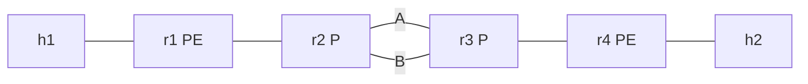
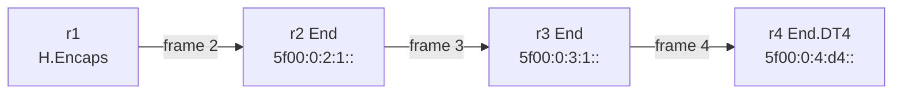
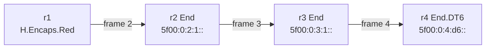
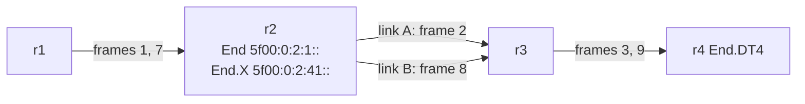
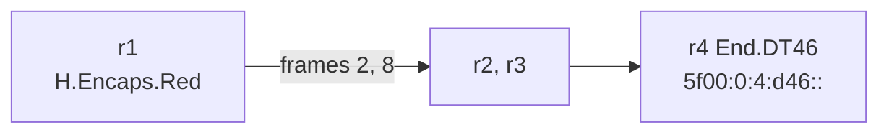
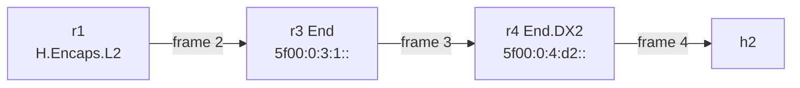
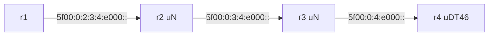
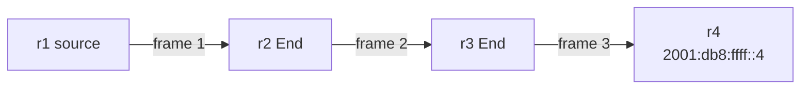
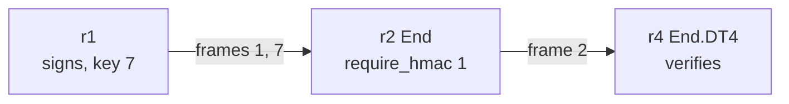

# SRv6 Packet Capture Library (pcap)

Nine SRv6 packet captures you can open in Wireshark, each with the topology, the exact commands that produced it, a packet-by-packet walkthrough and the display filters worth applying. Eight were **captured live** from a Linux 6.12 lab (network namespaces, iproute2 `seg6`/`seg6local`); one, the O-flag capture, is **synthetic** and says so in its name. Every frame carries a comment explaining what the node in front of it just did, so the files are self-explanatory even without this page.

The files are small (1–6 KB), use only documentation and SRv6 addressing (`2001:db8::/32`, `192.0.2.0/24`, `198.51.100.0/24`, `203.0.113.0/24`, `5f00::/16`) and are free to reuse under the site's [MIT license](https://github.com/eldaninavas/srv6.md/blob/main/LICENSE). The scripts that generate them are in [`tools/pcaps/`](https://github.com/eldaninavas/srv6.md/tree/main/tools/pcaps), and the captures themselves are browsable [on GitHub](https://github.com/eldaninavas/srv6.md/tree/main/docs/assets/pcaps) with a [`SHA256SUMS`](../assets/pcaps/SHA256SUMS) file.

## The Captures

| Capture | What it shows | Frames | Size |
|---------|---------------|:------:|-----:|
| [H.Encaps + End + End.DT4](#h-encaps-srh) | Three-SID SRH, Segments Left counting down hop by hop, IPv4 L3VPN | 10 | {{ pcap-size:srv6-h-encaps-srh-end-dt4.pcapng }} |
| [H.Encaps.Red + End.DT6](#h-encaps-red) | Reduced SRH (SL > Last Entry) and the no-SRH single-SID case, IPv6 L3VPN | 20 | {{ pcap-size:srv6-h-encaps-red-end-dt6.pcapng }} |
| [End.X vs End](#end-x) | The same router steering one flow onto a non-shortest link (both sides captured) | 12 | {{ pcap-size:srv6-end-x-adjacency.pcapng }} |
| [End.DT46 dual-stack](#end-dt46) | One VRF SID for IPv4 (next header 4) and IPv6 (next header 41) | 12 | {{ pcap-size:srv6-end-dt46-dual-stack.pcapng }} |
| [End.DX2 (L2)](#end-dx2) | Ethernet frames as SRv6 payload, next header 143 | 8 | {{ pcap-size:srv6-end-dx2-l2-ethernet.pcapng }} |
| [uSID (NEXT-C-SID)](#usid) | Container shift at each hop with no SRH, then a two-container SRH | 16 | {{ pcap-size:srv6-usid-next-csid.pcapng }} |
| [SRv6 ping and traceroute](#ping-traceroute) | ICMPv6 echo and traceroute with an SRH, Time Exceeded quoting the SRH | 18 | {{ pcap-size:srv6-ping-traceroute-srh.pcapng }} |
| [SRH HMAC TLV](#hmac) | HMAC-SHA256 TLV accepted, and the same flow without HMAC dropped | 7 | {{ pcap-size:srv6-srh-hmac-tlv.pcapng }} |
| [O-flag (synthetic)](#o-flag) | SRH Flags 0x20, the RFC 9259 O-flag. Crafted with Scapy | 3 | {{ pcap-size:synthetic-srv6-srh-o-flag.pcapng }} |

Each capture merges several interfaces into one pcapng, so one ping shows up once per link it crossed. Add **`frame.interface_name`** as a column (or read the `[r2-r1]` prefix of each frame comment) to see where each frame was seen.

## SRH Wireshark Display Filters

Wireshark dissects the Segment Routing Header as Routing Header type 4. These filters work in Wireshark and tshark 4.x; every one was checked against the captures on this page.

| Filter | Matches |
|--------|---------|
| `ipv6.routing.type == 4` | Any packet with an SRH |
| `ipv6.routing.segleft == 0 && ipv6.routing.type == 4` | SRH on its last segment (the next node decapsulates or delivers) |
| `ipv6.routing.srh.addr == 5f00:0:4:d4::` | A SID anywhere in the segment list |
| `ipv6.dst == 5f00::/16` | Packets addressed to an SRv6 SID, **with or without** an SRH (use your own SID block) |
| `ipv6.dst == 5f00::/16 && (ipv6.nxt == 4 \|\| ipv6.nxt == 41)` | Encapsulation with no SRH: single-SID H.Encaps.Red or uSID |
| `ipv6.routing.nxt == 4` / `== 41` / `== 143` | What the SRH carries: IPv4, IPv6, Ethernet |
| `ipv6.nxt == 143 \|\| ipv6.routing.nxt == 143` | L2 services (H.Encaps.L2, End.DX2), with or without an SRH |
| `ipv6.routing.segleft > ipv6.routing.srh.last_entry` | Reduced SRH (H.Encaps.Red): the active SID is only in the DA |
| `ipv6.routing.len > ipv6.routing.srh.last_entry*2+2` | SRH carrying TLVs (HMAC, padding): longer than its segment list |
| `ipv6.routing.srh.flags & 0x20` | O-flag set (RFC 9259) |
| `icmpv6.type == 3 && ipv6.routing` | Time Exceeded whose quoted packet had an SRH (traceroute through SRv6) |
| `frame.comment contains "End.X"` | Search the annotations in these files |

Useful custom columns: `ipv6.dst`, `ipv6.routing.segleft`, `ipv6.routing.srh.last_entry`, `ipv6.routing.nxt` and `frame.interface_name`. Right-click a field in the packet details pane and choose **Apply as Column**.

!!! info "What Wireshark 4.4 does not decode"
    Wireshark 4.4 (used to check these files) shows the SRH **Flags** as one byte and does **not** dissect SRH **TLVs**: the HMAC TLV in [the HMAC capture](#hmac) appears only as the extra length (`[Length: 80 bytes]` for two segments) and as raw bytes after the last address. It also has no notion of uSID containers: the DA is shown as a plain IPv6 address. Use the [SID Decoder](../tools/sid-decoder.md) to split a uSID DA into its parts.

The same matches in **tcpdump** (BPF), when the SRH directly follows the IPv6 header:

```bash
tcpdump -ni eth0 'ip6[6] == 43 and ip6[42] == 4'          # SRH present (routing type 4)
tcpdump -ni eth0 'ip6[6] == 43 and ip6[42] == 4 and ip6[43] == 0'   # Segments Left = 0
tcpdump -ni eth0 'dst net 5f00::/16'                      # to an SRv6 SID, SRH or not
tcpdump -ni eth0 'ip6[6] == 4 or ip6[6] == 41 or ip6[6] == 143'    # encapsulation without an SRH
```

## The Lab

All eight live captures come from one topology built from network namespaces on a single Linux host. r1 and r4 are PEs with a customer VRF `blue` (table 100); r2 and r3 are P routers joined by two parallel links. Static routes stand in for IS-IS, so every forwarding decision in the captures comes from the SRv6 data plane, not from a control protocol.



| Host | Addresses | Attached to |
|------|-----------|-------------|
| h1 | `192.0.2.10/24`, `2001:db8:a::10/64` (gateway `.1` / `::1` on r1) | r1, VRF blue |
| h2 | `198.51.100.10/24`, `2001:db8:b::10/64` (gateway `.1` / `::1` on r4) | r4, VRF blue |

| Item | Value |
|------|-------|
| Kernel / tools | Linux 6.12.7, iproute2 6.15.0, dumpcap/tshark 4.4.19 (Debian trixie container) |
| Locators | `5f00:0:N::/48` on router rN (SRv6 SID block `5f00::/16`, RFC 9602) |
| Outer source address | rN loopback `2001:db8:ffff::N` (`ip sr tunsrc set`) |
| Core links | r1–r2 `2001:db8:0:12::/64`, r2–r3 link A `2001:db8:0:23::/64`, link B `2001:db8:1:23::/64`, r3–r4 `2001:db8:0:34::/64` |
| Interface names | `<node>-<peer>`, so `r2-r1` is r2's interface toward r1 (link B: `r2-r3b`) |
| MAC addresses | `02:00:00:<node>:<peer>:00`, h1 = 10, h2 = 20 (link B ends in `0b`) |
| SID naming | End `5f00:0:N:1::`, End.X `5f00:0:2:41::`, End.DT4/DT6/DT46/DX2 `5f00:0:N:d4::` / `d6` / `d46` / `d2`, uSID uN `5f00:0:N::/48`, uDT46 `5f00:0:N:e000::/64` |

Regenerate everything with one command on a host where a container engine can run privileged containers (the SRv6 processing happens in the host kernel, so it needs root and kernel 6.1 or later; rootless Docker or Podman cannot create the namespaces):

```bash
git clone https://github.com/eldaninavas/srv6.md && cd srv6.md
tools/pcaps/run.sh            # all scenarios -> docs/assets/pcaps/
tools/pcaps/run.sh usid       # one scenario
```

The base topology is `topo_up` in [`lab.sh`](https://github.com/eldaninavas/srv6.md/blob/main/tools/pcaps/lab.sh); each section below lists the commands that scenario adds on top of it. Capture timestamps and SHA-256 values change on every run; the packet contents do not.

## H.Encaps with a Three-SID SRH { #h-encaps-srh }

The classic SRv6 L3VPN packet. r1 receives IPv4 from the customer in VRF blue and applies **H.Encaps**: a new outer IPv6 header plus an SRH listing three SIDs: End on r2, End on r3, End.DT4 on r4. Captured on five interfaces so the same ping can be followed through every hop: into r2 (`r2-r1`) and out of it (`r2-r3`), out of r3, and decapsulated at r4.



```bash
ip -n r2 -6 route add 5f00:0:2:1::/128 encap seg6local action End dev r2-r1
ip -n r3 -6 route add 5f00:0:3:1::/128 encap seg6local action End dev r3-r2
ip -n r4 -6 route add 5f00:0:4:d4::/128 encap seg6local action End.DT4 vrftable 100 dev blue
ip -n r1 route add 198.51.100.0/24 vrf blue encap seg6 mode encap \
    segs 5f00:0:2:1::,5f00:0:3:1::,5f00:0:4:d4:: dev r1-r2
# (+ the mirror image on r4/r1 for the reply)
ip netns exec h1 ping -c 1 198.51.100.10
```

| # | Seen on | Outer DA | SL | Last Entry | Segment list | SRH next header | What happened |
|---|---------|----------|:--:|:----------:|--------------|:---------------:|---------------|
| 1 | r1-h1 | — | | | | | Plain IPv4 echo request, 192.0.2.10 → 198.51.100.10 |
| 2 | r2-r1 | `5f00:0:2:1::` | 2 | 2 | [0] `5f00:0:4:d4::` [1] `5f00:0:3:1::` [2] `5f00:0:2:1::` | 4 (IPv4) | r1 ran **H.Encaps**. The list is stored in reverse: [0] is the last SID. DA = Segment List[SL] = [2]. Outer hop limit 63, source `2001:db8:ffff::1` |
| 3 | r2-r3 | `5f00:0:3:1::` | 1 | 2 | unchanged | 4 | r2 ran **End**: SL 2 → 1, DA ← [1]. The rest of the SRH is untouched |
| 4 | r3-r4 | `5f00:0:4:d4::` | 0 | 2 | unchanged | 4 | r3 ran **End**: SL 1 → 0, DA ← [0], the End.DT4 SID |
| 5 | r4-h2 | — | | | | | r4 ran **End.DT4**: outer header and SRH removed, IPv4 looked up in VRF blue |
| 6–10 | | | | | | | The reply, encapsulated by r4 with the mirror list `[0] 5f00:0:1:d4:: [1] 5f00:0:2:1:: [2] 5f00:0:3:1::` |

The encapsulation costs 40 (IPv6) + 8 (SRH) + 16 × 3 (segments) = 96 bytes: frame 2 is 194 bytes against 98 for frame 1.

**Try:** `ipv6.routing.type == 4`, then add `ipv6.routing.segleft` as a column and watch it go 2, 1, 0.

{{ pcap:srv6-h-encaps-srh-end-dt4.pcapng }}

## H.Encaps.Red: Reduced SRH and No SRH { #h-encaps-red }

**H.Encaps.Red** (RFC 8986 Section 5.2) leaves the first SID out of the SRH because it is already in the destination address. The capture has two IPv6 VPN flows over the same path: one with three SIDs (the SRH shrinks to two entries) and one with a single SID (no SRH at all). The decapsulating SID is End.DT6.



```bash
ip -n r4 -6 route add 5f00:0:4:d6::/128 encap seg6local action End.DT6 vrftable 100 dev blue
ip -n r1 -6 route add 2001:db8:b::10/128 vrf blue encap seg6 mode encap.red \
    segs 5f00:0:2:1::,5f00:0:3:1::,5f00:0:4:d6:: dev r1-r2
ip -n r1 -6 route add 2001:db8:b::20/128 vrf blue encap seg6 mode encap.red \
    segs 5f00:0:4:d6:: dev r1-r2
ip netns exec h1 ping -6 -c 1 2001:db8:b::10
ip netns exec h1 ping -6 -c 1 2001:db8:b::20
```

| # | Seen on | Outer DA | SL | Last Entry | Segment list | Next header | What happened |
|---|---------|----------|:--:|:----------:|--------------|:-----------:|---------------|
| 2 | r2-r1 | `5f00:0:2:1::` | 2 | **1** | [0] `5f00:0:4:d6::` [1] `5f00:0:3:1::` | SRH → 41 | **H.Encaps.Red**, three SIDs: only two in the SRH. SL (2) is larger than Last Entry (1), which is valid only because the SID SL points at lives in the DA |
| 3 | r2-r3 | `5f00:0:3:1::` | 1 | 1 | unchanged | SRH → 41 | End on r2: SL 2 → 1, DA ← [1] |
| 4 | r3-r4 | `5f00:0:4:d6::` | 0 | 1 | unchanged | SRH → 41 | End on r3: SL 1 → 0, DA ← [0] |
| 5 | r4-h2 | — | | | | | End.DT6: inner IPv6 delivered into VRF blue |
| 7–9 | | `5f00:0:1:d6::` | | | **no SRH** | 41 | The reply: single-SID H.Encaps.Red. Outer IPv6 next header is 41 directly; r2 and r3 just route on the DA |
| 12 | r2-r1 | `5f00:0:4:d6::` | | | **no SRH** | 41 | Second flow: one SID, no SRH. 158-byte frame vs 198 for the reduced SRH (40 bytes = SRH header + 2 SIDs) |

**Try:** `ipv6.routing.segleft > ipv6.routing.srh.last_entry` finds the reduced SRHs; `ipv6.dst == 5f00::/16 && ipv6.nxt == 41` finds the no-SRH packets that `ipv6.routing.type == 4` misses.

{{ pcap:srv6-h-encaps-red-end-dt6.pcapng }}

## End.X: Steering onto a Specific Adjacency { #end-x }

r2 has two links to r3. Its routing table sends traffic for r3 and r4 over **link A**. An **End.X** SID (RFC 8986 Section 4.2) tells r2 to send the packet to a specific neighbor instead: here the next hop on **link B**. Two flows are captured: flow 1 uses r2's End SID and follows the shortest path, flow 2 uses r2's End.X SID and leaves on link B. Both sides of r2 are captured (`r2-r1` in, `r2-r3` and `r2-r3b` out).



```bash
ip -n r2 -6 route add 5f00:0:2:1::/128 encap seg6local action End dev r2-r1
ip -n r2 -6 route add 5f00:0:2:41::/128 encap seg6local action End.X nh6 2001:db8:1:23::3 dev r2-r3b
ip -n r1 route add 198.51.100.10/32 vrf blue encap seg6 mode encap \
    segs 5f00:0:2:1::,5f00:0:4:d4:: dev r1-r2        # flow 1: End
ip -n r1 route add 198.51.100.20/32 vrf blue encap seg6 mode encap \
    segs 5f00:0:2:41::,5f00:0:4:d4:: dev r1-r2       # flow 2: End.X
```

| # | Seen on | Outer DA | SL | Segment list | What happened |
|---|---------|----------|:--:|--------------|---------------|
| 1 | r2-r1 | `5f00:0:2:1::` | 1 | [0] `5f00:0:4:d4::` [1] `5f00:0:2:1::` | Flow 1 arrives at r2 |
| 2 | **r2-r3** | `5f00:0:4:d4::` | 0 | unchanged | **End**: SL 1 → 0, then a normal FIB lookup on the new DA → link A |
| 3 | r3-r4 | `5f00:0:4:d4::` | 0 | unchanged | r3 is not the DA: it forwards on the destination address and leaves the SRH alone |
| 7 | r2-r1 | `5f00:0:2:41::` | 1 | [0] `5f00:0:4:d4::` [1] `5f00:0:2:41::` | Flow 2 arrives at r2 |
| 8 | **r2-r3b** | `5f00:0:4:d4::` | 0 | unchanged | **End.X**: same SRH update as End, but no FIB lookup: sent to `2001:db8:1:23::3` on link B (source MAC `02:00:00:02:03:0b`) |
| 9 | r3-r4 | `5f00:0:4:d4::` | 0 | unchanged | r3 forwards on the DA |

The replies (frames 4–6, 10–12) use a one-SID reduced encapsulation without End.X, so both come back over link A.

**Try:** `frame.interface_name == "r2-r3b"` shows only the End.X traffic.

{{ pcap:srv6-end-x-adjacency.pcapng }}

## End.DT46: One SID for IPv4 and IPv6 { #end-dt46 }

**End.DT46** (RFC 8986 Section 4.12) decapsulates both address families into one VRF, so a dual-stack VPN needs a single service SID per PE. With one SID and H.Encaps.Red there is no SRH; the only thing that tells r4 what is inside is the outer IPv6 **next header**: 4 for IPv4, 41 for IPv6.



```bash
sysctl -w net.vrf.strict_mode=1     # in r1 and r4: required for vrftable SIDs
ip -n r4 -6 route add 5f00:0:4:d46::/128 encap seg6local action End.DT46 vrftable 100 dev blue
ip -n r1 route add 198.51.100.0/24 vrf blue encap seg6 mode encap.red segs 5f00:0:4:d46:: dev r1-r2
ip -n r1 -6 route add 2001:db8:b::/64 vrf blue encap seg6 mode encap.red segs 5f00:0:4:d46:: dev r1-r2
```

| # | Seen on | Outer DA | Outer next header | Inner | What happened |
|---|---------|----------|:-----------------:|-------|---------------|
| 2 | r2-r1 | `5f00:0:4:d46::` | **4** | IPv4 echo 192.0.2.10 → 198.51.100.10 | One SID, no SRH, IPv4 payload |
| 3 | r4-h2 | — | | IPv4, TTL 63 | End.DT46 decapsulated and looked up 198.51.100.10 in VRF blue |
| 8 | r2-r1 | `5f00:0:4:d46::` | **41** | IPv6 echo 2001:db8:a::10 → 2001:db8:b::10 | Same SID, IPv6 payload |
| 9 | r4-h2 | — | | IPv6, hop limit 63 | End.DT46 decapsulated into the same VRF |

**Try:** `ipv6.dst == 5f00:0:4:d46:: || ipv6.dst == 5f00:0:1:d46::` and compare the `ipv6.nxt` column.

{{ pcap:srv6-end-dt46-dual-stack.pcapng }}

## End.DX2: Ethernet over SRv6 { #end-dx2 }

**H.Encaps.L2** carries a whole Ethernet frame as the SRv6 payload, next header **143** (Ethernet, assigned by RFC 8986). **End.DX2** at the far end removes the outer header and transmits the frame unchanged out of a configured interface. Wireshark shows two Ethernet headers per frame on the SRv6 links: the outer one for the link and the customer's inside.

The request uses `l2encap` with two SIDs (End on r3, then End.DX2 on r4), so the SRH next header is 143. The reply uses `l2encap.red` with one SID: no SRH, and the outer IPv6 next header itself is 143.



```bash
ip -n r4 -6 route add 5f00:0:4:d2::/128 encap seg6local action End.DX2 oif r4-h2 dev r4-h2
ip -n r1 route add 203.0.113.2/32 encap seg6 mode l2encap \
    segs 5f00:0:3:1::,5f00:0:4:d2:: dev r1-r2
ip -n r4 route add 203.0.113.1/32 encap seg6 mode l2encap.red segs 5f00:0:1:d2:: dev r4-r3
```

!!! note "How the lab feeds frames into H.Encaps.L2"
    Linux selects frames for `l2encap` with an ordinary route, so the frame must be addressed to the PE. To keep the customer frames identical end to end, the lab gives r1's customer interface h2's MAC address (and r4's customer interface h1's) and installs static ARP entries on the hosts. A production L2VPN would attach the interface with tc, eBPF or a vendor data plane instead. What End.DX2 emits on the wire is unaffected: frame 4 is byte-for-byte frame 1.

| # | Seen on | Outer DA | SL | Next header | What happened |
|---|---------|----------|:--:|:-----------:|---------------|
| 1 | r1-h1 | — | | | Ethernet `02:00:00:10:01:00` → `02:00:00:20:04:00`, IPv4 203.0.113.1 → .2 |
| 2 | r2-r1 | `5f00:0:3:1::` | 1 | SRH → **143** | H.Encaps.L2: SRH [0] `5f00:0:4:d2::` [1] `5f00:0:3:1::`, the full customer frame inside |
| 3 | r3-r4 | `5f00:0:4:d2::` | 0 | SRH → 143 | End on r3 |
| 4 | r4-h2 | — | | | End.DX2: the original frame out of r4-h2, same MACs, IPv4 TTL still 64 (no router touched it) |
| 6 | r3-r4 | `5f00:0:1:d2::` | | **143** | Reply via H.Encaps.L2.Red: no SRH, Ethernet directly after the IPv6 header |

**Try:** `ipv6.nxt == 143 || ipv6.routing.nxt == 143`.

{{ pcap:srv6-end-dx2-l2-ethernet.pcapng }}

## uSID (NEXT-C-SID) Container Shift { #usid }

With **uSID** (RFC 9800 NEXT-C-SID flavor, "F3216" format: 32-bit block, 16-bit SIDs) one 128-bit destination address carries several SIDs. Each router whose 16-bit uSID is at the front shifts the rest left and forwards; no SRH is needed while the container lasts. See [uSID Compression](../topics/usid-compression.md) for the theory.

Flow 1 (IPv4) fits in one container: `5f00:0:2:3:4:e000::` = block `5f00:0`, uN 2, uN 3, uN 4, uDT46 `e000`. Flow 2 (IPv6) deliberately splits the path into two containers to show what happens when the first runs out: the uN SID then behaves as a plain End and advances the SRH.



```bash
# uN: End with the NEXT-C-SID flavor on the whole locator (kernel 6.1+)
ip -n r2 -6 route add 5f00:0:2::/48 encap seg6local action End \
    flavors next-csid lblen 32 nflen 16 dev r2-r1
ip -n r3 -6 route add 5f00:0:3::/48 encap seg6local action End \
    flavors next-csid lblen 32 nflen 16 dev r3-r2
# uDT46 on r4
ip -n r4 -6 route add 5f00:0:4:e000::/64 encap seg6local action End.DT46 vrftable 100 dev blue
# flow 1: one container, no SRH
ip -n r1 route add 198.51.100.0/24 vrf blue encap seg6 mode encap.red \
    segs 5f00:0:2:3:4:e000:: dev r1-r2
# flow 2: two containers
ip -n r1 -6 route add 2001:db8:b::/64 vrf blue encap seg6 mode encap.red \
    segs 5f00:0:2:3::,5f00:0:4:e000:: dev r1-r2
```

| # | Seen on | Outer DA | SRH | What happened |
|---|---------|----------|-----|---------------|
| 1 | r2-r1 | `5f00:0:2:3:4:e000::` | none | Flow 1: four SIDs in one address, next header 4 |
| 2 | r2-r3 | `5f00:0:3:4:e000::` | none | r2 matched `5f00:0:2::/48`, removed its uSID `0002` and shifted the rest left by 16 bits |
| 3 | r3-r4 | `5f00:0:4:e000::` | none | r3 shifted again |
| 4 | r4-h2 | — | | `5f00:0:4:e000::/64` is End.DT46: decapsulated |
| 9 | r2-r1 | `5f00:0:2:3::` | SL 1, LE 0, [0] `5f00:0:4:e000::` | Flow 2: first container in the DA, second in a reduced SRH |
| 10 | r2-r3 | `5f00:0:3::` | SL 1 (unchanged) | r2 shifted; the SRH is not touched while the container has uSIDs left |
| 11 | r3-r4 | `5f00:0:4:e000::` | **SL 0** | r3's uSID was the last in its container, so End processed the SRH: SL 1 → 0, DA ← [0] |
| 12 | r4-h2 | — | | uDT46 delivered the IPv6 packet |

**Try:** `ipv6.dst == 5f00::/16` with `ipv6.dst` as a column shows the shift; paste any of those addresses into the [SID Decoder](../tools/sid-decoder.md) with the F3216 format to see them split.

{{ pcap:srv6-usid-next-csid.pcapng }}

## SRv6 Ping and Traceroute with an SRH { #ping-traceroute }

r1 originates an ICMPv6 echo and a UDP traceroute toward r4's loopback, steered through End on r2 and End on r3. Because r1 is the **SR source node** of its own packet, it puts the SRH directly into it (`mode inline`); there is no outer header, and the final destination is Segment List[0]. Linux has no `ping` option for an SRv6 segment list, so the route does the steering.



```bash
ip -n r1 -6 route replace 2001:db8:ffff::4/128 encap seg6 mode inline \
    segs 5f00:0:2:1::,5f00:0:3:1:: dev r1-r2
ip netns exec r1 ping -6 -c 1 2001:db8:ffff::4
ip netns exec r1 traceroute -6 -n -q 1 -N 1 -m 4 2001:db8:ffff::4
#  1  2001:db8:0:12::2    <- r2
#  2  2001:db8:0:23::3    <- r3
#  3  2001:db8:ffff::4    <- r4
```

| # | Seen on | DA | SL | Hop limit | What happened |
|---|---------|----|:--:|:---------:|---------------|
| 1 | r2-r1 | `5f00:0:2:1::` | 2 | 64 | Echo request with SRH [0] `2001:db8:ffff::4` [1] `5f00:0:3:1::` [2] `5f00:0:2:1::`, next header 58 |
| 2 | r2-r3 | `5f00:0:3:1::` | 1 | 63 | End on r2 |
| 3 | r3-r4 | `2001:db8:ffff::4` | 0 | 62 | End on r3; r4 sees SL 0 and processes the ICMPv6 |
| 4–6 | | `2001:db8:0:12::1` | | | Echo reply: ordinary IPv6, no SRH |
| 7 | r2-r1 | `5f00:0:2:1::` | 2 | **1** | Traceroute probe 1 (UDP) |
| 8 | r2-r1 | `2001:db8:0:12::1` | | | **Time Exceeded** from r2. The quoted packet already shows DA `5f00:0:3:1::` and SL 1: Linux runs End before the hop-limit check, so the error quotes the *updated* header |
| 11–12 | | `2001:db8:0:12::1` | | | Time Exceeded from r3, quoting DA `2001:db8:ffff::4`, SL 0 |
| 15 | r3-r4 | `2001:db8:ffff::4` | 0 | 1 | Probe 3 reaches r4 |
| 16–18 | | `2001:db8:0:12::1` | | | Port Unreachable from r4: destination reached |

This is the Linux equivalent of the SRv6 ping and traceroute in [OAM & Troubleshooting](../topics/oam-troubleshooting.md). Some router implementations also answer a ping addressed to a SID; the Linux End behavior does not: a packet for an End SID with no SRH, or with Segments Left 0, is dropped and counted as an error on the SID.

**Try:** `icmpv6.type == 3 && ipv6.routing` and expand the quoted packet inside the ICMPv6 message.

{{ pcap:srv6-ping-traceroute-srh.pcapng }}

## SRH with an HMAC TLV { #hmac }

RFC 8754 Section 2.1.2 defines an **HMAC TLV** that lets a node at the edge of the SR domain verify that the source address, Last Entry, flags and segment list were not changed. r1 signs with key ID 7 (HMAC-SHA256); r2 has `seg6_require_hmac = 1` on its interface toward r1, so it drops any SRH packet from r1 that is not signed. The capture shows a signed flow going through and an unsigned one dying at r2. See [Security](../topics/security.md) for where HMAC fits.



```bash
# same key on every node that processes the SRH (r1 signs, r2 and r4 verify)
printf 'srv6.md-demo-key' | ip -n r1 sr hmac set 7 sha256
printf 'srv6.md-demo-key' | ip -n r2 sr hmac set 7 sha256
printf 'srv6.md-demo-key' | ip -n r4 sr hmac set 7 sha256
ip netns exec r2 sysctl -w net.ipv6.conf.r2-r1.seg6_require_hmac=1
ip -n r1 route add 198.51.100.10/32 vrf blue encap seg6 mode encap \
    segs 5f00:0:2:1::,5f00:0:4:d4:: hmac 7 dev r1-r2   # signed
ip -n r1 route add 198.51.100.20/32 vrf blue encap seg6 mode encap \
    segs 5f00:0:2:1::,5f00:0:4:d4:: dev r1-r2          # unsigned
```

| # | Seen on | DA | SL | SRH length | Flags | What happened |
|---|---------|----|:--:|:----------:|:-----:|---------------|
| 1 | r2-r1 | `5f00:0:2:1::` | 1 | **80 bytes** | 0x08 | Signed: 8-byte SRH header + 2 × 16 segments + a 40-byte HMAC TLV (type 5, length 38, D-flag and reserved bits, key ID 7, 32-byte HMAC) |
| 2 | r2-r3 | `5f00:0:4:d4::` | 0 | 80 bytes | 0x08 | r2 verified the HMAC and ran End. The TLV is carried on unchanged |
| 3 | r4-h2 | — | | | | End.DT4 on r4 (which verifies the HMAC again before decapsulating) |
| 7 | r2-r1 | `5f00:0:2:1::` | 1 | 56 bytes | 0x00 | Unsigned flow: r2 drops it. No frame on r2-r3, and the ping times out |

Two details you only see in a real capture:

- Linux sets SRH Flags to **0x08** whenever it adds an HMAC TLV. That bit is the "H-flag" from pre-RFC drafts of the SRH; RFC 8754 defines no flags and says unused flags are ignored on receipt.
- With `seg6_require_hmac = 0` (the default) a node still **verifies an HMAC TLV if one is present**, and drops the packet if it has no key for that key ID. That is why r4 needs the key even though only r2 enforces HMAC.

**Try:** `ipv6.routing.len > ipv6.routing.srh.last_entry*2+2` matches only the signed packets. In the bytes pane, the TLV starts right after `Address[1]` with `05 26`.

{{ pcap:srv6-srh-hmac-tlv.pcapng }}

## SRH O-flag (Synthetic) { #o-flag }

!!! warning "Synthetic capture"
    The Linux kernel cannot set or process the RFC 9259 **O-flag**, so this file was **crafted with Scapy** ([`synthetic.py`](https://github.com/eldaninavas/srv6.md/blob/main/tools/pcaps/synthetic.py)), not captured. Its name starts with `synthetic-`, its capture comment says so, and so does every frame comment. It reuses the lab's addressing and shows the packet as it would look on three successive links.

The O-flag is **bit 2** of the SRH Flags field (counting from the most significant bit), so a Flags byte of **0x20**. An SRv6 node that implements RFC 9259 makes a timestamped copy of an O-flagged packet for its OAM process, then forwards the original normally.

| # | DA | SL | Flags | Segment list |
|---|----|:--:|:-----:|--------------|
| 1 | `5f00:0:2:1::` | 2 | **0x20** | [0] `2001:db8:ffff::4` [1] `5f00:0:3:1::` [2] `5f00:0:2:1::` |
| 2 | `5f00:0:3:1::` | 1 | 0x20 | unchanged |
| 3 | `2001:db8:ffff::4` | 0 | 0x20 | unchanged |

**Try:** `ipv6.routing.srh.flags & 0x20`. Wireshark 4.4 shows `Flags: 0x20` without naming the bit.

{{ pcap:synthetic-srv6-srh-o-flag.pcapng }}

## What Is Not Here (Yet)

- **TI-LFA repair paths.** A faithful capture needs an IGP that computes the post-convergence path and a real link failure. This lab uses static routes, and a static route imitating a repair list would not be TI-LFA, so it is left out until the lab runs IS-IS. See [TI-LFA](../topics/ti-lfa.md) for the mechanism.
- **End.B6.Encaps, End.T, PSP/USP flavors, End.DT2U/DT2M (EVPN).** The first three are in the Linux kernel and can be added to `lab.sh`; EVPN behaviors are not ([Linux Kernel](../implementations/linux-kernel.md) lists what is).
- **Vendor captures** (IOS XR, Junos, SR OS, EOS). If you have a sanitized SRv6 capture from a router, a pull request to `docs/assets/pcaps/` with a short scenario description is welcome; see [Contributing](../community/contributing.md).

## Frequently Asked Questions

### Can Wireshark decode SRv6?

Yes. Wireshark dissects the SRv6 Segment Routing Header as IPv6 Routing Header type 4, including Segments Left, Last Entry, Flags, Tag and every segment, and it decodes the inner IPv4, IPv6 or Ethernet payload. Wireshark 4.4 does not dissect SRH TLVs (such as HMAC) or individual flag bits, and shows uSID containers as plain IPv6 addresses.

### What is the Wireshark display filter for the SRH?

`ipv6.routing.type == 4` matches every packet with a Segment Routing Header. Add `ipv6.routing.segleft == 0` for packets on their last segment, `ipv6.routing.srh.addr == <SID>` to find a SID anywhere in the segment list, and `ipv6.dst == <SID block>` to also catch SRv6 packets that have no SRH.

### Why do some SRv6 packets in these captures have no SRH?

Reduced encapsulation (H.Encaps.Red) with a single SID, and uSID containers that fit in one address, carry the whole segment list in the destination address, so no SRH is needed. The outer IPv6 next header is then the payload type directly: 4 for IPv4, 41 for IPv6, 143 for Ethernet.

### How do I capture SRv6 traffic on Linux?

Run tcpdump or dumpcap on the interface: `tcpdump -ni eth0 -w srv6.pcap 'dst net 5f00::/16'` captures everything addressed to SIDs in that block, with or without an SRH. For a full lab, `tools/pcaps/run.sh` in this site's repository rebuilds every capture on this page in network namespaces.

### Are these SRv6 captures real?

Eight of the nine are real: captured with dumpcap on Linux 6.12 network namespaces running the kernel's SRv6 data plane, then trimmed of neighbor discovery and ARP. The O-flag capture is synthetic, crafted with Scapy because Linux cannot set that flag, and it is labeled as such in its file name and comments.

## Related

- [SRH & Packet Walk](../topics/srh-packet-walk.md): the header format these captures show
- [Network Programming](../topics/network-programming.md): what End, End.X, End.DT4/DT6/DT46 and End.DX2 do
- [uSID Compression](../topics/usid-compression.md): the theory behind the shift in the uSID capture
- [Linux Kernel](../implementations/linux-kernel.md): every iproute2 command used here, and a two-namespace lab
- [SRv6 SID Decoder](../tools/sid-decoder.md): split the DAs from these captures into locator, function and uSIDs
- [Containerlab](containerlab.md): grow the lab with FRR and a real IGP
