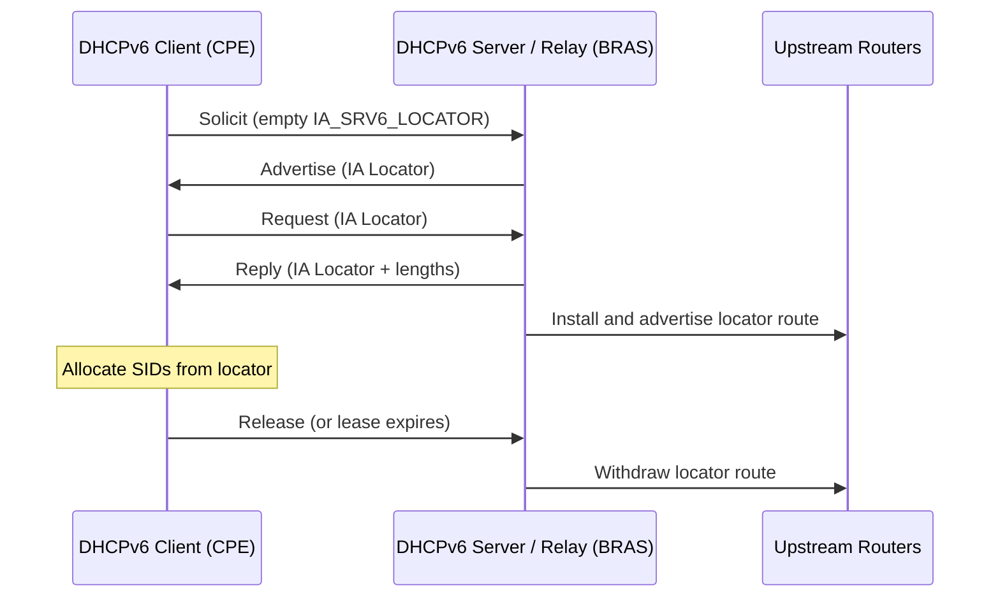

# RFC 10038 - SRv6 Locator Distribution via DHCPv6

| Field | Value |
|-------|-------|
| **Title** | Distributing the Segment Routing over IPv6 (SRv6) Locator Using DHCPv6 |
| **Authors** | W. Cheng (Ed.), R. Han, C. Lin (Ed.), D. Voyer, G. Zhang |
| **Date** | August 2026 |
| **Status** | Proposed Standard |
| **Link** | [datatracker.ietf.org/doc/rfc10038](https://datatracker.ietf.org/doc/rfc10038/) |

## Summary

Every SRv6 endpoint needs a locator, and today that is almost always configured by hand or pushed by a management system. RFC 10038 lets an SRv6 node obtain its locator from a **DHCPv6 server**, using the same lease model that DHCPv6 Prefix Delegation already uses for customer prefixes.

The motivating case comes from broadband networks (the authors include China Mobile and New H3C): operator-managed **CPEs** sit behind a BRAS that already runs or relays DHCPv6, and the operator wants CPE-to-CPE SRv6 tunnels. Instead of configuring a locator on each CPE, the CPE requests one; the BRAS (as server or relay) installs a route for the locator toward the CPE and advertises it into the IGP. When the lease is released or expires, the route is withdrawn.

The RFC only covers getting the locator. How the node then allocates SIDs from it, and how it advertises those SIDs, is out of scope.

## Key Sections

| Section | Topic | Description |
|---------|-------|-------------|
| 3 | Motivation | CPE → BRAS → backbone broadband topology with CPE-to-CPE SRv6 |
| 4.1 | IA_SRV6_LOCATOR Option | Identity Association container with IAID, T1, T2 |
| 4.2 | IA Locator Option | The locator itself, lifetimes, algorithm and SID structure lengths |
| 5 | Procedures | Solicit/Advertise/Request/Reply, Renew/Rebind/Release, client, server and relay behavior |
| 5.5 | Route Advertisement | Server or relay installs and advertises the locator route |
| 8 | Security | Client and server must be inside one trusted SR domain |

## New DHCPv6 Codepoints

| Code | Name | Type |
|------|------|------|
| 149 | `OPTION_IA_SRV6_LOCATOR` | Option (IA container) |
| 150 | `OPTION_IALOCATOR` | Option (carries one locator) |
| 23 | `NoSRv6LocatorAvail` | Status code |

## IA Locator Option Fields

| Field | Size | Meaning |
|-------|------|---------|
| Preferred / Valid lifetime | 4 + 4 octets | Same semantics as delegated prefixes; `0xffffffff` = infinity |
| Algorithm | 1 octet | IGP algorithm the locator belongs to (0 = default, 128-255 = [Flex-Algo](rfc9350.md)) |
| LB-Len / LN-Len | 1 + 1 octet | Locator Block and Locator Node lengths in bits |
| Fun-Len / Arg-Len | 1 + 1 octet | Function and Argument lengths in bits |
| SRv6-Locator | 0-16 octets | The locator, encoded in the minimum octets for LB-Len + LN-Len |

The four lengths must add up to at most 128 bits, and LB-Len + LN-Len must be non-zero. A client may send lengths with `::` as the locator to hint at the size it wants, much like a prefix-length hint in IA_PD.

## Lease Flow

| Locator algorithm | How the server/relay advertises it |
|-------------------|-------------------------------------|
| 0 (default) | Ordinary IP prefix reachability |
| Non-zero (Flex-Algo) | Must use the SRv6 Locator TLV ([RFC 9352](rfc9352.md) / [RFC 9513](rfc9513.md)) |

Multiple locators (for example, one best-effort and one low-latency Flex-Algo locator) are requested with multiple IA_SRV6_LOCATOR options; the RFC recommends asking for one larger locator up front rather than adding more later.

!!! warning "Common Pitfalls"
    - The DHCPv6 client and server **must** be in the same trusted SR domain. A CPE on customer premises is acceptable only if the operator fully manages it, and it must filter SRv6 traffic on both internal and external interfaces per RFC 8754 Section 5.1.
    - DHCPv6 has no end-to-end encryption; a rogue client can impersonate many clients and drain the locator pool. Configure per-client limits.
    - If some nodes get locators from DHCPv6 and others are configured manually, draw them from non-overlapping pools to avoid duplicates.
    - Aggregating locator routes at the BRAS hides individual withdrawals; decide whether per-CPE routes or an aggregate is advertised.
    - The client must not infer service meaning from the order of returned locators.

## Related Drafts & Updates

| Document | Relationship | Description |
|----------|-------------|-------------|
| [draft-ietf-spring-dhc-distribute-srv6-locator-dhcp](https://datatracker.ietf.org/doc/draft-ietf-spring-dhc-distribute-srv6-locator-dhcp/) | Draft lineage | Draft that became RFC 10038 |
| [RFC 9915](https://datatracker.ietf.org/doc/rfc9915/) | Base protocol | DHCPv6 specification whose IA_PD procedures this RFC reuses |
| [RFC 9800](rfc9800.md) | Applies to | Locators from DHCPv6 may be used for NEXT/REPLACE C-SIDs |

## Related

- :material-arrow-right: [Host-Based SRv6](../topics/host-based-srv6.md) - SRv6 on hosts and CPE-class Linux devices
- :material-arrow-right: [SID Structure](../topics/sid-structure.md) - Locator Block / Node / Function / Argument layout
- :material-file-document: [RFC 8986](rfc8986.md) - SRv6 Network Programming (locator definition)

## References

1. [RFC 10038](https://www.rfc-editor.org/rfc/rfc10038) - Distributing the SRv6 Locator Using DHCPv6
2. [RFC 9915](https://datatracker.ietf.org/doc/rfc9915/) - Dynamic Host Configuration Protocol for IPv6 (DHCPv6)
3. [RFC 8986](https://datatracker.ietf.org/doc/rfc8986/) - SRv6 Network Programming (SID structure, Section 3.1)
4. [IANA DHCPv6 Parameters](https://www.iana.org/assignments/dhcpv6-parameters/) - Registry holding option codes 149/150 and status code 23
