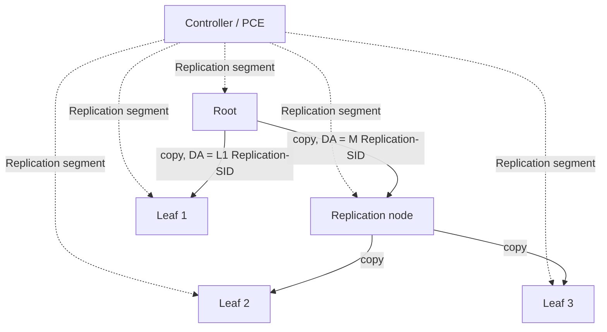

# RFC 9960 - SR P2MP Policy

| Field | Value |
|-------|-------|
| **Title** | Segment Routing Point-to-Multipoint Policy |
| **Authors** | R. Parekh (Ed.), D. Voyer (Ed.), C. Filsfils, H. Bidgoli, Z. Zhang |
| **Date** | April 2026 |
| **Status** | Proposed Standard |
| **Updates** | [RFC 9524](rfc9524.md) |
| **Link** | [datatracker.ietf.org/doc/rfc9960](https://datatracker.ietf.org/doc/rfc9960/) |

## Summary

RFC 9960 is the architecture behind **Tree-SID**. It defines the **SR P2MP Policy**: a construct, identified by `<Root, Tree-ID>`, that names a root node and a set of leaf nodes and carries one or more candidate paths (CPs) with constraints and optimization objectives, reusing the candidate-path model and selection rules of [RFC 9256](rfc9256.md).

A controller (typically a PCE) computes a **P2MP tree instance (PTI)** for each candidate path and instantiates it by programming [RFC 9524](rfc9524.md) Replication segments on the root, the intermediate replication nodes, and the leaves. The Replication-SID at the root is the **Tree-SID**; the RFC recommends reusing the same value at every node of the instance to simplify troubleshooting. For SRv6, the Replication-SID is the FUNCT part of the SID, so even with a common Tree-SID value the locator differs per node.

It works for both SR-MPLS and SRv6, and it updates RFC 9524 by giving the Replication-ID a precise structure: `<Root, Tree-ID, Instance-ID>`.

## Key Sections

| Section | Topic | Description |
|---------|-------|-------------|
| 2 | SR P2MP Policy | Identification, components, candidate paths and tree instances |
| 3 | Steering | Local-policy steering at the root vs BSID/Tree-SID steering from upstream |
| 4 | P2MP Tree Instance | Leaf Replication segments, shared Replication segments, forwarding |
| 5 | Controller | Tree compute, SID management, instantiation order, protection |
| App. A | Illustration | SR-MPLS and SRv6 examples with adjacent and non-adjacent replication |

## Identifiers

| Identifier | Size / Scope | Purpose |
|------------|--------------|---------|
| **Tree-ID** | 32-bit, unique per root | Identifies the SR P2MP Policy together with the root address |
| **Instance-ID** | 16-bit, unique per policy | Identifies one PTI (e.g., old and new instance during make-before-break) |
| **Replication-ID** | `<Root, Tree-ID, Instance-ID>` | Updated RFC 9524 identifier; full control-plane key adds Node-ID |
| **Tree-SID** | Replication-SID at the root | Data-plane identifier of the PTI |
| **BSID** | Per policy | Steers traffic into the policy when the root is not the domain ingress |

Shared Replication segments (for example, one protecting the X→Y adjacency for many trees) use Root = `::`/`0.0.0.0` and Instance-ID = 0. The simple 32-bit Replication-ID of RFC 9524 maps to `<::, Tree-ID, 0>`.

## How a Tree Is Built

| Step | Controller action |
|------|-------------------|
| 1 | Learn topology and node P2MP capability |
| 2 | Compute a loop-free tree for the active CP (constraints from RFC 9256 SR Policy) |
| 3 | Assign Replication-SIDs (from SRLB for SR-MPLS, or reserved blocks) and the BSID |
| 4 | Program leaves and intermediate nodes first, then the root, then activate the instance |
| 5 | On topology change, recompute — optionally via make-before-break with a new Instance-ID |

## SRv6-Specific Rules

| Rule | Why |
|------|-----|
| Leaf nodes **must** have a Replication segment | No penultimate-hop popping: the Tree-SID is in the IPv6 DA |
| Multiple services on one PTI need a service-context SID as the **last SID in the SRH** | Leaves derive the VPN/EVPN context from it |
| Non-adjacent downstream nodes are reached via the Replication-SID's locator, or an optional segment list | Same mechanics as RFC 9524 Section 2.2 |

## Protection

| Type | Mechanism |
|------|-----------|
| **Local** | Backup SR Policies per replication branch, or node-local LFA / [TI-LFA](rfc9855.md) plus micro-loop avoidance |
| **Path** | A backup CP whose PTIs are disjoint from the active CP's PTIs |

!!! warning "Common Pitfalls"
    - RFC 9960 defines the architecture, not the signaling. PCEP ([draft-ietf-pce-sr-p2mp-policy](https://datatracker.ietf.org/doc/draft-ietf-pce-sr-p2mp-policy/)) and BGP ([draft-ietf-idr-sr-p2mp-policy](https://datatracker.ietf.org/doc/draft-ietf-idr-sr-p2mp-policy/)) encodings are still Internet-Drafts, so vendor implementations may differ.
    - Only one PTI of a CP may be active at a time; two active instances deliver duplicate traffic to leaves.
    - Allocating Replication-SIDs from the SRGB is not recommended — trees are local state and can exhaust the global block.
    - A statically provisioned tree does not adapt to topology changes.
    - If the root's Replication segment fails to install, the controller should tear the instance down rather than leave a partial tree.

## Related Drafts & Updates

| Document | Relationship | Description |
|----------|-------------|-------------|
| [RFC 9524](rfc9524.md) | Updated by this RFC | Replication segment and End.Replicate |
| [draft-ietf-pce-sr-p2mp-policy](https://datatracker.ietf.org/doc/draft-ietf-pce-sr-p2mp-policy/) | Signaling | PCEP extensions for SR P2MP Policy |
| [draft-ietf-idr-sr-p2mp-policy](https://datatracker.ietf.org/doc/draft-ietf-idr-sr-p2mp-policy/) | Signaling | Advertising P2MP policies in BGP |
| [draft-ietf-pim-sr-p2mp-policy](https://datatracker.ietf.org/doc/draft-ietf-pim-sr-p2mp-policy/) | Draft lineage | Draft that became RFC 9960 |

## Related

- :material-arrow-right: [Multicast & Broadcast](../topics/multicast.md) - Tree-SID configuration and comparison with ingress replication and BIER
- :material-file-document: [RFC 9524](rfc9524.md) - SR Replication Segment
- :material-file-document: [RFC 9256](rfc9256.md) - SR Policy Architecture (candidate paths)
- :material-file-document: [RFC 9603](rfc9603.md) - PCEP Extensions for SRv6

## References

1. [RFC 9960](https://www.rfc-editor.org/rfc/rfc9960) - Segment Routing Point-to-Multipoint Policy
2. [RFC 9524](https://www.rfc-editor.org/rfc/rfc9524) - Segment Routing Replication for Multipoint Service Delivery
3. [RFC 9256](https://datatracker.ietf.org/doc/rfc9256/) - Segment Routing Policy Architecture
4. [draft-ietf-pce-sr-p2mp-policy](https://datatracker.ietf.org/doc/draft-ietf-pce-sr-p2mp-policy/) - PCEP extensions for SR P2MP Policy (Internet-Draft)
