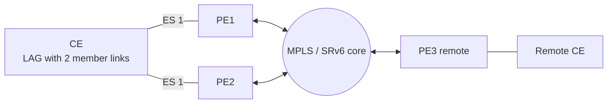
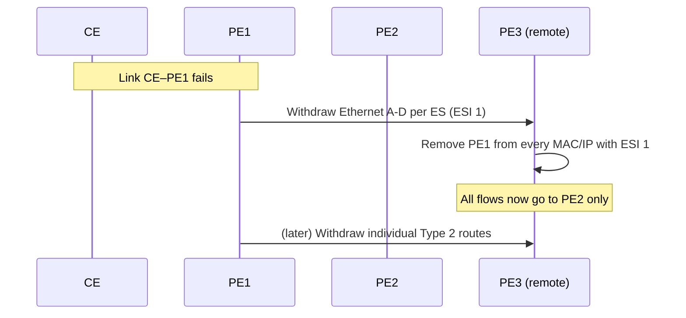

# EVPN Multihoming

**EVPN multihoming** (often shortened to EVPN-MH or EVPN multi-homing) lets a customer device — a switch, router, server or access node — attach to **two or more PE routers** over a single logical link, with the PEs coordinating through BGP instead of a proprietary MC-LAG control channel. It is defined in [RFC 7432](https://www.rfc-editor.org/rfc/rfc7432) (the EVPN base specification) and refined by [RFC 8584](https://www.rfc-editor.org/rfc/rfc8584) (DF election framework). [RFC 9252](../rfcs/rfc9252.md) and [RFC 9819](../rfcs/rfc9819.md) carry the same machinery over SRv6.

This page covers the generic mechanisms first — they are identical whether the core runs MPLS, VXLAN or SRv6 — and then the parts that change with an SRv6 data plane.



## Ethernet Segment and ESI

An **Ethernet Segment (ES)** is the set of links that connect one customer site to several PEs. From the CE's point of view it is usually a single LACP bundle; each PE sees one member link. Every PE attached to the segment configures the same **Ethernet Segment Identifier (ESI)**.

The ESI is **10 octets**: a 1-octet type followed by a 9-octet value ([RFC 7432 §5](https://www.rfc-editor.org/rfc/rfc7432#section-5)). Two values are reserved: all zeros means "single-homed, no ES", and all `FF` (MAX-ESI) is reserved.

| Type | Value is built from | Typical use |
|:----:|---------------------|-------------|
| **0** | 9 octets configured by the operator | Most common; you pick a unique value per segment |
| **1** | CE LACP system MAC (6) + port key (2) + 0 | Auto-derived from LACP when the CE runs LACP |
| **2** | IST root bridge MAC (6) + root bridge priority (2) + 0 | CE is a bridged LAN running MSTP; the PE learns the values from BPDUs |
| **3** | System MAC (6) + local discriminator (3) | Auto-generated by the PE from a MAC |
| **4** | Router ID (4) + local discriminator (4) + 0 | Auto-generated from the PE/CE router ID |
| **5** | AS number (4) + local discriminator (4) + 0 | Auto-generated from an ASN |

!!! tip "Type 0 vs auto-derived ESIs"
    Type 0 is explicit and portable between vendors. Auto-derived types save configuration on large access networks, but check what your vendor actually derives from: RFC 7432 Type 1 uses the **CE's** LACP system MAC and port key, while Junos `auto-derive lacp` builds the ESI from the **PE's own** LACP system ID and admin key (which must then be identical on every PE). Either way, all PEs on an all-active LAG must present the same LACP system ID to the CE, or the CE will not bundle the links.

## EVPN Routes Used for Multihoming

| Route | Name | Multihoming role |
|-------|------|------------------|
| **Type 4** | Ethernet Segment | Discovery of the other PEs on the same ES and **DF election**. Carries the ES-Import Route Target (auto-derived from the ESI value for types 1–3), so only PEs on that ES import it |
| **Type 1** | Ethernet A-D **per ES** | Advertises the redundancy mode (single-active flag in the ESI Label extended community) and the split-horizon label/argument; withdrawing it is the **mass withdrawal** signal |
| **Type 1** | Ethernet A-D **per EVI** | Advertised per service instance; lets remote PEs build **aliasing** (all-active) or **backup paths** (single-active) |
| **Type 2** | MAC/IP Advertisement | MAC and ARP/ND bindings; synced between PEs on the same ES |
| **Type 3** | Inclusive Multicast Ethernet Tag | BUM delivery; in SRv6 also carries the End.DT2M SID |
| **Type 5** | IP Prefix ([RFC 9136](https://www.rfc-editor.org/rfc/rfc9136)) | Routed prefixes, used by EVPN L3 multihoming |

## All-Active vs Single-Active

| | **All-active** | **Single-active** |
|--|----------------|-------------------|
| Who forwards known unicast | Every PE on the ES | Only the DF for that VLAN/EVI |
| CE side | One LAG across the PEs | Separate links or LAG with standby members; the non-DF blocks its port for that service |
| Remote PE behavior | ECMP to all PEs on the ES (**aliasing**) | Primary path to the DF, pre-programmed **backup path** to the non-DF |
| BUM toward the CE | Only the DF sends | Only the DF sends |
| Loop prevention needed | **Split-horizon** filtering (BUM received from the ES must not be sent back into it) | Not for the CE (the non-DF does not forward) |
| Typical use | Data center leaf pairs, access aggregation, bandwidth | Hand-offs to devices that cannot run a cross-chassis LAG, strict per-VLAN active/standby |

A third mode, **port-active** ([RFC 9786](https://www.rfc-editor.org/rfc/rfc9786), June 2025), elects one PE per interface rather than per VLAN — a drop-in replacement for MC-LAG active/standby. The DF election for port-active can use any of the algorithms below.

## Designated Forwarder (DF) Election

When the CE floods a broadcast or unknown-unicast frame, every PE on the ES would deliver remote BUM copies back to it. The **DF** is the one PE per <ES, VLAN> that sends BUM toward the CE; the others drop it.

PEs learn each other through Type 4 routes, wait for the **DF election timer** (3 seconds by default) so all routes arrive, then run the election.

| Algorithm | Defined in | How it picks the DF | Trade-off |
|-----------|-----------|---------------------|-----------|
| **Modulo / service carving** (default) | RFC 7432 §8.5 | Sort PE IPs ascending (index 0..N-1); DF for VLAN *V* is index `V mod N` | Simple, but when a PE joins or leaves, almost every VLAN moves |
| **HRW** (Highest Random Weight) | RFC 8584 §3 | Each PE computes a hash weight of (VLAN, ESI, PE address); highest wins, ties go to the lowest IP | Only the VLANs of the failed/added PE move; even spread with sparse VLAN IDs |
| **Preference-based** | [RFC 9785](https://www.rfc-editor.org/rfc/rfc9785) (June 2025) | Operator sets a 2-octet preference per PE per ES; highest (DF Alg 2) or lowest (DF Alg 3) wins; the **D** (Don't Preempt) bit makes it non-revertive | Deterministic primary/backup per ES; the norm for single-active designs |
| **AC-influenced (AC-DF)** | RFC 8584 | Any of the above, but a PE whose attachment circuit is down for that EVI is excluded | Avoids electing a DF that cannot actually forward |

RFC 8584 also introduced the **DF Election extended community** on the Type 4 route: a 5-bit algorithm field (0 = modulo, 1 = HRW, 2/3 = highest/lowest preference) and a capability bitmap (D, AC-DF, …). If the PEs on a segment disagree, they all fall back to modulo. Vendor support varies: Cisco IOS-XR and Junos expose modulo and preference-based election in configuration, so check the release notes before designing around HRW.

```text
Modulo example: ES with PE1 (192.0.2.1) and PE2 (192.0.2.2), N = 2
  Ordered list: [PE1, PE2]
  VLAN 100 → 100 mod 2 = 0 → PE1 is DF
  VLAN 101 → 101 mod 2 = 1 → PE2 is DF
  If you only use even VLANs, PE1 is DF for everything — HRW avoids this.
```

## Aliasing and Backup Path

A MAC address behind a multihomed CE may only be learned (and advertised in a Type 2 route) by **one** of the PEs — the one whose LAG member the CE hashed that flow onto. Without help, remote PEs would send all traffic for that MAC to that single PE.

**Aliasing** fixes this: each PE advertises an Ethernet A-D **per EVI** route for the ES. A remote PE that sees a Type 2 route with a non-zero ESI looks up every PE that advertised A-D per EVI for that ESI and load-balances across all of them, even the ones that never learned the MAC.

In **single-active** mode the same routes provide a **backup path**: the remote PE installs the DF as primary and the other PE as a pre-programmed backup, ready for fast switchover.

## Mass Withdrawal

If PE1 loses its link to a CE with 10 000 MACs, withdrawing 10 000 Type 2 routes takes time. Instead, PE1 withdraws a single **Ethernet A-D per ES** route. Every remote PE immediately removes PE1 from the next-hop set of *all* MACs associated with that ESI — a prefix-independent convergence step — and the individual Type 2 withdrawals follow in the background.



## Split-Horizon Filtering

In all-active mode, a BUM frame from the CE arrives at PE1, which floods it to every PE in the EVI — including PE2, which is attached to the **same** ES. If PE2 is the DF, it would send the frame straight back to the CE, creating a loop or duplicate. Split-horizon stops this: the receiving PE must know *which ES the frame came from* and skip that ES.

How the "came from" information is carried depends on the data plane:

| Data plane | Mechanism | Defined in |
|------------|-----------|------------|
| **MPLS** | **ESI label**: each PE advertises a label in its A-D per ES route; the ingress PE pushes the egress PE's ESI label beneath the EVPN label on BUM sent to it. The egress PE sees the label and does not forward onto that ES | RFC 7432 §8.3 |
| **VXLAN / NVO** | **Local bias**: no label space for an ESI label, so the egress PE uses the outer source IP to recognize a peer on the same ES; the ingress PE always floods locally to its own ESs regardless of DF state | RFC 8365 §8.3.1 |
| **SRv6** | **ESI-filtering argument (Arg.FE2)** carried in the argument bits of the egress PE's **End.DT2M** SID — the SRv6 equivalent of the ESI label. Local bias is also allowed | RFC 8986 §4.12, RFC 9252 §6.1.1/§6.3, RFC 9819 |

[RFC 9746](https://www.rfc-editor.org/rfc/rfc9746) (March 2025) lets PEs signal which method they use, with a Split-Horizon Type field in the ESI Label extended community: MPLS defaults to ESI-label filtering, VXLAN to local bias, and **SRv6 defaults to ESI filtering but supports both**. Local bias only works with all-active redundancy.

## EVPN Multihoming over SRv6

SRv6 has no label stack to push an ESI label onto, so the egress PE's local ES identifier travels as an **argument** inside the SID itself:

1. Each PE allocates an **End.DT2M** SID per bridge domain for BUM traffic and advertises its `LOC:FUNC` part in the **Type 3 (IMET)** route.
2. For each local ES it allocates an **Arg.FE2** value and advertises it in the **Type 1 A-D per ES** route (SRv6 L2 Service TLV).
3. When PE1 floods BUM that it received from ES 1 to PE2, it combines PE2's End.DT2M `LOC:FUNC` with PE2's Arg.FE2 for ES 1 into the destination address.
4. PE2 executes End.DT2M: it decapsulates and floods into the bridge domain, **excluding** the interfaces of the ES identified by the argument.

```text
PE2 Type 3 route:  End.DT2M LOC:FUNC = fc00:0:2:e002::   SID structure 32/16/16, AL 16
PE2 Type 1 route:  Arg.FE2 for ES 1  = 0x00a1             AL 16
PE1 → PE2, BUM received from ES 1:
    argument inserted at offset 32+16+16 = 64 bits
    DA = fc00:0:2:e002:a1::
PE2: End.DT2M with argument 0x00a1 → flood to every AC in the bridge domain except ES 1
```

!!! warning "Why RFC 9819 exists"
    RFC 9252 said the ingress PE SHOULD bitwise-OR the Type 3 SID and the Type 1 argument. That only works when both routes use the same SID structure; interop testing found implementations disagreeing. [RFC 9819](../rfcs/rfc9819.md) (July 2025) replaces the OR with an explicit rule: insert the argument at offset LBL + LNL + FL taken from the **Type 3** route's SID Structure, and stop forwarding BUM from that ES if the two routes announce different argument lengths. If you mix vendors on an SRv6 EVPN all-active segment, check RFC 9819 support first.

Known unicast does not need split-horizon. Remote PEs use **End.DT2U** (bridge-table lookup) or **End.DX2** (cross-connect, for EVPN-VPWS) SIDs from the Type 1 per-EVI and Type 2 routes, and aliasing simply becomes ECMP across the SRv6 SIDs of all PEs on the ES. With [uSID](usid-compression.md) these service SIDs are typically uDT2U/uDT2M micro-SIDs on the PE's locator.

The underlay contributes too: [TI-LFA](ti-lfa.md) protects the core paths between PEs, while mass withdrawal and aliasing protect the attachment circuit — the two mechanisms are complementary.

## EVPN L3 Multihoming (Routed CE)

When the CE is a router and the service is an L3VPN, the same ES concepts apply to a routed hand-off. [draft-ietf-bess-evpn-l3mh-proto](https://datatracker.ietf.org/doc/draft-ietf-bess-evpn-l3mh-proto/) specifies **EVPN L3 multihoming**:

1. CE connects to PE1 and PE2 via an Ethernet Segment (same ESI on both PEs)
2. PEs discover each other via Type 4 routes and elect a DF
3. ARP/ND entries learned by one PE are synced to the other with Type 2 routes, so either PE can route to the CE immediately
4. Prefixes are advertised to remote PEs as Type 5 (or VPNv4/VPNv6) routes with SRv6 **End.DT4/End.DT6/End.DT46** service SIDs
5. Remote PEs ECMP across both PEs; on PE or link failure, the Type 1 per-ES withdrawal triggers fast reconvergence

| Aspect | L2 multihoming (EVPN) | L3 multihoming (EVPN L3MH) |
|--------|----------------------|---------------------------|
| **Service type** | L2VPN / bridging | L3VPN / routing |
| **CE attachment** | Bridge domain | VRF / routed interface |
| **MAC learning** | Required | Only for ARP/ND sync |
| **Split-horizon** | Per ES (ESI label / Arg.FE2) | Not needed for routed traffic |
| **Prefix advertisement** | Type 2 (MAC/IP) | Type 5 (IP Prefix) + Type 2 (ARP/ND sync) |
| **SRv6 service SIDs** | End.DT2U, End.DT2M, End.DX2 | End.DT4, End.DT6, End.DT46 |

!!! note "Interoperability"
    EVPN L3 multihoming has been demonstrated in multi-vendor interoperability tests (EANTC) with Cisco and Nokia using both SRv6 and SR-MPLS underlays.

## EVPN Multihoming vs MC-LAG

| | EVPN multihoming | MC-LAG / MLAG |
|--|------------------|---------------|
| Control plane | Standard BGP (RFC 7432) | Vendor-specific (ICCP, peer-link) |
| Number of PEs | 2 or more | Usually exactly 2 |
| Peer link between PEs | Not required | Usually required |
| Multivendor PE pair | Possible | No |
| Works across a routed core (MPLS, VXLAN, SRv6) | Yes | Typically same site only |

## Configuration Examples

Both PEs on the segment get the same ESI and redundancy mode. The examples use the type 0 ESI `00:11:22:33:44:55:66:77:88:99` with preference-based DF election (PE1 preferred).

=== "Cisco IOS-XR"

    ```cisco
    !! PE1 (use weight 50 on PE2)
    interface Bundle-Ether10
     lacp system mac 0011.2233.4455
    !
    evpn
     interface Bundle-Ether10
      ethernet-segment
       identifier type 0 11.22.33.44.55.66.77.88.99
       !! all-active is the default; alternatives:
       !! load-balancing-mode single-active | port-active
       service-carving preference-based
        weight 100
      !
     !
     !! SRv6: EVPN services take SIDs from this locator
     segment-routing srv6
      locator MAIN
     !
    !
    ```

=== "Junos"

    ```junos
    # PE1 (use preference value 50 on PE2)
    set interfaces ae0 esi 00:11:22:33:44:55:66:77:88:99
    set interfaces ae0 esi all-active
    set interfaces ae0 esi df-election-type preference value 100
    # identical LACP system ID on every PE of the segment
    set interfaces ae0 aggregated-ether-options lacp active
    set interfaces ae0 aggregated-ether-options lacp system-id 00:11:22:33:44:55
    ```

!!! note "ESI notation"
    IOS-XR takes the 9-octet **value** after `type 0`; Junos takes all 10 octets, and a manually configured Junos ESI must start with `00` (type 0). The two lines above describe the same segment. IOS-XR locator precedence for EVPN SRv6 SIDs is per-service, then per-EVI (`evi N segment-routing srv6` → `locator`), then the global `evpn segment-routing srv6 locator`.

## Common Pitfalls

- **ESI mismatch**: a typo in one PE's ESI silently turns an all-active segment into two single-homed sites — the CE sees duplicate BUM and MAC flaps.
- **LACP system ID**: for an all-active LAG, every PE must present the same LACP system ID and key to the CE.
- **Mixed DF algorithms**: PEs that advertise different DF algorithms fall back to modulo; check the DF Election extended community on the Type 4 routes.
- **Core isolation**: if a PE loses all core connectivity but keeps its CE link up, the CE keeps hashing traffic into a black hole. Most implementations bring the access interface down on core isolation — enable it.
- **SRv6 argument length**: on SRv6, the End.DT2M argument length must match between Type 1 and Type 3 routes (RFC 9819); mismatches stop BUM from that segment.

## Further Reading

- :material-arrow-right: [BGP Overlay Services](bgp-overlay-services.md) — L3VPN and EVPN fundamentals over SRv6
- :material-arrow-right: [Network Programming](network-programming.md) — End.DT2M, End.DT2U and End.DX2 behaviors
- :material-arrow-right: [VPN Services](../use-cases/vpn-services.md) — SRv6 VPN use cases
- :material-arrow-right: [TI-LFA](ti-lfa.md) — Fast reroute for the SRv6 underlay
- :material-file-document: [RFC 9252](../rfcs/rfc9252.md) — BGP Overlay Services Based on SRv6
- :material-file-document: [RFC 9819](../rfcs/rfc9819.md) — End.DT2M ESI-filtering argument signaling (updates RFC 9252)

## References

1. [RFC 7432 - BGP MPLS-Based Ethernet VPN](https://www.rfc-editor.org/rfc/rfc7432) — EVPN base specification: ESI, route types, DF election, aliasing, mass withdrawal and the ESI label
2. [RFC 8584 - Framework for EVPN Designated Forwarder Election Extensibility](https://www.rfc-editor.org/rfc/rfc8584) — HRW and AC-influenced DF election, DF Election extended community
3. [RFC 9785 - Preference-Based EVPN Designated Forwarder (DF) Election](https://www.rfc-editor.org/rfc/rfc9785) — Highest/lowest-preference DF algorithms and the non-revertive (Don't Preempt) capability
4. [RFC 8365 - A Network Virtualization Overlay Solution Using EVPN](https://www.rfc-editor.org/rfc/rfc8365) — EVPN over VXLAN/NVO, including local-bias split-horizon
5. [RFC 9252 - BGP Overlay Services Based on SRv6](https://www.rfc-editor.org/rfc/rfc9252) — SRv6 Service TLVs for EVPN, including End.DT2M and the ESI-filtering argument
6. [RFC 9819 - Argument Signaling for BGP Services in SRv6](https://www.rfc-editor.org/rfc/rfc9819) — Precise rules for combining the End.DT2M SID and the Arg.FE2 argument
7. [RFC 8986 - SRv6 Network Programming](https://www.rfc-editor.org/rfc/rfc8986) — End.DT2M, End.DT2U and End.DX2 behaviors and Arg.FE2
8. [RFC 9136 - IP Prefix Advertisement in EVPN](https://www.rfc-editor.org/rfc/rfc9136) — EVPN Type 5 routes
9. [draft-ietf-bess-evpn-l3mh-proto](https://datatracker.ietf.org/doc/draft-ietf-bess-evpn-l3mh-proto/) — EVPN Layer-3 Multihoming
10. [RFC 9786 - EVPN Port-Active Redundancy Mode](https://www.rfc-editor.org/rfc/rfc9786) — Per-interface active/standby multihoming
11. [RFC 9746 - BGP EVPN Multihoming Extensions for Split-Horizon Filtering](https://www.rfc-editor.org/rfc/rfc9746) — Signaling ESI-label vs local-bias filtering per encapsulation, including SRv6
12. [Cisco IOS-XR EVPN Command Reference (NCS 5500)](https://www.cisco.com/c/en/us/td/docs/iosxr/ncs5500/vpn/b-ncs5500-vpn-cli-reference/m-evpn-commands.html) — `ethernet-segment`, `load-balancing-mode` and `service-carving` syntax
13. [Junos esi statement](https://www.juniper.net/documentation/us/en/software/junos/cli-reference/topics/ref/statement/esi-edit-interfaces.html) — ESI, redundancy mode and DF election type on Junos
14. [Junos: LACP for EVPN active-active multihoming](https://www.juniper.net/documentation/us/en/software/junos/evpn/topics/example/example-lacp-for-evpn-a-a-multihoming-configuring.html) — Matching LACP system IDs across PEs
15. [EANTC Multi-Vendor Interoperability Tests](https://eantc.de/events/) — Industry interoperability demonstrations including EVPN multihoming
