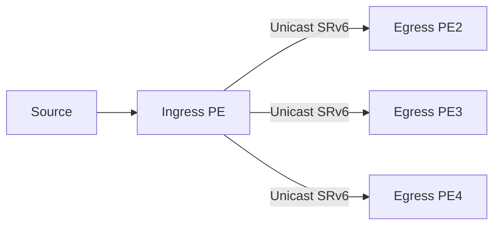
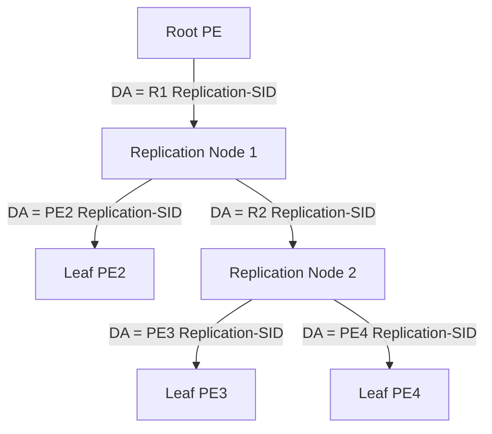
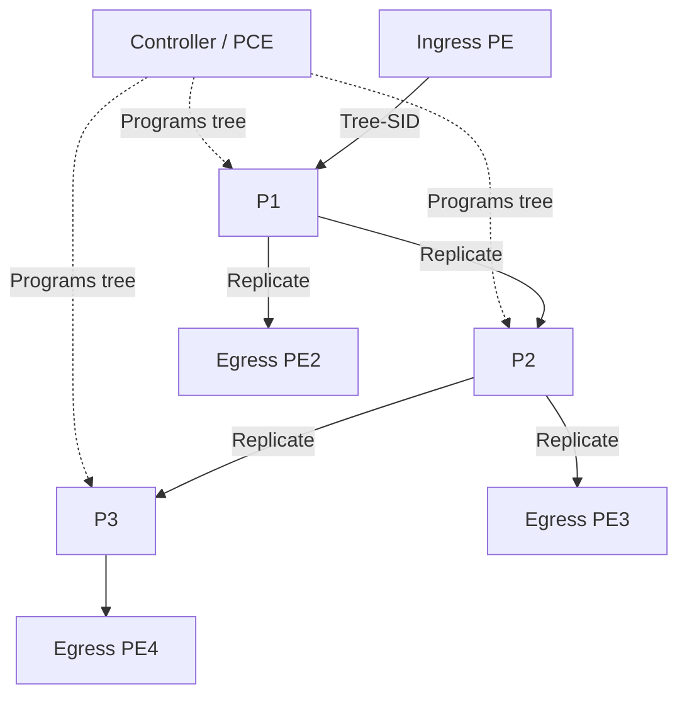
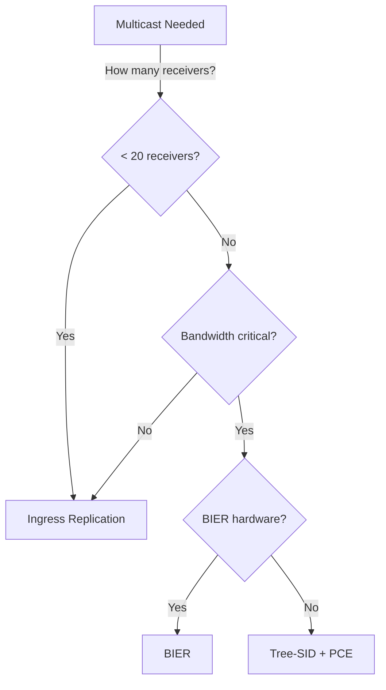

# Multicast & Broadcast

SRv6 is inherently a unicast transport — packets follow a segment list from source to destination. Delivering multicast and broadcast traffic over an SRv6 network requires additional mechanisms to replicate packets to multiple receivers without reverting to traditional PIM/mLDP trees.

!!! warning "Illustrative Configurations"
    The configuration examples in this document are pseudo-configurations intended for conceptual and illustrative purposes only. They are not production-ready or fully validated configurations and must be adapted to your network design and specific vendor platform/software version.

Several approaches have emerged, each with different trade-offs.

## The Challenge

Traditional IP multicast relies on per-group state at every router in the path (PIM, mLDP, IGMP). This creates:

- **State explosion** — every (S,G) or (*,G) entry on every transit router
- **Convergence complexity** — tree recomputation on any topology change
- **Operational burden** — debugging multicast is notoriously difficult

SRv6's source-routing model pushes complexity to the edges, which conflicts with multicast's distributed replication model. The solutions below bridge this gap.

## Approach 1: Ingress Replication (Head-End)

The simplest approach — the ingress PE replicates the packet and sends a **separate unicast SRv6 copy** to each egress PE.



| Pros | Cons |
|------|------|
| Zero state on transit nodes | Bandwidth wasteful — N copies on ingress uplink |
| Works today on any SRv6 network | Does not scale for large receiver sets |
| Simple to implement and debug | Ingress PE becomes bottleneck |

### When to use

- Small number of receivers (< 10-20)
- EVPN BUM (Broadcast, Unknown unicast, Multicast) in L2VPN
- Control plane traffic (e.g., ARP/ND flooding in EVPN)

### Configuration

=== "Cisco IOS-XR"

    ```cisco
    !! Ingress replication is the default for EVPN BUM traffic
    !! Enable via EVPN EVI configuration
    evpn
     evi 100
      bgp
       route-target import 65000:100
       route-target export 65000:100
      !
      advertise-mac
      !
     !
    !

    !! Verify ingress replication peers
    show evpn evi 100 inclusive-multicast detail
    ```

=== "Juniper"

    ```junos
    # Ingress replication is default when using EVPN
    set routing-instances EVPN-A protocols evpn default-gateway no-gateway-community
    set routing-instances EVPN-A protocols evpn replication-type ingress
    ```

!!! note "Validated for L3VPN multicast too"
    Ingress replication isn't limited to EVPN BUM. Cisco's 2026 mission-critical CVD validates **BGP MVPN with partitioned ingress replication** over SRv6 on IOS-XE: receiver interest is signaled via MVPN Type 4 leaf routes carrying an `End.DTMC4` Service SID (the multicast counterpart of `uDT4` — decap + IPv4 multicast lookup in the VRF), and the ingress PE replicates only toward PEs with active receivers. Anycast RP + MSDP at the hubs provide RP redundancy while the core stays multicast-stateless. See [Mission-Critical Networks](../use-cases/mission-critical.md).

## Approach 2: SRv6 Replication Segments (End.Replicate)

[RFC 9524](../rfcs/rfc9524.md) (February 2024) adds the **Replication segment** to the SR architecture and the SRv6 **End.Replicate** behavior (codepoint 75). It is the building block for both ingress replication and Tree-SID.

### How it works

1. A **replication node** holds local *replication state*: a list of branches, each pointing at a downstream node and that node's Replication-SID
2. When a packet's IPv6 DA is a local End.Replicate SID, the node makes one copy per branch and **rewrites the DA** to the downstream Replication-SID (optionally adding an `H.Encaps.Red` segment list to steer the copy over a TE path)
3. Downstream nodes do not need to be adjacent — routers in between just forward on the Replication-SID's locator
4. **Leaf** (and **bud**) nodes strip the outer header and deliver the payload using a context taken from the Replication-SID or from the next SID in the SRH



| Pros | Cons |
|------|------|
| Efficient bandwidth — replication happens in-network | Replication state on every replication node (programmed locally or by a controller) |
| No PIM/mLDP state; non-replicating transit routers forward on the locator | No traceroute to Replication-SIDs (ICMPv6 errors are suppressed, as for IPv6 multicast) |
| Same construct for SR-MPLS and SRv6 | Stitching segments into a tree needs a control plane ([RFC 9960](../rfcs/rfc9960.md)) |

### SRv6 SID behaviors

| Behavior | Description |
|----------|-------------|
| **End.Replicate** | Replicate the packet to each downstream node in the local replication state, and/or decapsulate at a leaf or bud node |

!!! info "Standards reference"
    Replication segments are standardized in [RFC 9524](../rfcs/rfc9524.md), updated by [RFC 9960](../rfcs/rfc9960.md) (April 2026), which defines the structured Replication-ID used by SR P2MP Policies.

!!! note "Implementation status"
    End.Replicate is in the open-source [zebra-rs](../implementations/zebra-rs.md) data plane, and Nokia's SRv6 application note lists P2MP SRv6 policy for multicast on its routing platforms (see [Nokia SR OS](../implementations/nokia-sros.md)). On vendor routers replication segments are normally consumed through Tree-SID (below) or EVPN/MVPN ingress replication rather than configured as standalone SIDs — check your platform's release notes for SRv6 (as opposed to SR-MPLS) support.

## Approach 3: Tree-SID

Tree-SID pre-computes a multicast distribution tree and assigns a single **Tree-SID** identifier that represents the entire tree. The ingress PE only needs to push one SID.

### How it works

1. A controller (e.g., PCE) computes a P2MP tree instance for the SR P2MP Policy's active candidate path
2. The controller programs an [RFC 9524](../rfcs/rfc9524.md) Replication segment on the root, each branching node, and each leaf (leaves first, root last)
3. The root encapsulates with its Replication-SID — the **Tree-SID** — and replication nodes rewrite the DA toward each downstream node



| Pros | Cons |
|------|------|
| Single SID for entire tree — minimal SRH overhead | Requires centralized controller (PCE) |
| Optimized replication at each branch point | Per-tree state on transit nodes |
| Make-before-break tree updates and disjoint backup trees | Less dynamic than ingress replication |

!!! info "Standards reference"
    The Tree-SID architecture — SR P2MP Policy, candidate paths, P2MP tree instances built from Replication segments — is [RFC 9960](../rfcs/rfc9960.md) (April 2026). The controller-to-router signaling is still in progress: PCEP in [draft-ietf-pce-sr-p2mp-policy](https://datatracker.ietf.org/doc/draft-ietf-pce-sr-p2mp-policy/) and BGP in [draft-ietf-idr-sr-p2mp-policy](https://datatracker.ietf.org/doc/draft-ietf-idr-sr-p2mp-policy/).

### Configuration

=== "Cisco IOS-XR"

    ```cisco
    !! SR-PCE Tree-SID configuration (on PCE)
    pce
     address ipv6 2001:db8:ffff::1
     segment-routing
      traffic-eng
       p2mp
        policy MCAST-TREE-1
         source ipv6 2001:db8::1
         color 1000
         treesid srv6
         candidate-paths
          preference 100
           dynamic
           !
          !
         endpoint-set RECEIVERS
          ipv6 2001:db8::2
          ipv6 2001:db8::3
          ipv6 2001:db8::4
         !
        !
       !
      !
     !
    !
    ```

### Verification

=== "Cisco IOS-XR"

    ```cisco
    !! On PCE
    show pce lsp p2mp
    show pce lsp p2mp detail

    !! On head-end
    show segment-routing traffic-eng tree-sid all
    show segment-routing traffic-eng tree-sid color 1000
    ```

## Approach 4: BIER with SRv6

**BIER (Bit Index Explicit Replication)** encodes the set of egress routers as a **bitmask** in the packet header. Each bit represents a specific egress PE. Transit nodes use the bitmask to determine where to replicate — no per-group multicast state needed.

### BIER + SRv6 integration

SRv6 can carry BIER information in the SRH, combining SRv6's source routing with BIER's stateless replication:

```
IPv6 Header → SRH [SRv6 SIDs] → BIER Header [Bitmask] → Payload
```

| Pros | Cons |
|------|------|
| Zero per-group state on transit nodes | Bitmask size limits receiver count (256-4096 per set) |
| No tree computation needed | Requires BIER-capable hardware |
| Works with any multicast source model | Additional header overhead |
| Scales linearly with egress PEs | Newer technology, less deployed |

!!! info "Standards reference"
    BIER is defined in [RFC 8279](https://datatracker.ietf.org/doc/rfc8279/). Carrying BIER over IPv6/SRv6 networks is being developed in [draft-ietf-bier-bierin6](https://datatracker.ietf.org/doc/draft-ietf-bier-bierin6/) (BIERin6).

### Configuration

=== "Cisco IOS-XR"

    ```cisco
    !! BIER sub-domain and bit-position assignment
    router isis CORE
     address-family ipv6 unicast
      bier
       sub-domain 0
        bit-position 1   !! unique per BFR in the domain
        bfr-prefix 2001:db8::1/128
       !
      !
     !
    !

    !! BIER with EVPN (multicast overlay)
    evpn
     evi 200
      bgp
       route-target import 65000:200
       route-target export 65000:200
      !
      multicast bier
      !
     !
    !
    ```

### Verification

=== "Cisco IOS-XR"

    ```cisco
    show bier sub-domain 0
    show bier topology
    show bier bfr-prefix
    show evpn evi 200 multicast detail
    ```

## Broadcast in SRv6

Broadcast is typically an L2 concept. In SRv6 networks, broadcast handling depends on the service type:

### EVPN L2VPN (bridging)

Broadcast, Unknown unicast, and Multicast (BUM) traffic is handled via:

- **Ingress replication** — the PE sends a copy to every remote PE in the EVPN instance
- **EVPN Type-3 routes** — advertise the inclusive multicast Ethernet tag, signaling which PEs need BUM traffic

### L3VPN (routing)

Broadcast is not applicable in L3VPN — ARP/ND is handled via EVPN proxy (suppressing broadcast) or standard ARP resolution within the VRF.

## Protecting PIM Trees with TI-LFA

Networks that keep PIM during migration can still reuse SR protection. [RFC 9860](../rfcs/rfc9860.md) (October 2025, Informational) builds the MoFRR standby tree along the **TI-LFA repair path**: the P-node's End SID becomes a PIM RPF Vector and the P→Q End.X SID becomes an Explicit RPF Vector, so the secondary join follows the repair path hop by hop. This extends MoFRR to topologies where classic LFA finds no loop-free secondary. See [TI-LFA](ti-lfa.md).

## Comparison of Approaches

| Approach | Transit State | Bandwidth Efficiency | Scalability | Maturity |
|----------|--------------|---------------------|-------------|----------|
| **Ingress Replication** | None | Low (N copies at ingress) | Small scale | Production |
| **Replication Segments** | Replication state on replication nodes only | Medium-High | Medium | RFC 9524 |
| **Tree-SID** | Per-tree (replication nodes) | High (optimal tree) | Large scale | RFC 9960 (PCEP/BGP signaling in draft) |
| **BIER** | BIER tables (no per-group) | High | Very large | Early deployment |

## Deployment Considerations

### Choosing the Right Approach



### Scaling Considerations

| Approach | Max Receivers | Controller Required | Hardware Dependency | Production Ready |
|----------|:------------:|:-------------------:|:-------------------:|:----------------:|
| **Ingress Replication** | ~20 per group | No | Any SRv6 | Yes |
| **Replication Segments** | Medium | No (static) / Yes (trees) | Replication-capable | Standardized; limited implementations |
| **Tree-SID** | Thousands | Yes (PCE) | Any SRv6 | Early |
| **BIER** | 256-4096 per set | No | BIER ASIC | Early |

### Migration from PIM/mLDP

1. **Phase 1:** Deploy SRv6 underlay alongside existing PIM/mLDP
2. **Phase 2:** Migrate EVPN BUM to ingress replication (no multicast tree needed)
3. **Phase 3:** For remaining multicast services, evaluate Tree-SID or BIER based on scale
4. **Phase 4:** Decommission PIM/mLDP when all services are migrated

!!! tip "Start with ingress replication"
    Most EVPN deployments work well with ingress replication for BUM traffic. Only invest in Tree-SID or BIER when ingress replication becomes a bandwidth bottleneck.

!!! note "Industry interest: low-latency multicast"
    Multicast over SRv6 is drawing attention beyond service providers. At the MPLS & SRv6 World Congress Paris 2025, Goldman Sachs presented ["SRv6 for Low-Latency Multicast"](https://www.segment-routing.net/conferences/Paris25-Goldman-Sachs-Michael-Valentine/) — a financial-industry perspective where deterministic, low-latency multicast delivery (e.g., market data distribution) is a core requirement.

## Further Reading

- :material-arrow-right: [BGP Overlay Services](bgp-overlay-services.md) — EVPN and L3VPN including BUM handling
- :material-arrow-right: [VPN Services](../use-cases/vpn-services.md) — L2VPN and BUM handling in EVPN-ELAN
- :material-arrow-right: [EVPN Multihoming](evpn-multihoming.md) — All-Active multihoming with BUM traffic considerations
- :material-arrow-right: [Network Programming](network-programming.md) — SRv6 behaviors including replication
- :material-arrow-right: [RFC 9524](../rfcs/rfc9524.md) and [RFC 9960](../rfcs/rfc9960.md) — Replication segment and SR P2MP Policy (Tree-SID) RFC summaries
- :material-arrow-right: [RFC 9860](../rfcs/rfc9860.md) — MoFRR based on TI-LFA
- :material-arrow-right: [5G Transport](../use-cases/5g-transport.md) — Multicast requirements for mobile networks
- :material-arrow-right: [Mission-Critical Networks](../use-cases/mission-critical.md) — Validated MVPN ingress replication design with End.DTMC4

## References

1. [RFC 9524](https://www.rfc-editor.org/rfc/rfc9524) — Segment Routing Replication for Multipoint Service Delivery (End.Replicate)
2. [RFC 9960](https://www.rfc-editor.org/rfc/rfc9960) — Segment Routing Point-to-Multipoint Policy (Tree-SID architecture; updates RFC 9524)
3. [draft-ietf-pce-sr-p2mp-policy](https://datatracker.ietf.org/doc/draft-ietf-pce-sr-p2mp-policy/) — PCEP extensions for SR P2MP Policy
4. [RFC 8279](https://datatracker.ietf.org/doc/rfc8279/) — Multicast Using Bit Index Explicit Replication (BIER)
5. [RFC 9252](https://datatracker.ietf.org/doc/rfc9252/) — BGP Overlay Services Based on SRv6
6. [draft-ietf-bier-bierin6](https://datatracker.ietf.org/doc/draft-ietf-bier-bierin6/) — Supporting BIER in IPv6 Networks (BIERin6)
7. [RFC 9860](https://www.rfc-editor.org/rfc/rfc9860) — Multicast-only Fast Reroute based on TI-LFA
8. [Cisco CVD: Quantum-Safe SRv6 Fabric for Mission-Critical Networks](https://www.cisco.com/c/en/us/td/docs/solutions/CVD/Campus/SRv6_Fabric-Mission-Critical_Networks.html) — Validated BGP MVPN ingress replication with End.DTMC4, Anycast RP, and MSDP over SRv6 on IOS-XE
9. [Goldman Sachs: SRv6 for Low-Latency Multicast — MPLS & SRv6 World Congress Paris 2025](https://www.segment-routing.net/conferences/Paris25-Goldman-Sachs-Michael-Valentine/) — Mike Valentine (Goldman Sachs) on SRv6 for low-latency multicast in financial networks
