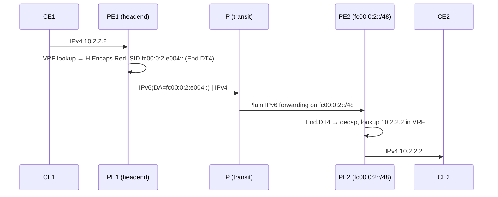

# SRv6 Network Programming

**SRv6 Network Programming** ([RFC 8986](../rfcs/rfc8986.md)) is the idea that a packet carries a *program*: an ordered list of instructions, each encoded as an IPv6 address (a **SID**). Every router that owns a SID binds it to a **behavior** — "forward over this link", "decapsulate and look up in VRF 10", "apply this policy" — and the source composes those behaviors into an end-to-end service.

RFC 8986 defines three kinds of building blocks:

| Building block | Executed by | Examples |
|----------------|-------------|----------|
| **Endpoint behaviors** | The node that owns the SID in the destination address | End, End.X, End.DT4, End.DX2 |
| **Headend behaviors** | The node that steers a packet into an SR policy | H.Encaps, H.Encaps.Red, H.Encaps.L2 |
| **Flavors** | Modifiers of End, End.X and End.T | PSP, USP, USD |

[RFC 9800](../rfcs/rfc9800.md) adds two more flavors for compressed SIDs (NEXT-CSID, the basis of **uSID**, and REPLACE-CSID). Other RFCs add behaviors for specific services, such as mobile user plane or multicast replication.

## The SID as an Instruction

A SID is split into **Locator : Function : Argument** ([SID Structure](sid-structure.md)). The locator is routed in the IGP so packets reach the right node; the function selects the behavior on that node; the argument, when present, parameterizes it.

```text
fc00:0:1:e004::        Locator fc00:0:1::/48 → node 1
         └── e004      Function 0xe004 → End.DT4 VRF CUSTOMER-A
```

Only the owner of the locator interprets the function bits. Every other router just does a longest-prefix match on the destination address — which is why transit nodes need **no SRv6 support at all**.

## Endpoint Behaviors (RFC 8986 Section 4)

| Behavior | IANA | What it does | Typical use |
|----------|:----:|--------------|-------------|
| **End** | 1 | Decrement Segments Left, copy the next SID into the DA, forward by FIB | Node SID; loose hop in a TE path; TI-LFA P-node |
| **End.X** | 5 | Like End, but forward over a specific L3 adjacency | Adjacency SID; strict hop; TI-LFA P→Q link |
| **End.T** | 9 | Like End, but look up the next SID in a specific IPv6 table | Multi-table / per-slice forwarding |
| **End.DX6** | 16 | Decapsulate, forward the inner IPv6 packet to a specific next hop | Per-CE L3VPN (IPv6), traffic to an appliance |
| **End.DX4** | 17 | Decapsulate, forward the inner IPv4 packet to a specific next hop | Per-CE L3VPN (IPv4) |
| **End.DT6** | 18 | Decapsulate, look up the inner IPv6 DA in a table (VRF) | Per-VRF L3VPN (IPv6), global IPv6 |
| **End.DT4** | 19 | Decapsulate, look up the inner IPv4 DA in a table (VRF) | Per-VRF L3VPN (IPv4), IPv4 over SRv6 core |
| **End.DT46** | 20 | Decapsulate, look up IPv4 or IPv6 in the same VRF | Dual-stack VRF with one SID |
| **End.DX2** | 21 | Decapsulate, send the inner Ethernet frame out a specific interface | EVPN-VPWS (E-Line), port pseudowire |
| **End.DX2V** | 22 | Decapsulate, look up the inner VLAN tag in a table to pick the interface | VLAN-aware E-Line / EVPN-VPWS service multiplexing |
| **End.DT2U** | 23 | Decapsulate, learn the source MAC, look up the destination MAC in a bridge table | EVPN E-LAN known unicast |
| **End.DT2M** | 24 | Decapsulate and flood into a bridge domain, skipping the ES named by the argument (Arg.FE2) | EVPN BUM with [multihoming](evpn-multihoming.md) split-horizon |
| **End.B6.Encaps** | 14 | Bind to an SR policy: push a new outer IPv6 header + SRH with the policy's SID list | Binding SID: stitching domains, hiding a path behind one SID |
| **End.B6.Encaps.Red** | 27 | Same, with the reduced SRH (first SID only in the DA) | Binding SID with smaller overhead |
| **End.BM** | 15 | Bind to an SR-MPLS policy: push an MPLS label stack | SRv6 → SR-MPLS interworking |

!!! note "Codepoints"
    The IANA column is the base behavior without flavors. Each flavor combination has its own codepoint (End with PSP is 2, End with USP is 3, and so on) in the IANA "SRv6 Endpoint Behaviors" registry. Routers advertise these codepoints in IS-IS, OSPFv3 and BGP so controllers and peers know what each SID does.

### Decapsulation behaviors at a glance

| | Cross-connect (fixed next hop) | Table lookup |
|--|-------------------------------|--------------|
| **IPv4 payload** | End.DX4 | End.DT4 |
| **IPv6 payload** | End.DX6 | End.DT6 |
| **IPv4 or IPv6** | — | End.DT46 |
| **Ethernet payload** | End.DX2, End.DX2V | End.DT2U (unicast), End.DT2M (flood) |

A rule of thumb: **DX** = "per-CE / per-interface SID" (no lookup, very fast, one SID per attachment), **DT** = "per-VRF / per-bridge-domain SID" (one SID per service instance, one lookup).

## Headend Behaviors (RFC 8986 Section 5)

A headend is where a packet enters an SR policy. RFC 8986 defines encapsulation-based headends only:

| Behavior | What it does | Typical use |
|----------|--------------|-------------|
| **H.Encaps** | Push an outer IPv6 header and an SRH carrying the full SID list; the inner packet (IPv4, IPv6) is untouched | L3VPN, traffic engineering, any IP service |
| **H.Encaps.Red** | Reduced encapsulation: the **first** SID goes only in the outer DA and is left out of the SRH | Default on most implementations — saves 16 bytes per packet |
| **H.Encaps.L2** | Like H.Encaps, but the payload is the received Ethernet frame (minus preamble and FCS) | EVPN, L2 VPN, pseudowires |
| **H.Encaps.L2.Red** | L2 variant of the reduced encapsulation | EVPN with minimal overhead |

!!! info "What about H.Insert?"
    Earlier drafts also defined **H.Insert** and **End.B6.Insert**, which add an SRH to the existing IPv6 packet instead of encapsulating it. These were moved out of RFC 8986 into a separate document ([draft-filsfils-spring-srv6-net-pgm-insertion](https://datatracker.ietf.org/doc/draft-filsfils-spring-srv6-net-pgm-insertion/)) because inserting an extension header in transit is debated against [RFC 8200](https://www.rfc-editor.org/rfc/rfc8200). Some implementations (for example Linux `seg6 mode inline`) still support insertion, but it is **not** part of the RFC 8986 behavior set.

```text
H.Encaps     with SID list <S1, S2, S3>:
  IPv6(DA=S1) SRH[S3, S2, S1; SL=2] | inner packet

H.Encaps.Red with SID list <S1, S2, S3>:
  IPv6(DA=S1) SRH[S3, S2;     SL=2] | inner packet      (S1 only in DA)

H.Encaps / H.Encaps.Red with SID list <S1>:
  IPv6(DA=S1)                       | inner packet      (SRH may be omitted)
```

RFC 8986 lets every encapsulating headend leave out the SRH entirely when the list has a single SID and no SRH flags, tag or TLVs are needed. That is why a plain L3VPN over SRv6 — one End.DT4/DT6 service SID — usually carries no SRH at all.

## Flavors: PSP, USP, USD (RFC 8986 Section 4.16)

Flavors change what End, End.X and End.T do at the end of the segment list. They are signaled with the SID, so the headend knows what to expect.

| Flavor | Name | Applies when | Effect | Why |
|--------|------|--------------|--------|-----|
| **PSP** | Penultimate Segment Pop | The node updates SL to 0 | Removes the SRH before forwarding | The last endpoint receives a plain IPv6 packet — useful when it cannot process an SRH in hardware |
| **USP** | Ultimate Segment Pop | The packet arrives with SL = 0 | Removes the SRH, then processes the next header | Delivering to an application that should not see the SRH |
| **USD** | Ultimate Segment Decapsulation | The packet arrives with SL = 0 and carries an inner packet | Removes the outer header and processes the inner packet | Lets a plain End/End.X SID terminate an encapsulation, e.g. TI-LFA repair to a node that is also the destination |

Flavors apply only to End, End.X and End.T. PSP and USD are the common pair — Cisco IOS-XR's `psp-usd` keyword selects it, and Linux exposes `flavors psp` on `seg6local` End/End.X.

## Compressed SID Flavors (RFC 9800)

Full 128-bit SIDs make long SID lists expensive (16 bytes each). RFC 9800 (June 2025) compresses them with two new flavors that work by placing several short **C-SIDs** in one 128-bit container. The RFC spells them NEXT-CSID and REPLACE-CSID; you will also see NEXT-C-SID and REPLACE-C-SID.

| Flavor | Common name | How it works | Typical C-SID size |
|--------|-------------|--------------|-------------------|
| **NEXT-CSID** | **uSID** / micro-SID | Several C-SIDs packed in one DA after a shared locator block; each node shifts the DA left to expose the next C-SID. Moves to the next SRH entry only when the container is exhausted | 16 bits (e.g. `fcbb:bb00::/32` block + 16-bit uSIDs) |
| **REPLACE-CSID** | **G-SID** / G-SRv6 | The SRH carries containers of 32-bit C-SIDs; each node *replaces* the C-SID part of the DA with the next one, using an index in the DA's argument bits | 32 bits |

| | NEXT-CSID | REPLACE-CSID |
|--|-----------|--------------|
| End, End.X, End.T | :material-check: (IANA 43–50, 52–59, 85–92) | :material-check: (IANA 101–112, 128–139) |
| End.B6.Encaps, End.B6.Encaps.Red, End.BM | :material-check: | :material-check: |
| End.DX*/End.DT* (decapsulation) | Not in RFC 9800 — they always end the list; the uDT/uDX codepoints 60–68 come from draft-filsfils-spring-net-pgm-extension-srv6-usid | :material-check: (IANA 116–124) |

RFC 9800 also defines two new behaviors, **End.LBS** and **End.XLBS**, for compressed lists. Vendors shorten the NEXT-CSID behaviors as **uN** (End with NEXT-CSID, typically PSP & USD = codepoint 48), **uA** (End.X with NEXT-CSID, PSP & USD = 57) and **uDT4/uDT6/uDT46/uDX2** — these are names, not separate behaviors; the RFC itself never uses the term "uSID".

```text
uSID container (block fcbb:bb00::/32, 16-bit uSIDs):
  DA = fcbb:bb00:0100:0200:0300:e004::
                 └uN 1 └uN 2 └uN 3 └uDT4 VRF
  Node 1 shifts → fcbb:bb00:0200:0300:e004::   (no SRH needed for 4 instructions)
```

See [uSID Compression](usid-compression.md) for the full packet walk.

## Behaviors Defined After RFC 8986

| Behavior | Defined in | Purpose |
|----------|-----------|---------|
| End.MAP, End.Limit, End.M.GTP6.D/Di/E, End.M.GTP4.E, H.M.GTP4.D | [RFC 9433](../rfcs/rfc9433.md) (Informational) | Mobile user plane: GTP-U interworking and mapping for 5G |
| End.Replicate | [RFC 9524](../rfcs/rfc9524.md) | Multicast replication segment for SR P2MP trees |
| End.NSH | [RFC 9491](https://www.rfc-editor.org/rfc/rfc9491) | Service function chaining with the Network Service Header |
| NEXT-CSID and REPLACE-CSID flavors, End.LBS, End.XLBS | [RFC 9800](../rfcs/rfc9800.md) | SID list compression |
| End.DX1 | [RFC 9801](https://www.rfc-editor.org/rfc/rfc9801) | Private line emulation (bit-transparent circuits) |
| End.DTMC4, End.DTMC6, End.DTMC46 | [RFC 10018](https://www.rfc-editor.org/rfc/rfc10018) | Multicast VPN / EVPN over SR P2MP and ingress replication |

New behaviors are allocated in the IANA registry, so the model keeps growing without changing the data plane of transit routers.

## Putting It Together: An L3VPN Program



The "program" here is a single instruction: PE2's End.DT4 SID. Add a TE waypoint and it becomes two instructions (an End or uN SID of the waypoint, then End.DT4); add a service function and it becomes three. The packet format never changes.

## Further Reading

- :material-file-document: [RFC 8986](../rfcs/rfc8986.md) - SRv6 Network Programming
- :material-file-document: [RFC 9800](../rfcs/rfc9800.md) - Compressed SRv6 SID lists (NEXT-CSID, REPLACE-CSID)
- :material-arrow-right: [SID Structure](sid-structure.md) - How SIDs encode locator, function and argument
- :material-arrow-right: [SRH & Packet Walk](srh-packet-walk.md) - End, PSP and the SRH hop by hop
- :material-arrow-right: [uSID Compression](usid-compression.md) - NEXT-C-SID in practice
- :material-arrow-right: [EVPN Multihoming](evpn-multihoming.md) - End.DT2M and the ESI-filtering argument
- :material-arrow-right: [Linux Kernel](../implementations/linux-kernel.md) - SRv6 behaviors you can run on any Linux host
- :material-arrow-right: [Containerlab Labs](../labs/containerlab.md) - Try SRv6 behaviors hands-on

## References

1. [RFC 8986 - SRv6 Network Programming](https://datatracker.ietf.org/doc/rfc8986/) - Defines the SRv6 Network Programming framework, endpoint and headend behaviors and the PSP/USP/USD flavors
2. [RFC 8754 - IPv6 Segment Routing Header (SRH)](https://www.rfc-editor.org/rfc/rfc8754.html) - Specifies the SRH that carries the ordered list of segments
3. [RFC 9800 - Compressed SRv6 Segment List Encoding](https://www.rfc-editor.org/rfc/rfc9800) - NEXT-CSID and REPLACE-CSID flavors, End.LBS and End.XLBS
4. [IANA Segment Routing Parameters - SRv6 Endpoint Behaviors](https://www.iana.org/assignments/segment-routing/segment-routing.xhtml) - Official IANA registry of SRv6 endpoint behavior codepoints
5. [RFC 9433 - Segment Routing over IPv6 for the Mobile User Plane](https://www.rfc-editor.org/rfc/rfc9433) - End.MAP, End.M.GTP* and H.M.GTP4.D behaviors
6. [RFC 9524 - Segment Routing Replication for Multipoint Service Delivery](https://www.rfc-editor.org/rfc/rfc9524) - Replication segment and End.Replicate
7. [draft-filsfils-spring-srv6-net-pgm-insertion](https://datatracker.ietf.org/doc/draft-filsfils-spring-srv6-net-pgm-insertion/) - SRH insertion behaviors (H.Insert, End.B6.Insert) kept outside RFC 8986
