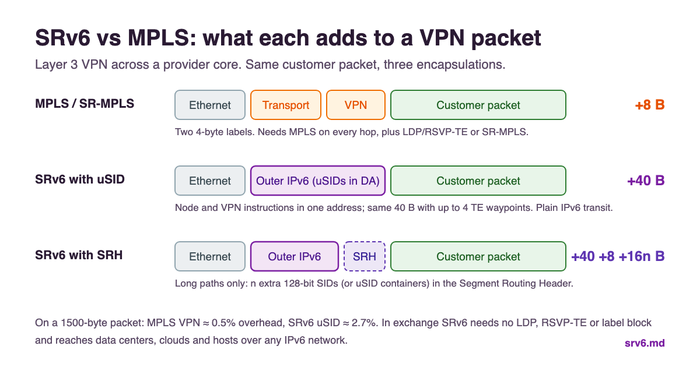

# SRv6 vs MPLS and SR-MPLS

**SRv6 and MPLS solve the same problem, steering traffic and carrying VPNs across a provider network, with different data planes.** MPLS forwards on labels and needs its own control protocols (LDP, RSVP-TE) or Segment Routing (SR-MPLS). SRv6 forwards on plain IPv6 addresses and needs neither. This page compares all three: classic MPLS, SR-MPLS and SRv6, with the real numbers behind the usual arguments.

!!! abstract "The short answer"
    - **Classic MPLS → SR-MPLS** removes LDP and RSVP-TE but keeps the MPLS data plane. It is the low-risk step for networks with MPLS hardware everywhere.
    - **SRv6** removes the MPLS data plane too. One IPv6 header carries the path, the VPN and the service, from the WAN into data centers, clouds and hosts.
    - **Overhead is the main trade-off:** a typical SR-MPLS VPN adds 8 bytes; an SRv6 uSID VPN adds 40. On 1500-byte packets that is 0.5% versus 2.7%.
    - **Most operators adopting SRv6 today go straight to SRv6 uSID** when their hardware supports it, and use SR-MPLS where it does not. See [Migration](interworking-migration.md).

## The three generations

| | Classic MPLS | SR-MPLS | SRv6 |
|--|-------------|---------|------|
| Data plane | MPLS labels | MPLS labels | IPv6 |
| Label / SID distribution | LDP, RSVP-TE | IGP (IS-IS, OSPF) or BGP | IGP or BGP (locators are IPv6 prefixes) |
| Traffic engineering | RSVP-TE: per-tunnel state on every transit router | SR Policy: state only at the headend | SR Policy and Flex-Algo: state only at the headend |
| Fast reroute | RSVP-TE FRR, LFA (partial coverage) | TI-LFA (full coverage) | TI-LFA (full coverage) |
| Segment identifier | — | 20-bit label (global index in the SRGB, or local) | 128-bit IPv6 address (locator : function : argument) |
| Services | L3VPN, L2VPN, EVPN | Same | Same, signalled with SRv6 SIDs ([RFC 9252](../rfcs/rfc9252.md)) |
| Standards | RFC 3031, LDP RFC 5036, RSVP-TE RFC 3209 | RFC 8402, RFC 8660, IGP extensions RFC 8665/8667 | [RFC 8754](../rfcs/rfc8754.md), [RFC 8986](../rfcs/rfc8986.md), [RFC 9800](../rfcs/rfc9800.md) |

Segment Routing ([RFC 8402](../rfcs/rfc8402.md)) is one architecture with two data planes. SR-MPLS and SRv6 share the same ideas: source routing, prefix and adjacency segments, TI-LFA, SR Policy and Flex-Algo. What changes is how a segment is encoded in the packet.

## How the packet changes

<figure markdown="span">
  { width="1200" height="630" loading="lazy" }
  <figcaption>SRv6 vs MPLS: what each encapsulation adds to a VPN packet</figcaption>
</figure>

A Layer 3 VPN packet crossing a core, with no traffic engineering:

```
Classic MPLS / SR-MPLS          +8 bytes
[ Ethernet ][ transport label | VPN label ][ customer IP packet ]
              4 bytes           4 bytes

SRv6 with uSID (no SRH)         +40 bytes
[ Ethernet ][ outer IPv6, DA = 5f00:0:0100:e004:: ][ customer IP packet ]
              40 bytes: node uSID + VPN uSID in one address

SRv6 with an SRH                +40 + 8 + 16 × n bytes
[ Ethernet ][ outer IPv6 ][ SRH: n extra SIDs ][ customer IP packet ]
```

With traffic engineering the gap narrows. Each extra SR-MPLS segment adds another 4-byte label, while SRv6 uSID packs up to six instructions into the same 128-bit destination address. The egress PE takes two of them (its node uSID and the VPN uSID), so a TE path with four waypoints and a VPN service still costs 40 bytes. Only longer paths need an SRH, which adds 8 bytes plus 16 per six more instructions.

| Case | SR-MPLS | SRv6 uSID |
|------|:-------:|:---------:|
| VPN, shortest path | 8 B | 40 B |
| VPN + 3 TE waypoints | 20 B | 40 B |
| VPN + 4 TE waypoints | 24 B | 40 B |
| VPN + 5 TE waypoints | 28 B | 64 B (one SRH container) |
| VPN + 10 TE waypoints | 48 B | 64 B (still one SRH container) |

What it means in practice: raise the core MTU (most cores already run 9000+), and the overhead disappears for any packet size you actually forward. Small-packet workloads (voice, gaming) feel the difference most, as a share of bandwidth. The [uSID page](usid-compression.md) has the full overhead comparison, and the [SID decoder](../tools/sid-decoder.md) shows how six uSIDs fit in one address.

## Where they really differ

### Control plane

Classic MPLS needs two or three protocols on top of the IGP: LDP for labels, RSVP-TE for engineered paths, and the synchronization between them (LDP-IGP sync, RSVP-TE refresh, FRR bypass tunnels). Both SR-MPLS and SRv6 drop all of that: the IGP advertises segments, BGP signals services, and an optional PCE computes explicit paths.

**SR-MPLS keeps one piece of MPLS state:** a label block (the SRGB) that must be consistent across the domain, plus label allocation for adjacencies and services. **SRv6 replaces labels with addresses:** each node owns a locator prefix, and SIDs are routable inside it. There is no label block to coordinate, and the core can summarize locators like any other IPv6 prefix.

### Reach beyond the MPLS core

This is the deciding factor for many networks. MPLS only works where every hop forwards MPLS. Public clouds, most data center fabrics and the Internet do not, so MPLS services stop at the edge and need gateways, GRE or VXLAN stitching to go further.

SRv6 works over any IPv6 network. Transit routers forward on the destination address and do not need to understand SRv6 at all; only the nodes that execute a SID do. That is how SRv6 reaches into [cloud backbones](../use-cases/cloud-native-backbone.md), [Kubernetes hosts](host-based-srv6.md) and [AI GPU fabrics](../ai/index.md), where MPLS never went.

### Network programming

An MPLS label means "forward here" or "this is VPN X". An SRv6 SID can also carry a function and arguments. [RFC 8986](../rfcs/rfc8986.md) defines decapsulate-and-lookup, cross-connect and policy-binding behaviors, and later RFCs add the [mobile user plane](../rfcs/rfc9433.md), [multicast replication](../rfcs/rfc9524.md) and [argument signaling](../rfcs/rfc9819.md). In practice most networks use the same handful of behaviors in both worlds; the difference shows in mobile, service chaining and host-based use cases.

### Load balancing

MPLS transit routers hash on the label stack, so they need an entropy label ([RFC 6790](https://www.rfc-editor.org/rfc/rfc6790)) or deep packet inspection to spread flows. SRv6 sets the IPv6 flow label from the inner flow at the headend, and every transit router hashes on the outer IPv6 header, which they already do for any IPv6 traffic.

### Inter-domain

MPLS VPNs across domains need inter-AS options A, B or C and label stitching at the borders. SRv6 SIDs are IPv6 prefixes: advertise or summarize the locator into the other domain and the end-to-end path works, with binding SIDs where you want to hide one domain's topology from the other. See [Inter-Domain SRv6](inter-domain.md).

### Security

An MPLS core is isolated by construction: labels are not routable from outside, so external packets cannot reach MPLS forwarding. SRv6 SIDs are IPv6 addresses, so the same isolation has to be built: filter the SID block (ideally `5f00::/16`, [RFC 9602](../rfcs/rfc9602.md)) and SRH packets at every external interface ([RFC 8754 section 5](../rfcs/rfc8754.md)). It is one well-defined filter, but it is not optional. See [Security](security.md).

### Operations

MPLS has LSP ping and traceroute ([RFC 8029](https://www.rfc-editor.org/rfc/rfc8029)) and decades of tooling and runbooks. SRv6 uses standard IPv6 ping and traceroute to SIDs plus the OAM extensions of [RFC 9259](../rfcs/rfc9259.md), and Wireshark decodes the SRH natively ([packet captures](../labs/pcaps.md)). Teams already fluent in IPv6 find SRv6 easier to read; teams with deep MPLS runbooks have retraining to do.

### Hardware and maturity

MPLS forwarding is in every service provider router built in the last twenty years. SRv6, and especially uSID, needs newer silicon: current NPUs and merchant switch chips handle uSID at line rate, while older line cards may support only SR-MPLS or full-length SRv6 with a small SID limit. Check the [support matrix](../implementations/support-matrix.md) and the push depth per platform before committing. SR-MPLS is the most widely deployed SR flavor today; SRv6 is the one growing fastest, with [19 organizations](../reports/state-of-srv6-2026.md#deployments-19-organizations) documenting production use, from SoftBank and Rakuten Mobile to Microsoft, Meta and Alibaba Cloud.

## When to choose each

!!! tip "Stay on classic MPLS (for now) when"
    - The network is stable, RSVP-TE does what you need, and nothing forces a change.
    - Plan the move to Segment Routing anyway: LDP and RSVP-TE are where vendors invest least.

!!! tip "Choose SR-MPLS when"
    - Your routers forward MPLS but cannot do SRv6 (or uSID) at line rate.
    - You want TI-LFA and SR Policy now, without changing the data plane.
    - Per-packet overhead matters more than reach beyond the core.

!!! tip "Choose SRv6 when"
    - You are building a new network or refreshing hardware.
    - Services must reach data centers, clouds or hosts that do not run MPLS.
    - You want one encapsulation from the access to the AI fabric, with no gateways in between.
    - Your team is moving to IPv6-only operations anyway.

Many operators run both during a transition: SR-MPLS in the parts of the network that cannot do SRv6 yet, SRv6 everywhere else, with interworking gateways or binding SIDs between them. The [migration guide](interworking-migration.md) covers greenfield, ship-in-the-night and phased strategies with real examples.

## Frequently Asked Questions

### Is SRv6 better than MPLS?

Neither is better everywhere. SRv6 removes protocols (LDP, RSVP-TE, the MPLS data plane itself) and reaches clouds, data centers and hosts that MPLS cannot. MPLS and SR-MPLS have less per-packet overhead and run on older hardware. For new networks and hardware refreshes, most operators now choose SRv6 with uSID.

### Will SRv6 replace MPLS?

Gradually, in many networks. LDP and RSVP-TE are being replaced by Segment Routing, and among Segment Routing deployments SRv6 is growing fastest, especially in 5G transport, cloud backbones and AI networks. MPLS will stay in installed networks for years, and SR-MPLS remains a sound choice where hardware cannot do SRv6.

### What is the difference between SRv6 and SR-MPLS?

Both implement the same Segment Routing architecture (RFC 8402). SR-MPLS encodes segments as 20-bit MPLS labels; SRv6 encodes them as 128-bit IPv6 addresses that also carry a function and arguments. SRv6 needs no label block and works over any IPv6 network, while SR-MPLS has smaller headers.

### How much overhead does SRv6 add compared to MPLS?

A typical SR-MPLS VPN adds 8 bytes (two labels). An SRv6 VPN with uSID adds 40 bytes (one outer IPv6 header) and keeps that size for paths with up to four traffic engineering waypoints. Longer paths add a Segment Routing Header: 8 bytes plus 16 bytes for every six more instructions. Classic SRv6 without compression adds 16 bytes per SID.

### Can SRv6 and MPLS run in the same network?

Yes. Ship-in-the-night deployments run SRv6 services in parallel with MPLS and move VRFs one at a time, and interworking gateways or binding SIDs connect SR-MPLS and SRv6 domains end to end. See the [migration guide](interworking-migration.md).

## Further Reading

- :material-arrow-right: [What is SRv6?](what-is-srv6.md) - The complete introduction
- :material-arrow-right: [MPLS to SRv6 Migration](interworking-migration.md) - Strategies, interworking and a phased rollout
- :material-arrow-right: [uSID Compression](usid-compression.md) - Why SRv6 overhead is no longer an issue
- :material-arrow-right: [SRv6 White Paper 2026](../white-papers/srv6-white-paper-2026.md) - Design and migration decisions for architects
- :material-arrow-right: [Real-World Deployments](../use-cases/deployments.md) - Who runs SRv6 in production

## References

1. [RFC 8402 - Segment Routing Architecture](https://www.rfc-editor.org/rfc/rfc8402) - One architecture for both MPLS and IPv6 data planes
2. [RFC 8660 - Segment Routing with the MPLS Data Plane](https://www.rfc-editor.org/rfc/rfc8660) - SR-MPLS forwarding and label encoding
3. [RFC 8754 - IPv6 Segment Routing Header (SRH)](https://www.rfc-editor.org/rfc/rfc8754) - The SRv6 extension header and its security model
4. [RFC 8986 - SRv6 Network Programming](https://www.rfc-editor.org/rfc/rfc8986) - SRv6 endpoint and headend behaviors
5. [RFC 9800 - Compressed SRv6 Segment List Encoding](https://www.rfc-editor.org/rfc/rfc9800) - uSID (NEXT-C-SID) and REPLACE-C-SID
6. [RFC 5036 - LDP Specification](https://www.rfc-editor.org/rfc/rfc5036) and [RFC 3209 - RSVP-TE](https://www.rfc-editor.org/rfc/rfc3209) - The classic MPLS control plane
7. [RFC 6790 - The Use of Entropy Labels in MPLS Forwarding](https://www.rfc-editor.org/rfc/rfc6790) - Load balancing in MPLS cores
8. [Cisco Segment Routing Overview and Migration Guidelines](https://www.cisco.com/c/en/us/support/docs/multiprotocol-label-switching-mpls/mpls/215215-segment-routing-overview-and-migration-g.html) - Practical overview of moving from LDP/RSVP-TE to SR
