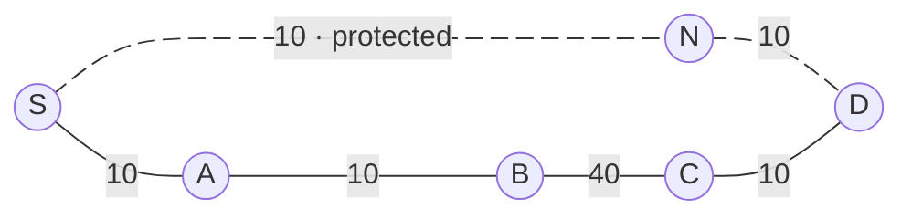

# TI-LFA (Topology Independent Loop-Free Alternate)

**Topology Independent Loop-Free Alternate — TI-LFA, sometimes written TILFA or "TI LFA" — is the fast-reroute (FRR) mechanism of Segment Routing.** Every router pre-computes, for each destination, a backup path that follows the route the network *will* use after the failure, and encodes it as a short segment list. When a link or neighbor fails, the router switches traffic onto that list in the data plane, without waiting for the IGP. It is standardized in [RFC 9855](../rfcs/rfc9855.md) (October 2025, Proposed Standard) and works identically for SR-MPLS and SRv6.

TI-LFA builds on the older IP FRR ideas — LFA, Remote LFA and Directed LFA — and, in the RFC's words, extends them to "guaranteed coverage in any two-connected network". Segment Routing is what makes that possible: the repair router can steer a packet along *any* path with a couple of SIDs, so it never depends on a lucky neighbor.

## The Problem: The Convergence Window

When a link fails, the IGP must detect the failure, flood the change, run SPF and update the FIB on every affected router. Until that finishes — hundreds of milliseconds to seconds in a large network — packets toward the failed link are dropped or loop.

IP FRR closes that gap locally: the router next to the failure, the **Point of Local Repair (PLR)**, has a backup next hop pre-installed in its FIB and switches to it as soon as it detects the failure (loss of light, BFD). The question is where that backup path comes from.

| Mechanism | How the backup is found | Limitation |
|-----------|-------------------------|------------|
| **LFA** ([RFC 5286](https://www.rfc-editor.org/rfc/rfc5286)) | A neighbor whose own shortest path to the destination does not come back through the PLR | Exists only if the topology happens to provide one. RFC 6571 measured per-prefix LFA coverage of **67–99%** (median 94%) across 11 service-provider cores |
| **Remote LFA** ([RFC 7490](https://www.rfc-editor.org/rfc/rfc7490)) | Tunnel (LDP) to a remote "PQ node" from which traffic flows to the destination unaided | Still topology-dependent: RFC 7490 reports **97.5–100%** link coverage on 14 topologies and much lower guaranteed node protection |
| **TI-LFA** (RFC 9855) | Segment list that reproduces the post-convergence path | Needs Segment Routing and enough SID depth on the PLR; covers any two-connected topology |

## Key Terms

| Term | Meaning |
|------|---------|
| **PLR** | Point of Local Repair — the router adjacent to the failure that switches traffic to the backup |
| **Protected resource (X)** | The link, node or SRLG the backup must avoid |
| **Post-convergence path** | The shortest path from the PLR to the destination once X is removed from the topology. TI-LFA repairs onto this path, so traffic does not move again when the IGP converges |
| **P-space P(R,X)** | Routers the PLR R can reach on its normal (pre-failure) shortest paths without any of those paths — including ECMP splits — crossing X |
| **Extended P-space** | The union of the P-spaces of the PLR's neighbors (except those reached via X). A router in the extended P-space can be reached by sending the packet out a specific neighbor first |
| **Q-space Q(D,X)** | Routers whose normal shortest path to the destination D does not cross X. A packet dropped off at a Q node gets to D on its own |
| **PQ node** | A node in both the (extended) P-space and the Q-space ([RFC 7490](https://www.rfc-editor.org/rfc/rfc7490) §1.1). A single segment to a PQ node is a complete repair |
| **Repair list (RL)** | The segments the PLR adds to the packet — generically `<Node-SID(P), explicit path P→Q>` |

## Worked Example: Finding P, Q and the Repair List

Six routers, IS-IS metrics on the links. S is the PLR, protecting its link to N, for traffic to D.



**Before the failure**, S reaches D via N (cost 20). A also reaches D via S and N (cost 30), so A is **not** an LFA: by the RFC 5286 inequality, A is loop-free only if dist(A,D) < dist(A,S) + dist(S,D), i.e. 30 < 10 + 20, which is false. Classic LFA has nothing to offer here.

**Step 1 — post-convergence path.** Remove S–N and recompute: S → A → B → C → D, cost 70.

**Step 2 — P-space of S (avoiding S–N).**

| Node | Shortest path from S today | Crosses S–N? | In P-space? |
|------|---------------------------|:------------:|:-----------:|
| A | S→A (10) | No | :material-check: |
| B | S→A→B (20) | No | :material-check: |
| C | S→N→D→C (30) | Yes | — |
| D | S→N→D (20) | Yes | — |

Extended P-space adds what A can reach without S–N: B, but not C (A's shortest path to C, cost 40, goes back through S–N). Extended P-space = {A, B}.

**Step 3 — Q-space of D (avoiding S–N).**

| Node | Shortest path to D today | Crosses S–N? | In Q-space? |
|------|--------------------------|:------------:|:-----------:|
| C | C→D (10) | No | :material-check: |
| B | B→A→S→N→D (40), cheaper than B→C→D (50) | Yes | — |
| A | A→S→N→D (30) | Yes | — |

**Step 4 — intersect along the post-convergence path.** P nodes on the path: A, B. Q nodes on the path: C. There is no PQ node, but the last P node (B) and the first Q node (C) are **adjacent**. RFC 9855 §5.3 gives the repair list:

```text
RL = < Node-SID(B), Adj-SID(B→C) >
```

The adjacency SID is essential: if S only sent the packet to B, B would forward it on its own shortest path to D — back through A and S — and the packet would loop. The Adj-SID forces B to use the expensive B–C link, after which C's normal routing delivers it.

!!! example "Variation: a PQ node exists"
    Lower the B–C metric to 10. Now B's own shortest path to D is B→C→D (20), so B is in the Q-space as well as the P-space. B is a **PQ node** and the repair list shrinks to a single segment: `RL = < Node-SID(B) >` — exactly what Remote LFA would have found, but without an LDP tunnel.

In SRv6 the same list becomes SRv6 SIDs: B's End (uN) SID followed by B's End.X (uA) SID toward C. With [uSID](usid-compression.md) both fit in one 128-bit container, so the PLR adds a single outer IPv6 header and no SRH:

```text
Original packet at S:   IPv6(DA = D's service SID) | payload
Repaired at S:          IPv6(DA = fcbb:bb00:B:BC::) | IPv6(DA = D's service SID) | payload
                                    └uN(B) └uA(B→C)
At B:  uN shifts, uA forwards over B–C and, with PSP/USD, removes the outer header
At C:  plain IPv6 forwarding of the original packet to D
```

### Repair-list shapes (RFC 9855 Section 5)

| Case | RFC 9855 | Repair list | Comparable to |
|------|----------|-------------|---------------|
| A direct neighbor is on the post-convergence path and in P and Q | §5.1 | Empty — just a different outgoing interface | Post-convergence LFA |
| A PQ node exists | §5.2 | `<Node-SID(PQ)>` | Remote LFA |
| P and Q are adjacent | §5.3 | `<Node-SID(P), Adj-SID(P→Q)>` | Directed LFA |
| P and Q are distant | §5.4 | `<Node-SID(P), …explicit path…>` (implementation-specific optimization) | — |

How often each case occurs is measured in RFC 9855 Appendix B on nine real networks: for link and local-SRLG protection, **one SID or fewer covers more than 99%** of destinations; for node protection, two SIDs or fewer cover 99%. On SRv6, adjacency SIDs are globally routable, so the list is often even shorter than on SR-MPLS (§7.2).

## Link vs Node vs SRLG Protection

The algorithm is the same; what changes is the resource X removed from the topology before computing the post-convergence path, P-space and Q-space.

| Protection | Removes from the topology | Repair-list effect | Use when |
|------------|---------------------------|--------------------|----------|
| **Link** (default) | The primary link S–N | Shortest lists; the backup may still pass **through N** via another link | Fiber cuts, optics failures |
| **Node** | N and all its links | Can need one more SID than link protection; never uses N | Router crashes, linecard resets, maintenance |
| **SRLG** | Every local link sharing an SRLG with S–N | Avoids links in the same conduit, DWDM system or linecard | Shared infrastructure failures |

Two things are easy to miss:

- **A link-protecting backup can be useless for a node failure.** If S has two parallel links to N, the link-protecting backup for one of them is simply the other — which dies too if N reboots. Node protection forces the list around N. If no node-protecting path exists, implementations fall back to link protection.
- **Node protection only protects transit through N.** Traffic whose destination *is* N (or a service SID owned by N) cannot be rerouted around N; RFC 9855 §6.1 keeps an active node segment on the packet and adds the repair list in front of it. Protecting traffic to a failed egress PE is a separate problem (see [draft-ietf-rtgwg-srv6-egress-protection](https://datatracker.ietf.org/doc/draft-ietf-rtgwg-srv6-egress-protection/) and BGP PIC).

Vendors pick between the modes with **tiebreakers**. A node-protecting path is preferred only when you configure it. Check SRLG support per data plane: Junos ignores SRLG in SRv6 TI-LFA and does not support SRLG protection in IPv6 networks.

## How TI-LFA Works with SRv6

RFC 9855 §7.2 states that the computation is identical for SRv6; only the encoding differs:

- At a **transit** PLR, the repair list is added with a headend behavior from RFC 8986 §5 — typically **H.Encaps.Red**, an outer IPv6 header whose DA is the first repair SID.
- At a PLR that is itself a **segment endpoint** for the packet, it first executes its endpoint behavior and then protects the packet like a transit packet.
- Repair SIDs advertised with the **USD** (and PSP) flavor let the last repair node remove the outer header and forward the original packet. That is why Cisco shows the P node's SID as `uN (PSP/USD)`.

Implementations differ in how the repair is applied, so don't assume one behavior:

| Platform | Repair encoding shown in the FIB |
|----------|----------------------------------|
| Cisco 8000 (IOS-XR) | `SRv6 H.Encaps.Red SID-list {…}`; with full-length SIDs, a backup is installed only if it needs two SIDs or fewer |
| Cisco NCS 5500/540 (IOS-XR) | `SRv6 H.Insert.Red SID-list {…}` (SRH insertion) |
| Cisco IOS-XE | `Segment List … mode:insert` |
| Junos | Encapsulation (reduced SRH) at the ingress PE; SRH insertion at transit nodes with `transit-srh-insert` |

## Configuration

=== "Cisco IOS-XR (SRv6)"

    ```cisco
    segment-routing
     srv6
      locators
       locator MAIN
        micro-segment behavior unode psp-usd
        prefix fcbb:bb00:1::/48
    !
    router isis CORE
     address-family ipv6 unicast
      metric-style wide
      microloop avoidance segment-routing
      segment-routing srv6
       locator MAIN
     !
     interface HundredGigE0/0/0/1
      point-to-point
      address-family ipv6 unicast
       fast-reroute per-prefix
       fast-reroute per-prefix ti-lfa
       !! optional: prefer node-protecting, then SRLG-disjoint backups
       fast-reroute per-prefix tiebreaker node-protecting index 100
       fast-reroute per-prefix tiebreaker srlg-disjoint index 200
    ```

    Link protection is the default. On current releases a **lower index means a higher priority** (range 1–255), and link protection always ranks below node or SRLG protection. Some older material, such as the 2016 SR TI-LFA TOI, describes the opposite ordering, so check the guide for your release. For SR-MPLS, configure the same `fast-reroute` commands under `address-family ipv4 unicast` with `segment-routing mpls`. To exclude a Flex-Algo from protection, use `flex-algo 128` → `fast-reroute disable`.

=== "Cisco IOS-XE"

    ```cisco
    !! SR-MPLS TI-LFA
    router isis
     fast-reroute per-prefix level-2 all
     fast-reroute ti-lfa level-2
     fast-reroute tie-break level-2 node-protecting 100
    !
    interface GigabitEthernet0/0/1
     isis network point-to-point
    !
    !! SRv6 TI-LFA (IOS XE 17.15.1a and later)
    segment-routing srv6
     locators
      locator A
       prefix CAFE:0:601::/48
       format usid-f3216
    !
    router isis 1
     address-family ipv6
      multi-topology
      segment-routing srv6
       locator A
      fast-reroute per-prefix level-2 all
      fast-reroute ti-lfa level-2
     exit-address-family
    ```

    Interface-level `isis fast-reroute ti-lfa protection level-2` overrides the protocol default and `... disable` excludes an interface. Default tiebreakers are linecard-disjoint, lowest-backup-metric and srlg-disjoint; node-protecting must be enabled explicitly. Cisco notes that IGP TI-LFA on IOS-XE "cannot guarantee 50 ms". See also [Cisco IOS-XE](../implementations/cisco-ios-xe.md).

=== "Junos"

    ```junos
    # TI-LFA for SR-MPLS and SRv6 in IS-IS
    set protocols isis backup-spf-options use-post-convergence-lfa
    set protocols isis backup-spf-options use-post-convergence-lfa maximum-backup-paths 2
    set protocols isis backup-spf-options use-source-packet-routing
    set protocols isis interface et-0/0/1.0 level 2 post-convergence-lfa
    # optional, per interface
    set protocols isis interface et-0/0/1.0 level 2 post-convergence-lfa node-protection
    set protocols isis interface et-0/0/1.0 level 2 post-convergence-lfa srlg-protection   # SR-MPLS/IPv4 only

    # SRv6 microloop avoidance
    set protocols isis spf-options microloop-avoidance post-convergence-path delay 5000
    ```

    Link protection is the default once `post-convergence-lfa` is on an interface. `maximum-labels` (2–5, default 3) caps the MPLS repair stack and `maximum-backup-paths` (1–8, default 1) the number of backups. For SRv6, Junos encapsulates with a reduced SRH at the ingress PE and can insert an SRH at transit nodes with `transit-srh-insert`. Micro-SID support for SRv6 TI-LFA and microloop avoidance arrived in Junos 23.4R1 (MX). `srlg-protection` (MX/PTX, 20.2R1) does not apply to SRv6: SRv6 TI-LFA ignores SRLGs, and SRLG protection is not supported in IPv6 or multi-topology networks. See [Juniper](../implementations/juniper.md) for the full SRv6 setup.

## Verification

=== "Cisco IOS-XR"

    ```cisco
    show isis ipv6 fast-reroute fcbb:bb00:2::/48 detail
    !! Backup path: TI-LFA (link), via fe80::..., HundredGigE0/0/0/1 Node3, Metric: 40
    !!   P node: Node4.00 [...], SRv6 SID: fcbb:bb00:4:: uN (PSP/USD)

    show route ipv6 fcbb:bb00:2::/48 detail
    !!   ... Backup (TI-LFA)   Repair Node(s): ...
    !!   SRv6 Headend: H.Encaps.Red, SID-list {fcbb:bb00:4::}

    show cef ipv6 fcbb:bb00:2::/48 detail
    show cef ipv6 fast-reroute-db
    ```

    The protection type appears in parentheses: `TI-LFA (link)`, `(node)`, `(srlg)` or `(node+srlg)`. On SR-MPLS, `show isis fast-reroute <prefix> detail` lists the P and Q nodes with their labels, and `show cef` shows the imposed label stack.

=== "Cisco IOS-XE"

    ```cisco
    show isis fast-reroute ti-lfa tunnel          ! SR-MPLS repair tunnels
    show ip cef 10.0.0.2 internal
    show isis ipv6 fast-reroute summary            ! SRv6: protected prefixes and coverage
    show isis ipv6 rib fcbb:bb00:2::/48            ! "repair path: via ... (DS,NP)"
    show ipv6 cef fcbb:bb00:2::/48 internal        ! "Segment List ... mode:insert"
    show isis ipv6 fast-reroute ti-lfa fwd-ids
    ```

=== "Junos"

    ```junos
    show isis backup coverage            # % of nodes and prefixes protected per address family
    show isis backup spf results         # backup computation per destination
    show isis backup spf results no-coverage
    show route 2001:db8::2 extensive     # primary and backup next hops
    ```

## TI-LFA and Micro-Loops

TI-LFA protects the moment of failure at the PLR. It does nothing for the **micro-loops** that can form elsewhere while routers update their FIBs at different times, or when the link comes back. RFC 9855 §1 calls the two mechanisms complementary and warns of one interaction: if the PLR converges early and releases its TI-LFA path before its neighbors have converged, the packets that were safely on the repair path can start looping — especially for repairs built from §5.2–5.4 (PQ or P/Q nodes rather than a direct neighbor).

The usual fix is to keep the TI-LFA path in place for a while after local convergence ([RFC 8333](https://www.rfc-editor.org/rfc/rfc8333)-style local delay) or to steer traffic over a loop-free SR path until the network settles:

```cisco
router isis CORE
 address-family ipv6 unicast
  microloop avoidance segment-routing
  microloop avoidance rib-update-delay 5000
```

On IOS-XR the delay range is documented as 1–60000 ms with a default of 5000. See [Micro-Loop Avoidance](micro-loop-avoidance.md) for the full picture.

!!! note "TI-LFA for multicast: RFC 9860"
    TI-LFA repair paths can also protect **PIM** trees. [RFC 9860](../rfcs/rfc9860.md) (October 2025, Informational) uses the repair segment list to build the MoFRR standby tree: the P-node's End SID is translated into a PIM RPF Vector and the P→Q End.X SID into an Explicit RPF Vector, so the secondary join follows the repair path hop by hop. This gives MoFRR the same topology-independent coverage that TI-LFA gives unicast. See [Multicast & Broadcast](multicast.md).

## TI-LFA vs Other FRR Mechanisms

| Mechanism | Coverage (published data) | Extra state | Repair follows post-convergence path | Topology dependent |
|-----------|---------------------------|-------------|:-----------------------------------:|:------------------:|
| **LFA** (RFC 5286) | 67–99% per prefix (RFC 6571, 11 SP cores) | None | Not necessarily | Yes |
| **Remote LFA** (RFC 7490) | 97.5–100% link protection (RFC 7490, 14 topologies) | Targeted LDP sessions | Not necessarily | Yes |
| **TI-LFA** (RFC 9855) | Any two-connected network; >99% with ≤ 1 SID for link protection (RFC 9855 App. B) | None beyond SR SIDs | Yes | No |
| **RSVP-TE FRR** | Full, per protected LSP | Bypass/detour LSPs and RSVP state | No | No |

!!! tip "No extra protocol state"
    TI-LFA needs no tunnels, no RSVP and no targeted LDP: the IGP computes the repair lists from the SIDs it already advertises. What it does need is enough **SID depth** on the PLR (some platforms install a backup only if it fits in two SIDs) and the protected SIDs advertised by every node on the repair path.

## Further Reading

- :material-file-document: [RFC 9855](../rfcs/rfc9855.md) - Topology Independent Fast Reroute Using Segment Routing
- :material-arrow-right: [Micro-Loop Avoidance](micro-loop-avoidance.md) - Preventing loops during the convergence window after TI-LFA
- :material-arrow-right: [uSID / SRv6 Compression](usid-compression.md) - Efficient backup segment encoding
- :material-arrow-right: [SRH Mechanics & Packet Walk](srh-packet-walk.md) - How backup segments are processed
- :material-download: [SRv6 Packet Captures](../labs/pcaps.md#end-x) - What an End.X adjacency SID (the building block of a repair list) looks like in Wireshark
- :material-arrow-right: [Flex-Algorithm](flex-algorithm.md) - TI-LFA within a Flex-Algo topology
- :material-arrow-right: [Mission-Critical Networks](../use-cases/mission-critical.md) - TI-LFA with node/SRLG/linecard-disjoint tiebreakers in a validated defense design
- :material-file-document: [RFC 9860](../rfcs/rfc9860.md) - MoFRR based on TI-LFA (multicast protection)
- :material-arrow-right: [Cisco IOS-XR](../implementations/cisco-ios-xr.md) - SRv6 configuration on IOS-XR
- :material-arrow-right: [Cisco IOS-XE](../implementations/cisco-ios-xe.md) - SRv6 configuration on IOS-XE
- :material-arrow-right: [Juniper](../implementations/juniper.md) - SRv6 configuration on Junos

## References

1. [RFC 9855 - Topology Independent Fast Reroute Using Segment Routing](https://www.rfc-editor.org/rfc/rfc9855) - Standards-track definition of TI-LFA: P/Q-space, repair lists, SR-MPLS and SRv6 data planes, coverage analysis
2. [RFC 7490 - Remote Loop-Free Alternate (LFA) Fast Reroute (FRR)](https://www.rfc-editor.org/rfc/rfc7490) - Remote LFA and the PQ node definition, with coverage results
3. [RFC 6571 - LFA Applicability in Service Provider Networks](https://www.rfc-editor.org/rfc/rfc6571) - Measured LFA coverage across 11 service-provider topologies
4. [RFC 5286 - Basic Specification for IP Fast Reroute: Loop-Free Alternates](https://www.rfc-editor.org/rfc/rfc5286) - The original LFA inequalities
5. [RFC 8333 - Micro-loop Prevention by Introducing a Local Convergence Delay](https://www.rfc-editor.org/rfc/rfc8333) - Delaying local FIB updates so FRR paths stay in place
6. [Cisco 8000: Configure TI-LFA for SRv6](https://www.cisco.com/c/en/us/td/docs/iosxr/cisco8000/SRv6/srv6-config-guide-cisco8000/implementing-ti-lfa-for-srv6/configure-ti-lfa.html) - IOS-XR SRv6 TI-LFA configuration and verification output
7. [Cisco 8000: Usage Guidelines for SRv6 TI-LFA](https://www.cisco.com/c/en/us/td/docs/iosxr/cisco8000/SRv6/srv6-config-guide-cisco8000/implementing-ti-lfa-for-srv6/usage-guidelines-for-srv6-ti-lfa.html) - Tiebreaker priorities, node and SRLG protection rules
8. [Cisco IOS-XE: IS-IS SRv6 TI-LFA](https://www.cisco.com/c/en/us/td/docs/ios-xml/ios/seg_routing/configuration/xe-17/segrt-xe-17-book/m_isis-srv6-tilfa-frr.html) - SRv6 TI-LFA on IOS XE 17.15.1a and later
9. [Cisco IOS-XE: IS-IS TI-LFA FRR](https://www.cisco.com/c/en/us/td/docs/ios-xml/ios/seg_routing/configuration/xe-17/segrt-xe-17-book/m_isis-tilfa-frr.html) - SR-MPLS TI-LFA configuration, tiebreakers and verification
10. [Cisco: IS-IS SRv6 Microloop Avoidance Behavior](https://www.cisco.com/c/en/us/support/docs/ip/ip-version-6/225441-is-is-srv6-microloop-avoidance-behavior.html) - TI-LFA and microloop avoidance sequence on NCS platforms (H.Insert.Red repair)
11. [Juniper: Configuring TI-LFA Using SPRING for IS-IS](https://www.juniper.net/documentation/us/en/software/junos/is-is/topics/example/example-configuring-ti-lfa-using-spring-is-is.html) - Junos TI-LFA configuration example
12. [Juniper: Understanding TI-LFA for IS-IS](https://www.juniper.net/documentation/us/en/software/junos/is-is/topics/concept/understanding-ti-lfa-for-is-is.html) - Junos backup options, limits and IPv6 caveats
13. [Juniper: SRv6 Network Programming in IS-IS](https://www.juniper.net/documentation/us/en/software/junos/is-is/topics/concept/isis-srv6-network-programming.html) - SRv6 TI-LFA on Junos, transit SRH insertion and the SRLG limitation
14. [RFC 9860 - Multicast-Only Fast Reroute (MoFRR) Based on TI-LFA](https://www.rfc-editor.org/rfc/rfc9860) - Uses TI-LFA repair paths and PIM RPF Vectors to build MoFRR standby trees
