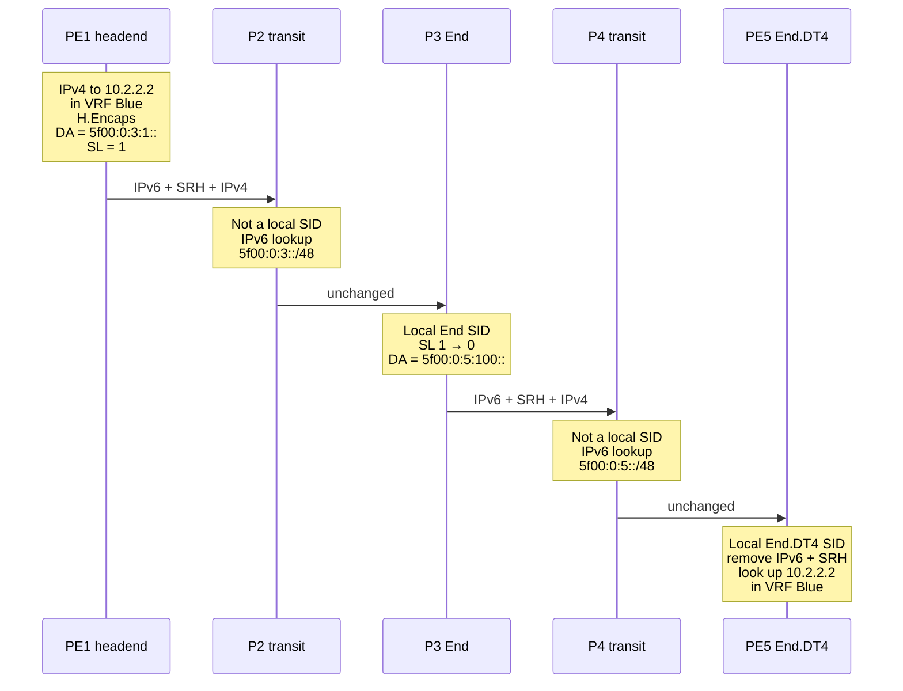

# What is SRv6?

**SRv6 (Segment Routing over IPv6)** is a way to steer and program network traffic by writing an ordered list of instructions, called *segments*, into the IPv6 packet itself. Each instruction is a 128-bit IPv6 address (a **SID**). A router acts on the instruction in the packet's destination address, then the next one takes its place. Paths, VPNs and fast reroute therefore work without per-flow state in the core, without LDP or RSVP-TE, and without an MPLS data plane. SRv6 is an IETF standard ([RFC 8402](../rfcs/rfc8402.md), [RFC 8754](../rfcs/rfc8754.md), [RFC 8986](../rfcs/rfc8986.md)) built on ordinary IPv6 forwarding.

!!! abstract "In this guide"
    1. [SRv6 at a glance](#srv6-at-a-glance)
    2. [Why SRv6 exists](#why-srv6-exists)
    3. [How SRv6 works: the building blocks](#how-srv6-works-the-building-blocks)
    4. [An SRv6 packet walk, hop by hop](#an-srv6-packet-walk-hop-by-hop)
    5. [uSID: SRv6 with compressed SIDs](#usid-srv6-with-compressed-sids)
    6. [SRv6 vs IPv6](#srv6-vs-ipv6) and [SRv6 vs MPLS and SR-MPLS](#srv6-vs-mpls-and-sr-mpls)
    7. [What SRv6 is used for](#what-srv6-is-used-for) and [who uses SRv6](#who-uses-srv6)
    8. [Trade-offs to know](#trade-offs-to-know)
    9. [How to try SRv6](#how-to-try-srv6)
    10. [Frequently asked questions](#frequently-asked-questions)

New to the vocabulary? Every term on this page has a short definition, with the RFC section behind it, in the [SRv6 Glossary](glossary.md).

## SRv6 at a glance

| | |
|---|---|
| **What it is** | Segment Routing ([RFC 8402](../rfcs/rfc8402.md)) applied to the IPv6 data plane |
| **Core idea** | The source encodes the path and the services as a list of IPv6 addresses (SIDs) in the packet |
| **Instruction format** | 128-bit SID = Locator (where) + Function (what) + Arguments (optional data) |
| **Header** | Normal IPv6 header, plus the Segment Routing Header (SRH, [RFC 8754](../rfcs/rfc8754.md)) when more than one SID has to be carried |
| **Behaviors** | End, End.X, End.DT4/DT6/DT46, End.DX2, H.Encaps… defined in [RFC 8986](../rfcs/rfc8986.md) |
| **Control plane** | IS-IS ([RFC 9352](../rfcs/rfc9352.md)), OSPFv3 ([RFC 9513](../rfcs/rfc9513.md)), BGP services ([RFC 9252](../rfcs/rfc9252.md)), SR Policy ([RFC 9256](../rfcs/rfc9256.md)). No LDP or RSVP-TE |
| **Compression** | uSID / compressed SIDs ([RFC 9800](../rfcs/rfc9800.md)): several instructions in one 128-bit address |
| **SID address block** | `5f00::/16`, reserved by IANA for SRv6 SIDs ([RFC 9602](../rfcs/rfc9602.md)) |
| **Typical uses** | Traffic engineering, L3VPN/EVPN, TI-LFA fast reroute, network slicing, 5G transport, AI fabrics |
| **Who runs it** | Operators such as SoftBank, Bell Canada, Swisscom and China Mobile, plus cloud and AI networks at Microsoft, Meta and OpenAI ([deployments](../use-cases/deployments.md)) |

### IPv6 Segment Routing, Segment Routing v6, SRv6: one technology

You will also see SRv6 called **IPv6 Segment Routing**, **Segment Routing v6** or **SR v6**. All of these names mean the same IETF technology. Segment Routing has two data planes:

| Name you will see | What it means |
|-------------------|---------------|
| **SRv6**, Segment Routing over IPv6, IPv6 Segment Routing, Segment Routing v6, SR v6 | Segments are IPv6 addresses. The list travels in the destination address and, when needed, in the SRH ([RFC 8754](../rfcs/rfc8754.md)) |
| **SR-MPLS**, Segment Routing MPLS | Segments are MPLS labels on a label stack ([RFC 8660](https://www.rfc-editor.org/rfc/rfc8660)) |

The "v6" names the IP version of the data plane. It does not mean a sixth release of Segment Routing. The two data planes share their control-plane features: IS-IS/OSPFv3 extensions, [Flex-Algo](flex-algorithm.md), [TI-LFA](ti-lfa.md) and [SR Policy](sr-policy.md). That is why vendor guides often cover both under one "Segment Routing" title.

## Why SRv6 exists

A classic MPLS service-provider network uses four or five protocols for what is really one job, which is moving packets along a chosen path and into the right VPN:

| Job | Classic MPLS network | SRv6 network |
|-----|----------------------|--------------|
| Topology and reachability | IS-IS or OSPF | IS-IS or OSPFv3, which also advertise SRv6 locators |
| Transport labels | LDP, one label per FEC on every hop | None. Locators are ordinary IPv6 prefixes |
| Traffic engineering | RSVP-TE, with tunnel state on every midpoint router | SR Policy. State lives only on the headend |
| VPN services | BGP with VPN labels | BGP with SRv6 service SIDs ([RFC 9252](../rfcs/rfc9252.md)) |
| Fast reroute | RSVP-TE FRR or LFA with coverage gaps | [TI-LFA](ti-lfa.md), with full topology-independent coverage |
| Data plane | MPLS, enabled hop by hop in every domain | IPv6. Transit routers only need to forward IPv6 |

Each extra protocol adds state, configuration and failure modes. RSVP-TE is the worst case: a full mesh of tunnels between *N* edge routers means on the order of *N²* tunnels, and every midpoint router keeps state for every tunnel that crosses it. MPLS also stops at domain edges. Data centers, hosts and many access networks run plain IP, so services have to be stitched together at every boundary with VXLAN, GRE or inter-AS options.

[Segment Routing](../rfcs/rfc8402.md) fixed the state problem with **source routing**. The headend writes the path into the packet, and the core keeps no per-path state. SR-MPLS still needs MPLS everywhere. SRv6 goes one step further and expresses the instructions as IPv6 addresses. As a result:

- **One data plane end to end.** The same encapsulation runs across WAN, metro, data center and even Linux hosts. IPv4 traffic is carried as a payload.
- **The service lives in the address.** An SRv6 SID can mean "decapsulate and look up in VRF Blue", so a VPN needs no separate label.
- **Locators can be summarized** like any IPv6 prefix, which helps large multi-area and multi-domain networks scale.
- **The network becomes programmable.** Operators and applications can chain instructions to build a "network program" ([RFC 8986](../rfcs/rfc8986.md)).

!!! tip "An analogy that fits"
    Think of SRv6 as a sat-nav route with waypoints. The driver (the headend) enters a few waypoints. Between waypoints, the sat-nav picks the best road (the IGP shortest path), and nobody along the road needs to know the full itinerary. At each waypoint something can happen, such as "pick up a passenger" or "switch to the express lane". In SRv6 that is the SID's function.

## How SRv6 works: the building blocks

### Segments and SIDs

A **segment** is an instruction. In SRv6 every segment is identified by a **SID** (Segment Identifier), which is a 128-bit value written like an IPv6 address. [RFC 8986](../rfcs/rfc8986.md) divides it into three parts:

<figure class="srv6-figure" style="width:100%">
<svg viewBox="0 0 760 222" role="img" aria-labelledby="sidfig-title sidfig-desc" xmlns="http://www.w3.org/2000/svg" style="width:100%;height:auto;max-width:760px">
<title id="sidfig-title">Anatomy of an SRv6 SID</title>
<desc id="sidfig-desc">The 128-bit SID 5f00:0:5:100:: split into a 32-bit block, a 16-bit node ID, a 16-bit function and 64 bits of arguments. Block and node ID form the locator 5f00:0:5::/48, a routable prefix that says where to go. The function says what to do there. The arguments carry optional data.</desc>
<style>
.sidf-a{fill:var(--md-primary-fg-color);fill-opacity:.10;stroke:var(--md-primary-fg-color);stroke-width:1.5}
.sidf-b{fill:var(--md-primary-fg-color);fill-opacity:.24;stroke:var(--md-primary-fg-color);stroke-width:1.5}
.sidf-c{fill:none;stroke:var(--md-default-fg-color--light);stroke-width:1.5;stroke-dasharray:5 4}
.sidf-hex{fill:var(--md-default-fg-color);font-family:var(--md-code-font-family,monospace);font-size:20px}
.sidf-bits{fill:var(--md-default-fg-color--light);font-size:14px}
.sidf-name{fill:var(--md-default-fg-color);font-size:15px;font-weight:700}
.sidf-note{fill:var(--md-default-fg-color--light);font-size:14px}
.sidf-br{fill:none;stroke:var(--md-default-fg-color--light);stroke-width:1.3}
.sidf-sid{fill:var(--md-default-fg-color);font-family:var(--md-code-font-family,monospace);font-size:16px}
</style>
<text class="sidf-bits" x="100" y="28" text-anchor="middle">32 bits</text>
<text class="sidf-bits" x="230" y="28" text-anchor="middle">16 bits</text>
<text class="sidf-bits" x="365" y="28" text-anchor="middle">16 bits</text>
<text class="sidf-bits" x="595" y="28" text-anchor="middle">64 bits</text>
<rect class="sidf-a" x="20" y="38" width="160" height="48" rx="4"/>
<rect class="sidf-a" x="180" y="38" width="100" height="48"/>
<rect class="sidf-b" x="280" y="38" width="170" height="48"/>
<rect class="sidf-c" x="450" y="38" width="290" height="48" rx="4"/>
<text class="sidf-hex" x="100" y="68" text-anchor="middle">5f00:0000</text>
<text class="sidf-hex" x="230" y="68" text-anchor="middle">0005</text>
<text class="sidf-hex" x="365" y="68" text-anchor="middle">0100</text>
<text class="sidf-hex" x="595" y="68" text-anchor="middle">0000:0000:0000:0000</text>
<text class="sidf-note" x="100" y="106" text-anchor="middle">SID block</text>
<text class="sidf-note" x="230" y="106" text-anchor="middle">node ID</text>
<path class="sidf-br" d="M22 116 v8 H278 v-8"/>
<path class="sidf-br" d="M282 116 v8 H448 v-8"/>
<path class="sidf-br" d="M452 116 v8 H738 v-8"/>
<text class="sidf-name" x="150" y="146" text-anchor="middle">Locator: where to go</text>
<text class="sidf-note" x="150" y="166" text-anchor="middle">5f00:0:5::/48, routed normally</text>
<text class="sidf-name" x="365" y="146" text-anchor="middle">Function: what to do</text>
<text class="sidf-note" x="365" y="166" text-anchor="middle">0x100 = End.DT4, VRF Blue</text>
<text class="sidf-name" x="595" y="146" text-anchor="middle">Arguments: optional data</text>
<text class="sidf-note" x="595" y="166" text-anchor="middle">zero for most behaviors</text>
<text class="sidf-sid" x="380" y="205" text-anchor="middle">Written as one IPv6 address: 5f00:0:5:100::</text>
</svg>
<figcaption>One SID, one instruction: "go to node 5, then decapsulate and look up the inner IPv4 packet in VRF Blue."</figcaption>
</figure>

| Part | Role | Example |
|------|------|---------|
| **Locator** | Routable prefix that leads to the node owning the SID. Made of a domain-wide **block** plus a **node ID** | `5f00:0:5::/48` |
| **Function** | Selects the behavior the node executes, such as End, End.X or End.DT4 | `0x100` → End.DT4 into VRF Blue |
| **Arguments** | Optional per-packet data used by a few behaviors (for example EVPN split-horizon or MUP) | Usually `0` |

Field lengths are an operator choice. Only the total of 128 bits is fixed. Routers advertise their **locators** in the IGP as ordinary IPv6 prefixes. Each router keeps its own **SIDs** in a local SID table, the "My SID table" of RFC 8986. A SID is not an interface address, and [RFC 9602](../rfcs/rfc9602.md) set aside `5f00::/16` so SIDs are easy to spot and filter. Details are in [SID Structure](sid-structure.md).

### The active segment lives in the destination address

This is the key idea of SRv6. **The IPv6 destination address (DA) always holds the active SID**, which is the instruction to execute next. Routers that do not own that SID route the packet like any other IPv6 packet. The router that owns it executes the function, writes the next SID into the DA, and forwards the packet again.

So a single-instruction program needs no extra header at all: one SID in the DA is enough. VPN traffic between two PEs often looks exactly like that.

### The Segment Routing Header (SRH)

When a path needs more than one SID, the remaining ones travel in the **Segment Routing Header**. The SRH is an IPv6 routing extension header (Next Header 43, Routing Type 4) defined in [RFC 8754](../rfcs/rfc8754.md).

```
 0                   1                   2                   3
 0 1 2 3 4 5 6 7 8 9 0 1 2 3 4 5 6 7 8 9 0 1 2 3 4 5 6 7 8 9 0 1
+-+-+-+-+-+-+-+-+-+-+-+-+-+-+-+-+-+-+-+-+-+-+-+-+-+-+-+-+-+-+-+-+
|  Next Header  |  Hdr Ext Len  | Routing Type=4| Segments Left |
+-+-+-+-+-+-+-+-+-+-+-+-+-+-+-+-+-+-+-+-+-+-+-+-+-+-+-+-+-+-+-+-+
|  Last Entry   |    Flags      |              Tag              |
+-+-+-+-+-+-+-+-+-+-+-+-+-+-+-+-+-+-+-+-+-+-+-+-+-+-+-+-+-+-+-+-+
|        Segment List[0]  (last SID of the path, 128 bits)      |
+-+-+-+-+-+-+-+-+-+-+-+-+-+-+-+-+-+-+-+-+-+-+-+-+-+-+-+-+-+-+-+-+
|                              ...                              |
+-+-+-+-+-+-+-+-+-+-+-+-+-+-+-+-+-+-+-+-+-+-+-+-+-+-+-+-+-+-+-+-+
|        Segment List[n]  (first SID of the path, 128 bits)     |
+-+-+-+-+-+-+-+-+-+-+-+-+-+-+-+-+-+-+-+-+-+-+-+-+-+-+-+-+-+-+-+-+
|              Optional TLVs (e.g. HMAC, padding)               |
+-+-+-+-+-+-+-+-+-+-+-+-+-+-+-+-+-+-+-+-+-+-+-+-+-+-+-+-+-+-+-+-+
```

| Field | What it does |
|-------|--------------|
| **Segments Left (SL)** | Index of the active SID. Each endpoint decrements it by one |
| **Last Entry** | Index of the last element of the segment list |
| **Segment List** | The SIDs, stored in **reverse order**: `[0]` is the final SID and `[n]` is the first |
| **Tag / Flags** | Packet marking. No flags are defined yet |
| **TLVs** | Optional data, such as the HMAC TLV for authenticating the SRH |

Overhead for encapsulated traffic is **40 bytes** of outer IPv6 header, plus **8 bytes** of fixed SRH, plus **16 bytes per SID** in the list. The SRH is often smaller than that, or absent:

- **H.Encaps.Red** (reduced encapsulation) leaves the first SID out of the SRH because it is already in the DA. With a single SID this removes the SRH completely.
- **uSID** packs several instructions into one address, so many paths need no SRH at all. See [below](#usid-srv6-with-compressed-sids).

See [SRH Mechanics & Packet Walk](srh-packet-walk.md) for every field and the PSP/USP/USD flavors.

### Three roles: source, transit and endpoint

| Role | What the node does | Needs SRv6 support? |
|------|--------------------|:-------------------:|
| **Source node / headend** | Classifies the packet, picks the SID list (from BGP, an SR Policy or a controller) and adds the outer IPv6 header and SRH (H.Encaps) | Yes |
| **Transit node** | Forwards on the DA with a normal IPv6 longest-prefix match. It does not inspect the SRH ([RFC 8754 §4.2](../rfcs/rfc8754.md)) | **No**, plain IPv6 is enough |
| **Segment endpoint** | The DA matches one of its local SIDs, so it runs the behavior: update SL and DA, decapsulate, cross-connect… | Yes |

Because transit nodes need nothing beyond IPv6, SRv6 can cross parts of the network that have never heard of it. This is a major practical difference from MPLS.

### Network programming: SIDs as instructions

[RFC 8986](../rfcs/rfc8986.md) defines what a SID can *do*. A segment list is effectively a small program, and each SID is one instruction in it.

| Behavior | Meaning | Typical use |
|----------|---------|-------------|
| **End** | Move to the next SID (decrement SL, copy the next SID into the DA) | Pass through a node, as in loose TE |
| **End.X** | Same as End, but send the packet out a specific adjacency | Strict TE, TI-LFA repair paths |
| **End.DT4 / End.DT6 / End.DT46** | Decapsulate and look up the inner packet in a VRF table | L3VPN |
| **End.DX4 / End.DX6** | Decapsulate and send to a specific next hop | Per-CE L3VPN |
| **End.DX2 / End.DT2U / End.DT2M** | Decapsulate an Ethernet frame into a cross-connect or bridge | EVPN VPWS / E-LAN |
| **End.B6.Encaps** | Apply another SR Policy (Binding SID) | Scaling and inter-domain TE |
| **H.Encaps / H.Encaps.Red** | Headend: wrap the packet in IPv6 + SRH | Steering into SRv6 |

Later RFCs add behaviors for compressed SIDs ([RFC 9800](../rfcs/rfc9800.md)), the mobile user plane ([RFC 9433](../rfcs/rfc9433.md)) and multicast replication ([RFC 9524](../rfcs/rfc9524.md)). The full catalogue is in [Network Programming](network-programming.md).

### The control plane: who tells the headend which SIDs to use

SRv6 has no signaling protocol of its own. Existing protocols carry the information:

- **IS-IS / OSPFv3** advertise each node's locator and its End/End.X SIDs ([RFC 9352](../rfcs/rfc9352.md), [RFC 9513](../rfcs/rfc9513.md)). [Flex-Algo](flex-algorithm.md) gives each locator its own constrained topology.
- **BGP** advertises service SIDs with VPN and EVPN routes ([RFC 9252](../rfcs/rfc9252.md)). In the simplest mode, **SRv6 BE (best effort)**, a PE puts the remote PE's service SID in the DA and the IGP shortest path does the rest.
- **SR Policy** ([RFC 9256](../rfcs/rfc9256.md)) defines explicit SID lists for **SRv6 TE**. A controller can deliver it through BGP ([RFC 9830](../rfcs/rfc9830.md)) or PCEP ([RFC 9603](../rfcs/rfc9603.md)), using topology learned through BGP-LS ([RFC 9514](../rfcs/rfc9514.md)). Traffic is steered into a policy by color.

## An SRv6 packet walk, hop by hop

Here is a complete example: an L3VPN packet that must take a traffic-engineered path through **P3**, for instance because P3 is on the low-latency route.

- **PE1** (headend) learned from BGP that `10.2.2.0/24` in VRF Blue sits behind **PE5**, with service SID `5f00:0:5:100::` (End.DT4).
- An SR Policy on PE1 says to reach PE5 through P3, whose End SID is `5f00:0:3:1::`.
- **P2** and **P4** are transit routers. They only know the locator prefixes `5f00:0:3::/48` and `5f00:0:5::/48` from IS-IS.



This is the packet PE1 builds:

```
Outer IPv6   SA = 2001:db8::1 (PE1)   DA = 5f00:0:3:1::   Next Header = 43
SRH          Routing Type = 4   Segments Left = 1   Last Entry = 1
             Segment List[0] = 5f00:0:5:100::   (PE5: End.DT4, VRF Blue)
             Segment List[1] = 5f00:0:3:1::     (P3: End)
Inner IPv4   10.1.1.1 → 10.2.2.2
Payload
```

| Step | Node | Role | DA after this node | SL | What happens |
|:----:|------|------|--------------------|:--:|--------------|
| 1 | PE1 | Headend, H.Encaps | `5f00:0:3:1::` | 1 | Wraps the IPv4 packet in IPv6 + SRH, with the first SID in the DA |
| 2 | P2 | Transit | `5f00:0:3:1::` | 1 | Normal IPv6 longest-prefix match. The SRH is ignored |
| 3 | P3 | Endpoint, End | `5f00:0:5:100::` | 0 | DA matches a local SID: SL is decremented, `Segment List[0]` is copied into the DA, hop limit is decremented |
| 4 | P4 | Transit | `5f00:0:5:100::` | 0 | Normal IPv6 lookup toward PE5's locator |
| 5 | PE5 | Endpoint, End.DT4 | (decapsulated) | – | Removes the outer IPv6 header and SRH, then forwards 10.2.2.2 using VRF Blue's table |

!!! info "What changes in practice"
    - **PSP flavor:** P3 is the penultimate endpoint, so with Penultimate Segment Pop it removes the SRH. PE5 then receives a plain IPv6 packet whose DA is its End.DT4 SID.
    - **Overhead:** the example costs 40 + 8 + 2 × 16 = **80 bytes**. With H.Encaps.Red it is 64 bytes. With uSID both instructions fit in the DA, so it is **40 bytes and no SRH**.
    - **Without TE (SRv6 BE):** PE1 would put only `5f00:0:5:100::` in the DA with no SRH, and the IGP shortest path would carry the packet to PE5.

## uSID: SRv6 with compressed SIDs

Early SRv6 was criticized for overhead. Sixteen bytes per SID adds up fast on a long TE path, and some hardware can only push a few SIDs. **Micro-SIDs (uSIDs)** solve this. They are the NEXT-C-SID flavor of [RFC 9800](../rfcs/rfc9800.md), which also defines the REPLACE-C-SID flavor (G-SRv6).

With the common **F3216** format, one 128-bit address holds a 32-bit uSID block followed by up to **six 16-bit micro-instructions**:

```
fcbb:bb00 : 0003 : 0005 : e004 : 0000 : 0000 : 0000
 block      P3     PE5    PE5's VRF decap   end of container
```

Each node consumes its own uSID and **shifts** the rest of the address left, then forwards on the new DA. Transit nodes still do a plain IPv6 lookup. Recent deployments such as Rakuten Mobile, Swisscom, Bell Canada, Telefonica VIVO and Rijkswaterstaat run uSID, and with it a typical VPN-over-TE path fits in the IPv6 header alone.

→ Full explanation with overhead tables: [uSID / SRv6 Compression](usid-compression.md).

## SRv6 vs IPv6

SRv6 is **not** a new IP version and not an alternative to IPv6. It is a way of *using* IPv6: addresses gain a second meaning as instructions, and the routing header type 4 carries the list.

| | IPv6 | SRv6 |
|---|------|------|
| **What it is** | The Internet Protocol, version 6 ([RFC 8200](https://www.rfc-editor.org/rfc/rfc8200)) | Segment Routing implemented with IPv6 packets |
| **Meaning of the destination address** | A host or interface | The active instruction: a node *and* a function |
| **Path selection** | Hop by hop, each router picks the next hop | The source picks waypoints. Between them, normal IPv6 routing applies |
| **Headers** | IPv6 header + optional extension headers | The same, plus the SRH (Routing Type 4) when needed |
| **Router support** | Every IPv6 router | Headends and endpoints need SRv6. Transit routers only need IPv6 |
| **Services** | None built in | VPN, TE, fast reroute and slicing encoded in SIDs |

## SRv6 vs MPLS and SR-MPLS

| | MPLS with LDP / RSVP-TE | SR-MPLS | SRv6 |
|---|---|---|---|
| **Data plane** | MPLS labels | MPLS labels | IPv6 |
| **Instruction size** | 4-byte label entry | 4-byte label entry | 16-byte SID, or 2-byte uSID |
| **Label/SID distribution** | LDP, RSVP-TE | IGP extensions | IGP extensions (locators are prefixes) |
| **TE state in the core** | Per tunnel (RSVP-TE) | None | None |
| **Crosses IP-only networks** | No | No | Yes |
| **Summarization of node addresses** | Not with LDP (needs /32 host routes) | No (prefix SIDs per node) | Yes, locators are summarizable prefixes |
| **Network programming** | VPN labels only | Limited | Rich (function + arguments) |
| **Encapsulation overhead** | Smallest | Smallest | 40-byte IPv6 header minimum; per-SID cost removed by uSID |
| **Maturity** | Decades | Widely deployed | In production since 2019, growing fast |

SRv6 trades a larger fixed header for one data plane everywhere and no LDP or RSVP-TE. The full comparison, with guidance on when to choose each, is in [SRv6 vs SR-MPLS](srv6-vs-sr-mpls.md). Migration paths are in [Interworking & Migration](interworking-migration.md).

## What SRv6 is used for

| Use case | What SRv6 provides | Learn more |
|----------|--------------------|------------|
| **Traffic engineering** | Explicit or constraint-based paths with no midpoint state. Low-latency and disjoint paths through SR Policy and Flex-Algo | [Traffic Engineering](../use-cases/traffic-engineering.md), [SR Policy](sr-policy.md), [Flex-Algo](flex-algorithm.md) |
| **L3VPN and EVPN** | VPN and EVPN services carried by a service SID, with no MPLS and no VXLAN | [VPN Services](../use-cases/vpn-services.md), [BGP Overlay](bgp-overlay-services.md), [EVPN Multihoming](evpn-multihoming.md) |
| **Fast reroute** | TI-LFA protection, typically under 50 ms, in any topology, repairing onto the post-convergence path | [TI-LFA](ti-lfa.md), [Micro-Loop Avoidance](micro-loop-avoidance.md) |
| **Network slicing** | Per-slice topologies and SLAs from Flex-Algo, QoS and SR Policy | [Network Slicing](../use-cases/network-slicing.md) |
| **5G transport and MUP** | One transport from RAN to core. SRv6 MUP replaces GTP-U tunnels ([RFC 9433](../rfcs/rfc9433.md)) | [5G Transport](../use-cases/5g-transport.md) |
| **AI fabrics** | Deterministic per-flow path placement across GPU fabrics and between AI data centers | [SRv6 for AI](../ai/index.md), [AI/ML Networks](../use-cases/ai-networking.md) |
| **Service chaining** | Steering traffic through firewalls and other network functions as SIDs in the list | [Service Chaining](../use-cases/service-chaining.md) |
| **Cloud and host networking** | SRv6 from the server or a cloud VPC across the backbone | [Cloud Backbone](../use-cases/cloud-native-backbone.md), [Host-Based SRv6](host-based-srv6.md) |

## Who uses SRv6

SRv6 has been in commercial service since 2019 and is deployed by:

- **Telecom operators**, including SoftBank and Rakuten Mobile (Japan), China Mobile, Reliance Jio, Bell Canada, Swisscom, Iliad, Telefonica VIVO and Verizon (which is moving to SRv6 in all domains).
- **Cloud and AI networks:** Microsoft (Fairwater AI data centers), OpenAI (MRC on 100K+ GPU clusters), Meta (backbone TE), Google (Virgo AI fabric), Alibaba Cloud and Nebius.
- **Public sector:** Rijkswaterstaat (Netherlands), which migrated its national backbone from MPLS to SRv6 uSID.

Every entry, with a link to the original announcement, is in [Real-World Deployments](../use-cases/deployments.md). Implementations include Cisco IOS XR and IOS XE, Juniper Junos, Nokia SR OS, Arista EOS, Huawei, the Linux kernel, FRRouting, VPP and SONiC. See [Implementations](../implementations/index.md).

### A short history

| Year | Milestone |
|:----:|-----------|
| 2013 | The IETF SPRING working group is formed to standardize Segment Routing |
| 2017 | Linux 4.10 ships an SRv6 data plane, with endpoint behaviors added in 4.14 |
| 2018 | [RFC 8402](../rfcs/rfc8402.md), Segment Routing Architecture |
| 2019 | First commercial SRv6 networks, including Iliad's greenfield network in Italy |
| 2020 | [RFC 8754](../rfcs/rfc8754.md), the Segment Routing Header |
| 2021 | [RFC 8986](../rfcs/rfc8986.md), SRv6 Network Programming |
| 2022–2023 | BGP services ([RFC 9252](../rfcs/rfc9252.md)), SR Policy ([RFC 9256](../rfcs/rfc9256.md)), IS-IS ([RFC 9352](../rfcs/rfc9352.md)), MUP ([RFC 9433](../rfcs/rfc9433.md)), OSPFv3 ([RFC 9513](../rfcs/rfc9513.md)) |
| 2024 | [RFC 9602](../rfcs/rfc9602.md) reserves `5f00::/16` for SRv6 SIDs |
| 2025 | Compressed SIDs ([RFC 9800](../rfcs/rfc9800.md)) and TI-LFA ([RFC 9855](../rfcs/rfc9855.md)) published. SRv6 in Microsoft's and OpenAI's AI supercomputers |

## Trade-offs to know

SRv6 is not free. A fair evaluation includes:

- **MTU.** Encapsulation adds at least 40 bytes, and more with an SRH. Core links need a larger MTU than the edge. Plan for it ([Performance & Scaling](performance-scaling.md)).
- **Hardware SID depth.** Each ASIC can push or process only a limited number of SIDs. uSID largely removes this limit, so check that your platforms support it.
- **Load balancing.** Core routers hash on the outer IPv6 header, so the headend must set the **flow label** from the inner packet to keep ECMP working.
- **Security boundary.** Like MPLS, SRv6 trusts its own domain. Edge filtering is mandatory (see the FAQ below and [Security](security.md)).
- **Operations.** Ping and traceroute work on SIDs because they are IPv6 addresses ([RFC 9259](../rfcs/rfc9259.md)), but some monitoring and tooling still assumes MPLS. See [OAM & Troubleshooting](oam-troubleshooting.md).

## How to try SRv6

You can run SRv6 on a laptop. The Linux kernel implements it natively:

```bash
# Headend: steer 10.2.2.0/24 through P3's End SID, then PE5's End.DT4 SID
ip route add 10.2.2.0/24 vrf blue encap seg6 mode encap \
  segs 5f00:0:3:1::,5f00:0:5:100:: dev eth0

# P3: install the End SID
ip -6 route add 5f00:0:3:1::/128 encap seg6local action End dev eth0

# Egress PE5: bind the End.DT4 SID to VRF blue (needs net.vrf.strict_mode=1)
ip -6 route add 5f00:0:5:100::/128 encap seg6local \
  action End.DT4 vrftable 100 dev blue
```

iproute2 takes the segments in path order and builds the reversed SRH itself. For full working setups:

- [SRv6 on Linux](../implementations/linux-kernel.md): kernel support by version and a tested two-namespace lab
- [netlab](../labs/netlab.md): ready-made multi-vendor SRv6 topologies in minutes
- [Containerlab](../labs/containerlab.md) and [GNS3](../labs/gns3.md): build your own
- [All labs](../labs/index.md)

## Frequently Asked Questions

### What is SRv6 in networking?

SRv6 (Segment Routing over IPv6) is a source-routing technology in which the ingress router writes a list of instructions into the IPv6 packet. Each instruction is a 128-bit IPv6 address called a SID. Routers execute the SID in the destination address and forward the packet to the next one. This lets operators build traffic-engineered paths, VPNs and fast reroute on a plain IPv6 network, without MPLS, LDP or RSVP-TE.

### How does SRv6 work?

The headend router encapsulates the packet in an outer IPv6 header whose destination address is the first SID. If the path has more than one SID, the rest go in a Segment Routing Header. Transit routers forward the packet on that address like any IPv6 packet. The router that owns the SID executes its function: it moves to the next SID, sends the packet out a specific link, or decapsulates the packet into a VPN. The process repeats until the last SID.

### What is the difference between IPv6 and SRv6?

IPv6 is the Internet Protocol itself. SRv6 is a way of using IPv6 in which addresses also act as instructions and an IPv6 routing extension header (the SRH, routing type 4) can carry a list of them. Every SRv6 packet is a valid IPv6 packet, and routers in the middle of the path only need ordinary IPv6 forwarding. Only the nodes that add or execute SIDs need SRv6 support.

### Is SRv6 a protocol?

Not in the sense of a protocol that exchanges its own messages. SRv6 is an architecture and data plane: IPv6 packets with the Segment Routing Header (RFC 8754) and a set of standardized SID behaviors (RFC 8986). The information it needs is carried by existing protocols, such as IS-IS and OSPFv3 for locators, BGP for VPN service SIDs, and BGP or PCEP for SR Policies.

### Does SRv6 replace MPLS?

It can. SRv6 provides the services operators use MPLS for, including VPNs, traffic engineering and fast reroute, without an MPLS data plane, LDP or RSVP-TE. Several operators and public networks have migrated their backbones from MPLS to SRv6. MPLS and SR-MPLS remain widely deployed, though, and most migrations run both side by side for years using interworking gateways and dual-stack PEs.

### Is SRv6 secure?

SRv6 is as secure as the boundary filtering around it. Like MPLS, it assumes a trusted domain (RFC 8402, RFC 8754), so edge routers must drop packets from outside that carry an SRH or are addressed to internal SIDs. Using the 5f00::/16 SID block from RFC 9602 makes that filter simple. The SRH also supports an optional HMAC TLV that authenticates the segment list where links cross untrusted infrastructure.

### What is a SID in SRv6?

A SID (Segment Identifier) is a 128-bit value, written as an IPv6 address, that names one instruction. It has three parts: a locator that routes the packet to the right node, a function that selects the behavior to execute there (for example End.DT4, decapsulate into a VRF), and optional arguments.

### What is uSID in SRv6?

uSID (micro-SID) is SRv6 compression, standardized as the NEXT-C-SID flavor in RFC 9800. It packs up to six 16-bit instructions into a single 128-bit IPv6 address. Each node consumes its own instruction and shifts the rest. A multi-hop TE path plus a VPN service can therefore fit in the IPv6 destination address, without an SRH.

## Further Reading

- :material-arrow-right: [SID Structure](sid-structure.md): the 128-bit SID format and the `5f00::/16` block
- :material-arrow-right: [SRH Mechanics & Packet Walk](srh-packet-walk.md): every SRH field and the PSP/USP/USD flavors
- :material-arrow-right: [Network Programming](network-programming.md): all SRv6 behaviors (End, End.X, End.DT4, End.DX6…)
- :material-arrow-right: [uSID / SRv6 Compression](usid-compression.md): micro-SIDs and RFC 9800
- :material-arrow-right: [SRv6 vs SR-MPLS](srv6-vs-sr-mpls.md): when to choose each
- :material-arrow-right: [Interworking & Migration](interworking-migration.md): moving from MPLS to SRv6
- :material-arrow-right: [Security](security.md): filtering, HMAC and attack vectors
- :material-arrow-right: [Implementations](../implementations/index.md): configuration guides for Cisco, Juniper, Arista, Nokia, FRR and Linux
- :material-book-alphabet: [SRv6 Glossary](glossary.md): every SRv6 term defined, with its RFC section
- :material-file-document: [RFCs & Standards](../rfcs/index.md): every SRv6 RFC explained

## References

1. [RFC 8402 - Segment Routing Architecture](https://www.rfc-editor.org/rfc/rfc8402) - Defines the Segment Routing architecture for both the MPLS and IPv6 data planes, including the SR domain trust model
2. [RFC 8754 - IPv6 Segment Routing Header (SRH)](https://www.rfc-editor.org/rfc/rfc8754.html) - Specifies the SRH, source/transit/endpoint processing and the HMAC TLV
3. [RFC 8986 - SRv6 Network Programming](https://www.rfc-editor.org/rfc/rfc8986.html) - Defines the SID structure, endpoint and headend behaviors, and the PSP/USP/USD flavors
4. [RFC 9252 - BGP Overlay Services Based on SRv6](https://www.rfc-editor.org/rfc/rfc9252.html) - How BGP signals SRv6 service SIDs for L3VPN and EVPN
5. [RFC 9602 - SRv6 Segment Identifiers in the IPv6 Addressing Architecture](https://www.rfc-editor.org/rfc/rfc9602.html) - Reserves `5f00::/16` for SRv6 SIDs
6. [RFC 9800 - Compressed SRv6 Segment List Encoding](https://www.rfc-editor.org/rfc/rfc9800.html) - Standardizes NEXT-C-SID (uSID) and REPLACE-C-SID compression
7. [What is SRv6 network programming? - APNIC Blog](https://blog.apnic.net/2020/05/01/what-is-srv6-network-programming/) - Clarence Filsfils' 2020 introduction to the network-programming model
